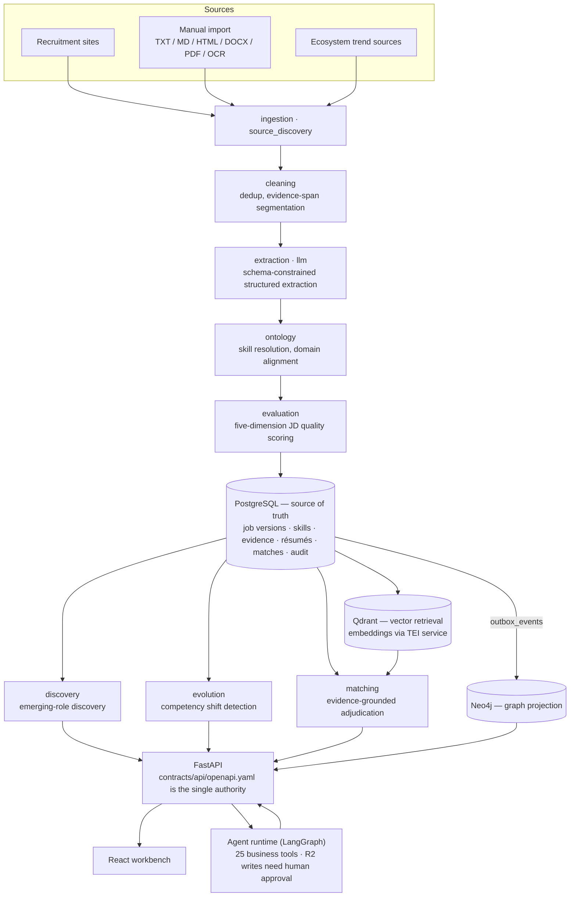
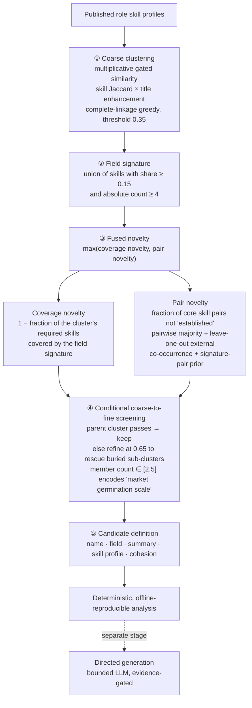
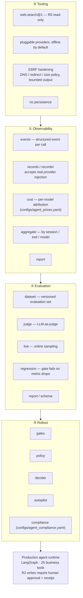

<a href="../README.md">← Portfolio</a> · <a href="zh-CN/01-artifex.md">中文</a>

# 01 · ARTIFEX — Multi-source Data-Driven Job Competency Graph System

| | |
|---|---|
| **Period** | June – September 2026 |
| **Role** | Team Lead & Core Developer (Algorithms & Backend) |
| **Context** | iFLYTEK industry-sponsored competition topic **XH-202621** |
| **Team** | 4 contributors |
| **My contribution** | 48 commits, 391 files, ~60k lines added |
| **Code** | [`asdf243/artifex-job-competency-graph`](https://github.com/asdf243/artifex-job-competency-graph) (private) |

---

## Contents

1. [Summary](#1-summary)
2. [Problem](#2-problem)
3. [System architecture](#3-system-architecture)
4. [My modules](#4-my-modules)
5. [Deep dive: emerging-job discovery](#5-deep-dive-emerging-job-discovery)
6. [Deep dive: LLM-agent platform layer](#6-deep-dive-llm-agent-platform-layer)
7. [Evaluation — what the numbers do and do not mean](#7-evaluation--what-the-numbers-do-and-do-not-mean)
8. [Engineering practices](#8-engineering-practices)
9. [Retrospective](#9-retrospective)

---

## 1. Summary

ARTIFEX ingests job descriptions from recruitment sites and manual imports, cleans and segments them into evidence, extracts structured skill requirements with an LLM, and builds a **job–competency graph at the granularity of individual skill points**. On top of that graph it discovers *emerging* job roles that do not yet exist in the corpus, detects how the competency requirements of *existing* roles shift over time, projects the whole thing into a queryable graph, and matches résumés to roles by adjudicating each requirement against evidence in the candidate's actual experience. Every AI-produced conclusion is bound to a source evidence span; when evidence is insufficient the system **fails closed** rather than guessing.

I was team lead and owned the algorithmic and backend core: the emerging-job discovery algorithm, the reproducible evaluation contract, job-capability evolution detection, the résumé–job matching benchmark, and the LLM-agent platform layer (observability, evaluation, staged rollout).

---

## 2. Problem

The competition topic asks for four capabilities. Stating them precisely matters, because two of them are much harder than they first appear.

| # | Requirement | Why it is hard |
|---|---|---|
| ① | Multi-source collection, cleaning, and **new-role discovery** | "New" has no ground truth. A role is new *relative to what already exists*, so the problem needs a prior — see §5 |
| ② | **Competency updating** for existing roles | Distinguishing a genuine shift in demand from sampling noise is a statistical inference problem, not a counting problem |
| ③ | Panoramic job–competency graph | Keeping a projection consistent with a mutating source of truth |
| ④ | Résumé parsing and job matching | Keyword overlap rewards résumé padding; the system has to adjudicate evidence, not count terms |

---

## 3. System architecture

### Layered view

| Layer | Package | Responsibility | My involvement |
|---|---|---|---|
| **Ingestion** | `ingestion/` | Source discovery workers, batch import, multi-format parsing | Partial |
| **Cleaning** | `cleaning/` | Normalisation, dedup by content hash, evidence-span segmentation | Partial |
| **Extraction** | `extraction/`, `llm/` | Bounded, schema-constrained LLM extraction of structured requirements | Partial |
| **Ontology** | `ontology/` | Skill resolution, domain and level taxonomy alignment | Partial |
| **Discovery** | `discovery/` | **Emerging-role discovery — §5** | **Owned** |
| **Evolution** | `evolution/` | **Competency shift detection — §4.2** | **Owned** |
| **Matching** | `matching/`, `recommendation/` | Evidence-grounded résumé adjudication, gap analysis, learning paths | **Benchmark owned** |
| **Graph** | `graph/`, `storage/neo4j/` | Outbox-driven projection into Neo4j | Partial |
| **Agent** | `agent/` | **Observability, evaluation, rollout — §6** | **Owned** |
| **Evaluation** | `evaluation/`, `tools/` | **Reproducible evaluation contracts — §7** | **Owned** |
| **API** | `api/`, `contracts/` | Contract-first FastAPI; OpenAPI is the single authority | Shared |

**Stack**: Python 3.12 · FastAPI · SQLAlchemy + Alembic · Dishka (DI) · LangGraph · PostgreSQL 17 · Neo4j 5.26 · Qdrant + Text Embeddings Inference (BAAI/bge-m3) · React 19 + TypeScript + Vite + Tailwind · Docker Compose · pytest with a 70% coverage gate

---

## 4. My modules

### 4.1 Emerging-job discovery → [§5](#5-deep-dive-emerging-job-discovery)

### 4.2 Job-capability evolution detection

**The problem.** A skill appearing more often in this quarter's postings than last quarter's may be a real shift in the labour market, or may be sampling noise. With thousands of skills tested simultaneously, some will look "significant" by chance.

```mermaid
flowchart LR
    A["Extraction cohort<br/>approved roles from one cohort"] --> B["Leaf-role aggregation<br/>by normalized_name + field + level"]
    B --> C["Weighting<br/>source · role confidence · skill confidence<br/>time decay · per-company weight cap"]
    C --> D["Multi-window demand rates<br/>30 / 90 / 180 / 365 days"]
    D --> E["Two-proportion z-test"]
    E --> F["Benjamini–Hochberg FDR correction"]
    F --> G["Hysteresis + consecutive windows<br/>entry 2/2/3 windows · exit 3 consecutive"]
    G --> H["Candidate with confidence + provenance"]
    H --> I["Human approval → immutable snapshot"]
```

Design points worth defending:

- **Hysteresis, not a single threshold.** Entry and exit thresholds differ and require consecutive windows, so a skill hovering at the boundary does not flicker in and out of a role's profile.
- **Company weight capping.** One company posting the same role 200 times must not create a "market trend".
- **Generic terms are context-only.** Vague words are recorded as observations but cannot by themselves enter a competency profile.
- **Provenance on every finding.** Each detected shift carries the evidence and confidence that produced it.

Delivered: `analyze` / `latest` / `approve` API contract closure, DB migration `0052`, 20 unit tests.

### 4.3 Résumé–job matching benchmark

A standardised comparison of **12 algorithms** — Jaccard, TF-IDF cosine, BM25, character n-gram TF-IDF, skill-weighted matching, skill coverage, content filtering + collaborative filtering, LSA/SVD, edit distance, supervised classification, synonym/ontology expansion, and a weighted-vote ensemble — over 13 résumés × 10 job descriptions.

What made the benchmark informative was the **adversarial hard-case suite**: deliberately exaggerated résumés (claimed 10× throughput, in-house Kafka replacement, 500% efficiency gains), keyword-stuffed résumés (18 skills claimed, 3 actually used), cross-domain ambiguous profiles, and a negative control with no relevant background. Pure frequency-based methods (TF-IDF, LSA, BM25) scored **0 on the hard cases** — they reward exactly the padding the hard cases contain — while skill-vocabulary and supervised-classification methods held up.

The supervised component: TF-IDF (jieba tokenisation, 1–2 gram, 8,000 dims, sublinear TF) + **LinearSVC** (`class_weight='balanced'`) trained on **16,935 real job postings across 31 categories**. Replacing naive Bayes with a linear SVM raised 5-fold CV accuracy from 0.704 to **0.763**; the reason is diagnosable rather than empirical — naive Bayes assumes conditional independence, and skill terms in real postings are strongly correlated ("backend" ↔ "Java" ↔ "Spring"), which violates the assumption directly.

A four-factor **résumé credibility score** (claim specificity, content depth, keyword coverage, red-flag penalties) detected padding with MAE 0.143 and correlation 0.776 against human ratings.

> ⚠️ **Status**: this benchmark is a **historical offline comparison**. The production matching strategy was later replaced by an evidence-grounded adjudication pipeline (`evidence-grounded/2.x`) that reasons over the candidate's actual project, internship and work experience per requirement. The benchmark numbers describe the benchmark, not the shipped system.

### 4.4 Backend infrastructure

Contract-first jobs API (five endpoints against `openapi.yaml`), import deduplication with database integrity constraints, Qdrant client lifecycle and health checks, graph query and snapshot-export endpoints, request-ID middleware and unified error handling. Thirteen test files still on main.

---

## 5. Deep dive: emerging-job discovery

### 5.1 The symmetry trap

The obvious approach is outlier detection: cluster the postings, flag the clusters that are unlike the others. This fails in a way that is easy to miss:

> Suppose the corpus contains only two kinds of role — *RAG Engineer* and *Java Developer* — and they are dissimilar to each other. Remove either one, and **the remaining one looks isolated and therefore "novel"**. But *Java Developer* is one of the most common roles in existence.

The conclusion: novelty **cannot** be defined by relative position inside the corpus. It needs an external reference frame — a prior for what "already established" looks like.

### 5.2 The prior: field-level majority skill signature

For each published field, take the union of skills whose **frequency share** among that field's roles exceeds a threshold (default 0.15, with an absolute floor of 4 occurrences). That union is the field's *signature* — an empirical description of what a mainstream role in this field requires.

Why this prior:

- **Interpretable** — whether a skill is "common" is a frequency share, not a latent coordinate.
- **Self-sufficient** — needs only published and approved roles, no external industry knowledge base.
- **Reproducible** — frequency counting is deterministic; the same data always yields the same signature.

### 5.3 Pipeline

### 5.4 The conservative principle

**Missing evidence ≠ novel.** When a cluster has no required skills, or its field has no signature prior (cold start, small corpus), novelty is scored **0.0** and the cluster is not reported.

Early versions (≤ 1.2) returned `1.0` here — "when unsure, report it for human review". In practice this was a systematic failure mode: every role without a skill profile and every cluster in a cold-start corpus was flagged, and the review queue drowned in noise. Since candidates defaulted to `needs_review`, over-reporting destroyed the queue's usability entirely. Flipping this single default was one of the largest single improvements in the iteration log.

### 5.5 Iteration log

Eighteen rounds, each one re-running the full evaluation:

| Round | Change | End-to-end F1 |
|---|---|---|
| r1 (baseline) | v1.2 behaviour re-measured | 0.000 (P = 0.08, all false positives) |
| r3 | Single-linkage → complete-linkage greedy clustering | 0.31 |
| r4–r5 | Leave-one-out external co-occurrence + member gating | 0.45 |
| r7 | Linear fusion → max fusion + signature-pair prior | 0.62 |
| r10–r11 | Conditional coarse-to-fine + parameter sweep (0.65 / 0.35 / 0.65) | 0.89 |
| r13 | Injected generic skills (Git/Linux/Docker) into eval data to remove optimism | 0.89 (harder corpus) |
| r15 | Signature share 0.4 → 0.15 + absolute floor of 4 | 0.93 |
| r16–r18 | Freeze defaults + re-verify | **0.964** |

Clustering quality moved in step: over-merge rate 1.0 → 0.51, purity 0.04 → 0.65. The residual 0.51 over-merge is a deliberate trade-off — gradually-evolving roles genuinely are adjacent to mainstream ones, and forcing them apart costs more in false negatives than it gains.

---

## 6. Deep dive: LLM-agent platform layer

Four subsystems that together make an LLM agent *operable* rather than merely functional:

| Subsystem | Why it exists | CLI |
|---|---|---|
| **Observability** | Without per-model cost attribution, "the agent is expensive" is not actionable. The recorder must accept a real provider injection, otherwise cost attribution is measured against a mock and is simply wrong | `tools/agent_observe.py` |
| **Evaluation** | A versioned evaluation set + LLM-as-judge + a regression gate turns "the agent got worse" from a user report into a CI failure | `tools/agent_eval.py` |
| **Rollout** | Gates, policy and a decider so that promoting a new agent version is a decision with recorded criteria, not a judgement call | `tools/agent_rollout.py` |
| **Tooling** | External network access is the highest-risk tool class; this one is read-only, offline by default, SSRF-hardened, bounded in output size, and never persists | `tools/agent_verify.py` |

---

## 7. Evaluation — what the numbers do and do not mean

This section exists because it is the part of the project I would most want a supervisor to examine.

### 7.1 The evaluation contract

Scattered one-off evaluation scripts were consolidated into a **reproducible contract** with CI-gateable thresholds:

| Component | Purpose |
|---|---|
| `EVAL_CONTRACT_VERSION` | The contract itself is versioned |
| `GoldenLabelSet` + `golden_fingerprint` | Order-invariant, version-sensitive fingerprint of the gold set — reordering labels does not change the fingerprint, changing content does |
| `parse_golden` / `read_golden` | Tolerant of both bare booleans and `{"emerging": bool, "reason": ...}`; raises `GoldenFormatError` on anything else |
| `EmergingEvalGate` + `check_gate` | Per-metric PASS/FAIL with the shortfall reported; thresholds set ~20% below the current baseline as *regression* detection, not as a quality claim |
| Fixed seed (7), 30 bootstrap draws | Stability is measured, not assumed |
| `--review-batch` | Periodic human spot-check data sheet |
| `--check` exit code 1 | Any metric below threshold fails the build |

### 7.2 Synthetic versus real

| Setting | Result | What it means |
|---|---|---|
| **Synthetic end-to-end benchmark** (v1.3) | P 0.933 · R 1.000 · **F1 0.964** · FPR 0.019 | The algorithm behaves as designed on data whose ground truth is constructed |
| **81 real job postings, rule-based line** (golden g1) | P **0.158** · R 1.000 · F1 0.273 · bootstrap Jaccard 0.242 | On real market data the rule-based line over-reports heavily. Recall is perfect; precision is not |
| **81 real postings, LLM-assisted line** | F1 ≈ 0.55–0.86 (variance across runs) | Better, but non-deterministic. When the corpus grew from 70 to 81 postings, F1 fell from ≈1.0 to 0.5–0.86 — recorded in the contract with a deliberately loose lower bound of 0.45 |

**I report both.** The 0.964 belongs to the synthetic benchmark and is labelled as such everywhere it appears; it is not a claim about real-world accuracy. Making the gap visible — and building the harness so that such gaps surface automatically as the corpus grows — is the actual contribution of this part of the work.

### 7.3 A bug that changed every reported number

In the résumé-matching benchmark, predicted categories (English `field`) were being compared directly against labels (Chinese `label`), so classification accuracy was **identically zero** — and the comparison it fed had already been reported. After finding it I fixed the comparison, re-ran every experiment, and corrected all published results (v3 of the report). Three further issues were fixed in the same pass: a misdescribed classifier (documented as naive Bayes, actually LinearSVC), hard-coded paths breaking portability, and a `set`-versus-`list` iteration order that made synthetic-résumé language selection non-deterministic and results unstable across runs.

---

## 8. Engineering practices

| Practice | Implementation |
|---|---|
| **Contract-first** | `contracts/api/openapi.yaml` is the single authority for front-end and back-end; schema drift is a build failure, not a meeting topic |
| **Evidence binding** | Every AI conclusion links to the source evidence span; insufficient evidence ⇒ fail closed |
| **Immutable versions** | Role capability updates publish a new immutable `JobVersion` rather than mutating the current one |
| **Outbox pattern** | PostgreSQL remains the source of truth; Neo4j is a projection fed by `outbox_events` |
| **Migrations** | Alembic chain under `database/postgres/migrations/`; schema change and code change ship together |
| **CI gates** | `ruff` lint; pytest with a **70% combined coverage gate**; integration tests for worker coordination and the agent control plane; front-end coverage ≥ 60% on statements, lines, functions and branches |
| **Permission tiers** | Agent tools graded R0–R2; R2 (write) operations require human approval and leave a receipt |
| **Reproducible deployment** | A single `docker compose up` brings up frontend, backend, migration, postgres, neo4j, qdrant and embedding services, with an optional local vLLM LoRA profile |

---

## 9. Retrospective

**What worked**

- **Treating novelty detection as a *prior* problem rather than a *distance* problem.** The symmetry trap is not obvious until stated, and stating it correctly was worth more than any subsequent tuning.
- **Logging F1 every round.** With 18 rounds, the log is what distinguishes "this change helped" from "this change coincided with improvement".
- **Building the evaluation contract *before* the corpus grew.** It is why the 70 → 81 posting regression was caught by the gate instead of by a user.

**What I would do differently**

- **Get real data earlier.** The synthetic benchmark drove 18 rounds of tuning before real postings revealed a precision of 0.158. Much of that tuning optimised for a distribution that was not the target.
- **Separate "analysis" and "product" earlier.** The analysis chain (candidate discovery) and the product chain (directed generation) were entangled for too long; the analysis chain was eventually retired entirely while its algorithmic core was reused by the product chain. Recognising that split sooner would have saved rework.
- **Cheaper LLM evaluation.** The LLM-assisted line's run-to-run variance forced loose regression thresholds; a larger gold set with paired-sample comparison would give tighter bounds at acceptable cost.

---

*Team-level acceptance results for the whole system — JD extraction 94.00% contract-gated semantic accuracy; résumé extraction 0.9624 / 0.9670 over 100 PDFs; résumé–job matching accuracy 0.980 with macro-F1 0.980; agent strict success rate 92.0% over a 200-case set — are the product of the full four-person team and are not individual results.*
