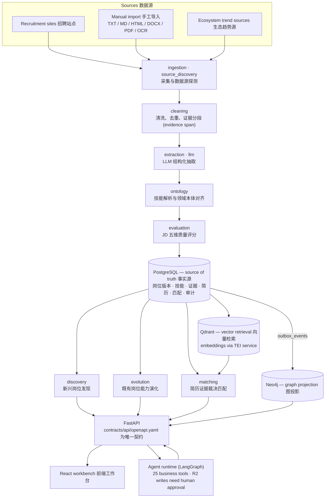
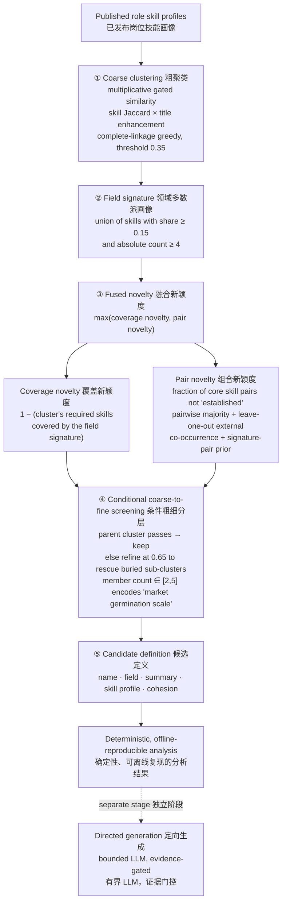
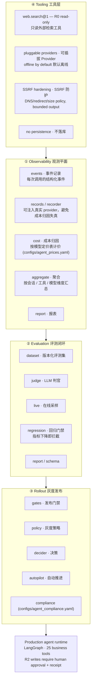

# 01 · ARTIFEX — Multi-source Data-Driven Job Competency Graph System
# 01 · ARTIFEX —— 多源异构数据驱动的岗位与能力图谱构建及动态演化分析系统

> **Period 时间**: June – September 2026 · **Role 角色**: Team Lead & Core Developer (Algorithms & Backend) 队长兼核心开发（算法与后端）
> **Context 背景**: iFLYTEK industry-sponsored competition topic **XH-202621** 科大讯飞企业命题 XH-202621
> **Team 团队**: 4 contributors · **My contribution 个人贡献**: 48 commits, 391 files, ~60k lines added
> **Code 代码**: [`asdf243/artifex-job-competency-graph`](https://github.com/asdf243/artifex-job-competency-graph) (private 私有)

---

## Contents / 目录

1. [Summary / 摘要](#1-summary--摘要)
2. [Problem / 问题定义](#2-problem--问题定义)
3. [System architecture / 系统架构](#3-system-architecture--系统架构)
4. [My modules / 我负责的模块](#4-my-modules--我负责的模块)
5. [Deep dive: emerging-job discovery / 重点：新兴岗位发现算法](#5-deep-dive-emerging-job-discovery--重点新兴岗位发现算法)
6. [Deep dive: LLM-agent platform layer / 重点：LLM Agent 平台层](#6-deep-dive-llm-agent-platform-layer--重点llm-agent-平台层)
7. [Evaluation — what the numbers do and do not mean / 评测与数字的边界](#7-evaluation--what-the-numbers-do-and-do-not-mean--评测与数字的边界)
8. [Engineering practices / 工程实践](#8-engineering-practices--工程实践)
9. [Retrospective / 复盘](#9-retrospective--复盘)

---

## 1. Summary / 摘要

**EN** — ARTIFEX ingests job descriptions from recruitment sites and manual imports, cleans and segments them into evidence, extracts structured skill requirements with an LLM, and builds a **job–competency graph at the granularity of individual skill points**. On top of that graph it (a) discovers *emerging* job roles that do not yet exist in the corpus, (b) detects how the competency requirements of *existing* roles shift over time, (c) projects the whole thing into a queryable graph, and (d) matches résumés to roles by adjudicating each requirement against evidence in the candidate's actual experience. Every AI-produced conclusion is bound to a source evidence span; when evidence is insufficient the system **fails closed** rather than guessing.

I was team lead and owned the algorithmic and backend core: the emerging-job discovery algorithm, the reproducible evaluation contract, job-capability evolution detection, the résumé–job matching benchmark, and the LLM-agent platform layer (observability, evaluation, staged rollout).

**中文** — ARTIFEX 从招聘站点与手工导入的多源 JD 出发，经清洗与证据分段、LLM 结构化抽取，构建**以技能点为粒度的岗位—能力图谱**；在此之上（a）发现语料中尚不存在的**新兴岗位**，（b）检测**既有岗位**能力要求随时间的变化，（c）把事实投影为可查询的图谱，（d）以"逐项要求对照候选人真实经历证据裁决"的方式完成人岗匹配。所有 AI 结论都绑定到来源证据片段，证据不足时系统**fail-closed**（拒绝输出）而非猜测。

我担任队长并负责算法与后端核心：新兴岗位发现算法、可复现评测契约、既有岗位能力演化检测、简历—岗位匹配基准，以及 LLM Agent 平台层（观测、评测、灰度发布）。

---

## 2. Problem / 问题定义

The competition topic asks for four capabilities. Stating them precisely matters, because two of them are much harder than they first appear:
赛题要求四项能力。精确表述很重要，因为其中两项远比表面上困难：

| # | Requirement 赛题条款 | Why it is hard 难点 |
|---|---|---|
| ① | Multi-source collection, cleaning, and **new-role discovery** 多源采集清洗与**新岗位发现** | "New" has no ground truth. A role is new *relative to what already exists*, so the problem needs a prior — see §5. 「新」没有真值。岗位的"新"是相对于既有岗位而言的，因此必须有先验参照系。 |
| ② | **Competency updating** for existing roles 既有岗位**能力更新** | Distinguishing a genuine shift in demand from sampling noise is a statistical inference problem, not a counting problem. 区分真实需求变化与采样噪声是统计推断问题，不是计数问题。 |
| ③ | Panoramic job–competency graph 岗位—能力全景图谱 | Keeping a projection consistent with a mutating source of truth. 保持投影与不断变化的事实源一致。 |
| ④ | Résumé parsing and job matching 简历解析与人岗匹配 | Keyword overlap rewards résumé padding; the system has to adjudicate evidence, not count terms. 关键词重合会奖励简历注水；系统必须裁决证据而非统计词频。 |

---

## 3. System architecture / 系统架构

### Layered view / 层次划分

| Layer 层 | Package 包 | Responsibility 职责 | My involvement 参与度 |
|---|---|---|---|
| **Ingestion 采集** | `ingestion/` | Source discovery workers, batch import, multi-format parsing 数据源探测 Worker、批量导入、多格式解析 | Partial 部分 |
| **Cleaning 清洗** | `cleaning/` | Normalisation, dedup by content hash, evidence-span segmentation 归一化、内容哈希去重、证据分段 | Partial 部分 |
| **Extraction 抽取** | `extraction/`, `llm/` | Bounded, schema-constrained LLM extraction of structured requirements 受 schema 约束的 LLM 抽取 | Partial 部分 |
| **Ontology 本体** | `ontology/` | Skill resolution, domain/level taxonomy alignment 技能解析、领域与层级本体对齐 | Partial 部分 |
| **Discovery 发现** | `discovery/` | **Emerging-role discovery — §5** 新兴岗位发现 | **Owned 主责** |
| **Evolution 演化** | `evolution/` | **Competency shift detection — §4.2** 能力演化检测 | **Owned 主责** |
| **Matching 匹配** | `matching/`, `recommendation/` | Evidence-grounded résumé adjudication, gap analysis, learning paths 证据裁决、差距分析、学习路径 | **Benchmark owned 基准主责** |
| **Graph 图谱** | `graph/`, `storage/neo4j/` | Outbox-driven projection into Neo4j 基于 Outbox 的图投影 | Partial 部分 |
| **Agent 智能体** | `agent/` | **Observability, evaluation, rollout — §6** 观测、评测、灰度 | **Owned 主责** |
| **Evaluation 评测** | `evaluation/`, `tools/` | **Reproducible evaluation contracts — §7** 可复现评测契约 | **Owned 主责** |
| **API 接口** | `api/`, `contracts/` | Contract-first FastAPI; OpenAPI is the single authority 契约优先，OpenAPI 为唯一权威 | Shared 共同 |

**Stack 技术栈**: Python 3.12 · FastAPI · SQLAlchemy + Alembic · Dishka (DI) · LangGraph · PostgreSQL 17 · Neo4j 5.26 · Qdrant + Text Embeddings Inference (BAAI/bge-m3) · React 19 + TypeScript + Vite + Tailwind · Docker Compose · pytest (70% coverage gate)

---

## 4. My modules / 我负责的模块

### 4.1 Emerging-job discovery / 新兴岗位发现 → [§5](#5-deep-dive-emerging-job-discovery--重点新兴岗位发现算法)

### 4.2 Job-capability evolution detection / 既有岗位能力演化检测

**The problem 问题**: a skill appearing more often in this quarter's postings than last quarter's may be a real shift in the labour market, or may be sampling noise. With thousands of skills tested simultaneously, some will look "significant" by chance.
某项技能在本季度 JD 中出现得比上季度多，可能是市场真实变化，也可能是采样噪声；同时检验成千上万个技能时，总有一些会偶然"显著"。

**The approach 方法**:

```mermaid
flowchart LR
    A["Extraction cohort<br/>同一抽取 cohort 的已审核岗位"] --> B["Leaf-role aggregation<br/>按 normalized_name + field + level 聚合<br/>（不把每个 source_posting 当成不同岗位）"]
    B --> C["Weighting 加权<br/>来源 · 岗位置信度 · 技能置信度<br/>时间衰减 · 企业权重上限"]
    C --> D["Multi-window rates 多窗口需求率<br/>30 / 90 / 180 / 365 天"]
    D --> E["Two-proportion z-test<br/>两比例 z 检验"]
    E --> F["BH-FDR correction<br/>Benjamini–Hochberg 多重检验校正"]
    F --> G["Hysteresis + consecutive windows<br/>迟滞 + 连续窗口<br/>进入 2/2/3 窗 · 退出连续 3 窗"]
    G --> H["Candidate with confidence + provenance<br/>带置信度与数据来源的候选"]
    H --> I["Human approval → immutable版本<br/>人工审批 → 发布不可变快照"]
```

Design points worth defending 值得展开的设计点:
- **Hysteresis, not a single threshold** — entry and exit thresholds differ and require consecutive windows, so a skill hovering at the boundary does not flicker in and out of a role's profile. 进入与退出使用不同阈值且要求连续窗口，避免边界附近的技能反复抖动。
- **Company weight capping** — one company posting the same role 200 times must not create a "market trend". 单一企业的大量重复发布不得制造"市场趋势"。
- **Generic terms are context-only** — vague words are recorded as observations but cannot by themselves enter a competency profile. 泛化词只作为 `context_only` 观测，不能单独进入画像。
- **Provenance on every finding** — each detected shift carries the evidence and confidence that produced it. 每条结论都附带产生它的证据与置信度。

**Delivered 交付**: `analyze` / `latest` / `approve` API contract closure, DB migration `0052`, 20 unit tests. 契约闭环、迁移 0052、20 项单测。

### 4.3 Résumé–job matching benchmark / 简历—岗位匹配算法基准

A standardised comparison of **12 algorithms** — Jaccard, TF-IDF cosine, BM25, character n-gram TF-IDF, skill-weighted matching, skill coverage, content-filtering + collaborative filtering, LSA/SVD, edit distance, supervised classification, synonym/ontology expansion, and a weighted-vote ensemble — over 13 résumés × 10 job descriptions.
对 **12 种算法**在 13 份简历 × 10 个 JD 上做标准化对比评测。

What made the benchmark informative was the **adversarial hard-case suite**: deliberately exaggerated résumés (claimed 10× throughput, in-house Kafka replacement, 500% efficiency gains), keyword-stuffed résumés (18 skills claimed, 3 actually used), cross-domain ambiguous profiles, and a negative control with no relevant background. Pure frequency-based methods (TF-IDF, LSA, BM25) scored **0 on the hard cases** — they reward exactly the padding the hard cases contain — while skill-vocabulary and supervised-classification methods held up.
使基准有信息量的是**极限难例集**：刻意夸大的简历、关键词堆砌的简历、跨域模糊的简历、以及完全不相关的负例。纯词频方法（TF-IDF / LSA / BM25）在极限难例上 Top-1 为 **0**——它们恰好奖励难例中的注水行为——而技能词表与监督分类方法则稳定得多。

The supervised component: TF-IDF (jieba tokenisation, 1–2 gram, 8,000 dims, sublinear TF) + **LinearSVC** (`class_weight='balanced'`) trained on **16,935 real job postings across 31 categories**. Replacing naive Bayes with a linear SVM raised 5-fold CV accuracy from 0.704 to **0.763**; the reason is diagnosable rather than empirical — naive Bayes assumes conditional independence, and skill terms in real postings are strongly correlated ("backend" ↔ "Java" ↔ "Spring"), which violates the assumption directly.
监督部分：TF-IDF + **LinearSVC**，在 **16,935 条真实 JD、31 个类别**上训练。把朴素贝叶斯换成线性 SVM 使 5 折交叉验证准确率从 0.704 提升到 **0.763**；原因可诊断而非纯经验——朴素贝叶斯假设特征条件独立，而真实 JD 中的技能词强相关，该假设被直接破坏。

A four-factor **résumé credibility score** (claim specificity, content depth, keyword coverage, red-flag penalties) detected padding with MAE 0.143 and correlation 0.776 against human ratings.
四维**简历信度评分**（声明具体性、内容深度、关键词覆盖率、红牌惩罚）识别注水，MAE 0.143、与人工评分相关系数 0.776。

> ⚠️ **Status 状态**: this benchmark is a **historical offline comparison**. The production matching strategy was later replaced by an evidence-grounded adjudication pipeline (`evidence-grounded/2.x`) that reasons over the candidate's actual project/internship/work experience per requirement. The benchmark numbers describe the benchmark, not the shipped system.
> 该基准是**历史离线对比**。生产匹配策略后来改为按岗位要求逐项裁决候选人真实经历证据的 `evidence-grounded/2.x`。基准数字描述的是基准本身，不是上线系统。

### 4.4 Backend infrastructure / 后端基础设施

Contract-first jobs API (five endpoints against `openapi.yaml`), import deduplication with database integrity constraints, Qdrant client lifecycle and health checks, graph query and snapshot-export endpoints, request-ID middleware and unified error handling. 13 test files still on main.
按 OpenAPI 契约实现岗位 API、导入去重与数据库完整性约束、Qdrant 客户端生命周期与健康检查、图谱查询与快照导出、Request-ID 中间件与统一错误处理；13 个测试文件仍在主干。

---

## 5. Deep dive: emerging-job discovery / 重点：新兴岗位发现算法

### 5.1 The symmetry trap / 对称陷阱

The obvious approach is outlier detection: cluster the postings, flag the clusters that are unlike the others. This fails in a way that is easy to miss:
显而易见的做法是离群检测：把岗位聚类，标记与其他簇不相似的簇。这个做法有一个容易被忽略的失败模式：

> Suppose the corpus contains only two kinds of role — *RAG Engineer* and *Java Developer* — and they are dissimilar to each other. Remove either one, and **the remaining one looks isolated and therefore "novel"**. But *Java Developer* is one of the most common roles in existence.
> 假设语料只含两类岗位——RAG 工程师与 Java 开发工程师，二者互不相似。移除其中任何一个，**剩下的那个都会因"孤立"而被判为新颖**。但 Java 开发是极其常见的岗位。

The conclusion: novelty **cannot** be defined by relative position inside the corpus. It needs an external reference frame — a prior for what "already established" looks like.
结论：新颖性**不能**由语料内部的相对位置定义，必须有一个外部参照系——"什么算已确立"的先验。

### 5.2 The prior: field-level majority skill signature / 先验：领域多数派技能画像

For each published field, take the union of skills whose **frequency share** among that field's roles exceeds a threshold (default 0.15, with an absolute floor of 4 occurrences). That union is the field's *signature* — an empirical description of what a mainstream role in this field requires.
对每个已发布领域，取该领域岗位中**出现频次占比**超过阈值（默认 0.15，并设绝对下限 4 次）的技能并集，作为该领域的**画像（signature）**——即"本领域主流岗位需要什么"的经验描述。

Why this prior 为什么选它:
- **Interpretable 可解释** — whether a skill is "common" is a frequency share, not a latent coordinate. 一个技能是否"常见"由频次占比决定，而非潜空间坐标。
- **Self-sufficient 数据自给** — needs only published/approved roles, no external industry knowledge base. 只依赖已发布/已批准岗位，不需要外部行业知识库。
- **Reproducible 可复现** — frequency counting is deterministic; the same data always yields the same signature. 频次统计确定性，同一份数据总得到同一份画像。

### 5.3 Pipeline / 算法流水线

### 5.4 The conservative principle / 保守原则

**Missing evidence ≠ novel.** When a cluster has no required skills, or its field has no signature prior (cold-start, small corpus), novelty is scored **0.0** and the cluster is not reported.
**缺证据 ≠ 新颖。** 当某主题没有必需技能、或所在领域没有画像先验（冷启动小语料）时，新颖度按 0.0 处理，不报出。

Early versions (≤ 1.2) returned `1.0` here — "when unsure, report it for human review". In practice this was a systematic failure mode: every role without a skill profile and every cluster in a cold-start corpus was flagged, and the review queue drowned in noise. Since candidates defaulted to `needs_review`, over-reporting destroyed the queue's usability entirely. Flipping this single default was one of the largest single improvements in the iteration log.
早期版本（≤1.2）在此返回 `1.0`——"不确定就报出来让人复核"。实践中这是系统性误报：无技能画像的岗位、冷启动语料下的全部主题都会被判新兴，人工复核队列被噪声淹没。由于候选默认状态是 `needs_review`，多报直接让队列失去可用性。翻转这一个默认值是迭代日志中收益最大的单项改动之一。

### 5.5 Iteration log / 迭代记录

18 rounds, each one re-running the full evaluation:
18 轮迭代，每轮重跑完整评测：

| Round 轮次 | Change 关键改动 | End-to-end F1 |
|---|---|---|
| r1 (baseline) | v1.2 behaviour re-measured 复测 1.2 版行为 | 0.000 (P = 0.08, all false positives 全误报) |
| r3 | Single-linkage → complete-linkage greedy clustering 单连接 → 完全连接贪心聚类 | 0.31 |
| r4–r5 | Leave-one-out external co-occurrence + member gating LOO 外部共现 + 成员门控 | 0.45 |
| r7 | Linear fusion → max fusion + signature-pair prior 线性融合 → max 融合 + 画像对先验 | 0.62 |
| r10–r11 | Conditional coarse-to-fine + parameter sweep (0.65 / 0.35 / 0.65) 条件粗细分层 + 参数扫描定门槛 | 0.89 |
| r13 | Injected generic skills (Git/Linux/Docker) into eval data to remove optimism 评测数据注入通用技能，消除过乐观 | 0.89 (harder corpus 更难语料) |
| r15 | Signature share 0.4 → 0.15 + absolute floor 4 画像占比下调 + 绝对下限 | 0.93 |
| r16–r18 | Freeze defaults + re-verify 默认参数冻结 + 复验 | **0.964** |

Clustering quality moved in step: over-merge rate 1.0 → 0.51, purity 0.04 → 0.65. The residual 0.51 over-merge is a deliberate trade-off — gradually-evolving roles genuinely are adjacent to mainstream ones, and forcing them apart costs more in false negatives than it gains.
聚类质量同步改善：过度合并率 1.0 → 0.51，纯度 0.04 → 0.65。剩余 0.51 是有意的权衡——渐进演化的主题与常规主题天然相邻，强行分开带来的漏报代价高于收益。

---

## 6. Deep dive: LLM-agent platform layer / 重点：LLM Agent 平台层

Four subsystems that together make an LLM agent operable rather than merely functional:
四个子系统，共同让一个 LLM Agent 变得**可运维**而不只是**能运行**：

| Subsystem 子系统 | Why it exists 存在理由 | CLI |
|---|---|---|
| **Observability 观测** | Without per-model cost attribution, "the agent is expensive" is not actionable. The recorder must accept a real provider injection, otherwise cost attribution is measured against a mock and is wrong. 没有按模型的成本归因，"Agent 很贵"无法转化为行动；recorder 必须支持注入真实 provider，否则成本归因是对着 mock 测的。 | `tools/agent_observe.py` |
| **Evaluation 评测** | A versioned evaluation set + LLM-as-judge + a regression gate turns "the agent got worse" from a user report into a CI failure. 版本化评测集 + LLM 判官 + 回归门禁，把"Agent 变差了"从用户反馈变成 CI 失败。 | `tools/agent_eval.py` |
| **Rollout 灰度** | Gates, policy and a decider so that promoting a new agent version is a decision with recorded criteria, not a judgement call. 门禁、策略与决策器，让"升级 Agent 版本"成为有记录标准的决策而非拍脑袋。 | `tools/agent_rollout.py` |
| **Tooling 工具** | External network access is the highest-risk tool class; this one is read-only, offline by default, SSRF-hardened, bounded in output size, and never persists. 外部网络访问是风险最高的工具类别；该工具只读、默认离线、SSRF 加固、输出有界、不落库。 | `tools/agent_verify.py` |

---

## 7. Evaluation — what the numbers do and do not mean / 评测与数字的边界

This section exists because it is the part of the project I would most want a supervisor to examine.
本节存在的理由是：这是我最希望导师审视的部分。

### 7.1 The evaluation contract / 评测契约

Scattered one-off evaluation scripts were consolidated into a **reproducible contract** with CI-gateable thresholds:
把散落的一次性评测脚本收敛为**可复现契约**，并可接入 CI 门禁：

| Component 组件 | Purpose 作用 |
|---|---|
| `EVAL_CONTRACT_VERSION` | The contract itself is versioned 契约自身版本化 |
| `GoldenLabelSet` + `golden_fingerprint` | Order-invariant, version-sensitive fingerprint of the gold set — reordering labels does not change the fingerprint, changing content does 顺序无关、版本敏感的金标指纹 |
| `parse_golden` / `read_golden` | Tolerant of both bare booleans and `{"emerging": bool, "reason": ...}`; raises `GoldenFormatError` on anything else 兼容两种标注格式，非法输入直接抛错 |
| `EmergingEvalGate` + `check_gate` | Per-metric PASS/FAIL with the shortfall reported; thresholds set ~20% below the current baseline as *regression* detection, not as a quality claim 逐项 PASS/FAIL 并报告缺口；门限设在当前基线下方约 20%，语义是"回归检测"而非"质量声明" |
| Fixed seed (7), 30 bootstrap draws | Stability is measured, not assumed 稳定性是测出来的，不是假设的 |
| `--review-batch` | Periodic human spot-check data sheet 周期性人工抽检数据单 |
| `--check` exit code 1 | Any metric below threshold fails the build 任一指标低于门限即以退出码 1 拦截 |

### 7.2 Synthetic vs. real / 合成数据与真实数据

| Setting 设定 | Result 结果 | What it means 含义 |
|---|---|---|
| **Synthetic end-to-end benchmark 合成端到端评测** (v1.3) | P 0.933 · R 1.000 · **F1 0.964** · FPR 0.019 | The algorithm behaves as designed on data whose ground truth is constructed. 在人工构造真值的数据上，算法按设计工作。 |
| **81 real job postings, rule-based line 81 条真实 JD，规则线** (golden g1) | P **0.158** · R 1.000 · F1 0.273 · bootstrap Jaccard 0.242 | On real market data the rule-based line over-reports heavily. Recall is perfect; precision is not. 真实市场数据上规则线严重多报：召回完美，精确率不行。 |
| **81 real postings, LLM-assisted line 81 条真实 JD，LLM 线** | F1 ≈ 0.55–0.86 (variance across runs 跑次间方差) | Better, but non-deterministic. When the corpus grew 70 → 81 postings, F1 fell from ≈1.0 to 0.5–0.86 — recorded in the contract with a deliberately loose lower bound (0.45). 更好，但不确定；语料从 70 增至 81 条时 F1 从约 1.0 回落，契约如实记录该方差并以宽松下限拦截回归。 |

**I report both.** The 0.964 belongs to the synthetic benchmark and is labelled as such everywhere it appears; it is not a claim about real-world accuracy. Making the gap visible — and building the harness so that such gaps surface automatically as the corpus grows — is the actual contribution of this part of the work.
**两者都报告。** 0.964 属于合成基准，在所有出现的地方都如此标注，它不是对真实世界准确率的声明。把差距暴露出来、并让评测体系在语料增长时自动暴露这种差距，才是这部分工作的真正贡献。

### 7.3 A bug that changed every reported number / 一个改变了全部结果的 bug

In the résumé-matching benchmark, predicted categories (English `field`) were being compared directly against labels (Chinese `label`), so classification accuracy was **identically zero** — and the comparison it fed had been reported. After finding it I fixed the comparison, re-ran every experiment, and corrected all published results (v3 of the report). Three further issues were fixed in the same pass: a misdescribed classifier (documented as naive Bayes, actually LinearSVC), hard-coded paths breaking portability, and a `set`-vs-`list` iteration order that made synthetic-résumé language selection non-deterministic and results unstable across runs.
在简历匹配基准中，类别预测（英文 `field`）被直接与标签（中文 `label`）比较，导致分类准确率**恒为 0**，而基于它的对比结果已经写进报告。发现后我修复比较逻辑、重跑全部实验、订正所有已发布结果（报告 v3）。同一轮还修复了三处：分类器描述错误（文档写朴素贝叶斯，实际是 LinearSVC）、硬编码路径影响可移植性、`set` 与 `list` 的迭代顺序差异导致合成简历语言选择不确定、结果跑次间不稳定。

---

## 8. Engineering practices / 工程实践

| Practice 实践 | Implementation 落实 |
|---|---|
| **Contract-first 契约优先** | `contracts/api/openapi.yaml` is the single authority for front-end and back-end; schema drift is a build failure, not a meeting topic. OpenAPI 契约是前后端唯一权威，契约漂移是构建失败而非会议议题。 |
| **Evidence binding 证据绑定** | Every AI conclusion links to the source evidence span; insufficient evidence ⇒ fail closed. 每条 AI 结论绑定来源证据片段；证据不足即 fail-closed。 |
| **Immutable versions 不可变版本** | Role capability updates publish a new immutable `JobVersion` rather than mutating the current one. 能力更新发布新的不可变岗位版本，而非就地修改。 |
| **Outbox pattern** | PostgreSQL remains the source of truth; Neo4j is a projection fed by `outbox_events`. PostgreSQL 为事实源，Neo4j 由 outbox 事件驱动的投影。 |
| **Migrations 迁移** | Alembic chain under `database/postgres/migrations/`; schema change and code change ship together. 数据库变更与代码变更同步交付。 |
| **CI gates 门禁** | `ruff` lint; pytest with a **70% combined coverage gate**; integration tests for worker coordination and the agent control plane; front-end coverage ≥ 60% on statements/lines/functions/branches. |
| **Permission tiers 权限分级** | Agent tools graded R0–R2; R2 (write) operations require human approval and leave a receipt. Agent 工具按 R0–R2 分级，R2 写操作需人工批准并留回执。 |
| **Reproducible deployment 可复现部署** | Single `docker compose up` brings up frontend / backend / migration / postgres / neo4j / qdrant / embedding, with an optional local vLLM LoRA profile. |

---

## 9. Retrospective / 复盘

**What worked 有效的做法**
- Treating novelty detection as a *prior* problem rather than a *distance* problem. The symmetry trap is not obvious until stated, and stating it correctly was worth more than any subsequent tuning. 把新颖性检测当作"先验"问题而非"距离"问题。对称陷阱在被表述出来之前并不显然，而正确表述它的价值超过之后任何调参。
- Logging F1 every round. With 18 rounds, the log is what distinguishes "this change helped" from "this change coincided with improvement". 每轮记录 F1。18 轮之后，这份日志是区分"这个改动有效"与"这个改动恰好赶上了改善"的唯一依据。
- Building the evaluation contract *before* the corpus grew. It is why the 70 → 81 posting regression was caught by the gate instead of by a user. 在语料扩张前先建好评测契约——这是 70→81 条时的回归被门禁而非用户发现的原因。

**What I would do differently 会改进的地方**
- **Get real data earlier.** The synthetic benchmark drove 18 rounds of tuning before real postings revealed a precision of 0.158. Much of that tuning optimised for a distribution that was not the target. 更早引入真实数据。合成基准驱动了 18 轮调优，之后真实 JD 才暴露出 0.158 的精确率——其中相当一部分调优是在为非目标分布优化。
- **Separate "analysis" and "product" earlier.** The analysis chain (candidate discovery) and the product chain (directed generation) were entangled for too long; the analysis chain was eventually retired entirely while its algorithmic core was reused by the product chain. Recognising that split sooner would have saved rework. 更早区分"分析链"与"产品链"。两者纠缠过久，分析链最终整体下线而其算法内核被产品链复用；更早识别这一分野可以减少返工。
- **Cheaper LLM evaluation.** The LLM-assisted line's run-to-run variance forced loose regression thresholds; a larger gold set with paired-sample comparison would give tighter bounds at acceptable cost. 更廉价的 LLM 评测。LLM 线的跑次间方差迫使回归门限设得很宽松；用更大的金标集配合配对样本比较，可以在可接受成本下收紧上下界。

---

*Team-level acceptance results for the whole system (JD extraction 94.00% contract-gated semantic accuracy; résumé extraction 0.9624/0.9670 over 100 PDFs; résumé–job matching accuracy 0.980, macro-F1 0.980; agent strict success rate 92.0% over a 200-case set) are the product of the full four-person team and are not individual results.*
*系统整体的团队验收结果（JD 解析契约门控语义正确率 94.00%；简历解析两次全量 0.9624/0.9670；人岗匹配准确率 0.980、macro-F1 0.980；Agent 200 条测试集严格成功率 92.0%）属于四人团队的共同成果，非个人成果。*
