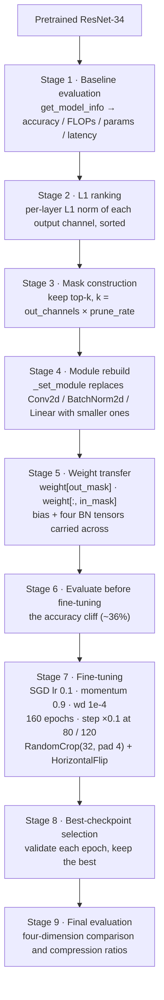
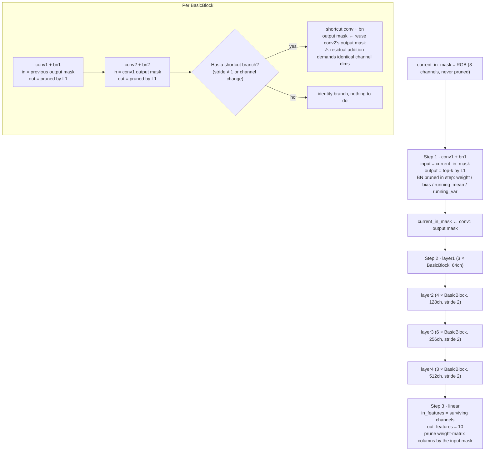

<a href="../README.md">← Portfolio</a> · <a href="zh-CN/02-dnn-inference-optimization.md">中文</a>

# 02 · DNN Inference Optimization for Resource-Constrained Devices

| | |
|---|---|
| **Period** | April – July 2026 |
| **Role** | Independent research project |
| **Programme** | Open Innovation Experiment Program, Center for Edge Intelligence, Jilin University |
| **Grade** | A+ |
| **Code** | [`asdf243/dnn-inference-optimization`](https://github.com/asdf243/dnn-inference-optimization) (private) |

---

## Contents

1. [Summary](#1-summary)
2. [Why structured pruning](#2-why-structured-pruning)
3. [Technical path](#3-technical-path)
4. [Layered view](#4-layered-view)
5. [The three structural constraints](#5-the-three-structural-constraints)
6. [Results](#6-results)
7. [Measurement discipline](#7-measurement-discipline)
8. [Limitations and next steps](#8-limitations-and-next-steps)

---

## 1. Summary

An end-to-end structured model-compression pipeline built in PyTorch: rank every convolution filter of a trained ResNet-34 by L1 norm, physically remove half the channels, rebuild a genuinely smaller network with correct weight transfer, and fine-tune it back to competitive accuracy. At 50% channel retention on CIFAR-10 the model drops from 21.28 M to 5.33 M parameters and from 1.16 G to 0.29 G FLOPs (both −75%), with top-1 accuracy falling from 95.70% to 91.84%.

---

## 2. Why structured pruning

The choice between unstructured and structured pruning is the first real decision in the project, and it is determined by the deployment target rather than by accuracy.

| | Unstructured (weight-level) | Structured (channel-level) |
|---|---|---|
| What is removed | Individual weights | Whole filters / channels |
| Resulting tensor shape | Unchanged (zeros scattered) | Genuinely smaller |
| Speedup requires | Sparse kernels + specialist runtime | **Nothing — any standard runtime** |
| Accuracy at equal compression | Usually higher | Usually lower |
| Suitable for edge | Only with dedicated hardware support | **Yes** |

Since the project's premise is *resource-constrained devices*, structured pruning is the only option that delivers on a device without a sparse-tensor stack. Accepting a somewhat larger accuracy drop in exchange for unconditional deployability is the trade-off the project is built around.

### The importance criterion

For output channel *i*: `L1_norm[i] = Σ |weight[i, :, :, :]|`. A filter whose weights are collectively near zero contributes little to the layer output and can be removed with limited damage.

L1 is the cheapest defensible criterion — no gradients, no forward pass over data, fully deterministic — which makes it the correct **baseline** before attempting anything more expensive (Taylor expansion, gradient-based saliency, learned gates). Establishing the cheap baseline first is a deliberate methodological choice, not a limitation.

---

## 3. Technical path

### The pruning pass in detail

---

## 4. Layered view

| Layer | Module | Responsibility |
|---|---|---|
| **Model definition** | `resnet.py` | CIFAR-adapted ResNet: `BasicBlock` (expansion 1), `Bottleneck` (expansion 4), `ResNet`, and `resnet18/34/50/101/152` constructors. Differs from the ImageNet variant in conv1 (3×3, stride 1, no max-pool) to suit 32×32 inputs |
| **Data & metrics** | `utils.py` | `get_dataset` — CIFAR-10/100 with per-dataset normalisation constants, train-time RandomCrop(32, pad 4) + HorizontalFlip, eval-time normalise only. `get_model_accuarcy` — top-1 on the validation loader |
| **Pruning algorithm** | `main.py :: l1_structured_prune` | L1 ranking, mask construction, `_set_module` replacement, weight transfer, and enforcement of the three structural constraints (§5) |
| **Measurement** | `main.py :: get_model_info` | Unified harness: accuracy, FLOPs and parameters via `thop.profile`, plus inference latency — every variant measured the same way (§7) |
| **Experiment driver** | `main.py :: __main__` | The nine stages above, printing a four-dimension comparison and compression ratios |
| **Interactive replication** | `pruning_pytorch_tools.ipynb` | Same pipeline, stepwise, with retained run outputs |

---

## 5. The three structural constraints

Filter pruning on a plain stack of convolutions is bookkeeping. On a **residual** network it is not, because three invariants must hold simultaneously or the network silently produces wrong output.

### 5.1 Mask propagation

A layer's **input** mask must equal the previous layer's **output** mask. A single `current_in_mask` variable threads forward through the entire network so adjacent layers always agree on channel dimensions. Get this wrong and the shape mismatch raises immediately — this is the *friendly* failure mode.

### 5.2 Residual alignment

In a downsampling block, the shortcut branch's output channels must match the main path's `conv2` output, or the residual addition fails. The shortcut therefore **reuses `conv2`'s output mask** instead of computing its own L1 ranking — it is not free to choose its own "most important" channels, because its job is to be addable to the main path.

### 5.3 BatchNorm statistics travel with their convolution

Each `BatchNorm2d` carries four per-channel tensors: `weight`, `bias`, `running_mean`, `running_var`. Pruning a convolution's output channels without pruning the corresponding BN entries produces a network that **runs without error and outputs nonsense** — the dangerous failure mode, because nothing raises. Every BN is rebuilt alongside its convolution, with `momentum` preserved.

---

## 6. Results

| Metric | Baseline | Pruned, before fine-tuning | Pruned + fine-tuned | Change |
|---|---|---|---|---|
| Top-1 accuracy | **95.70%** | ~35.9% | **91.84%** | −3.86 pt |
| Parameters | 21.28 M | 5.33 M | 5.33 M | **−74.9%** |
| FLOPs | 1.16 G | 0.29 G | 0.29 G | **−74.9%** |
| Channel retention | 100% | 50% | 50% | — |

### Fine-tuning trajectory

| Epoch | Top-1 | Note |
|---|---|---|
| 1 | 35.89% | Post-pruning cliff |
| 2–10 | 43.55% → 77.76% | Rapid early recovery |
| 11 | 79.30% | — |
| ~80 | **> 90%** | **First LR decay (×0.1)** |
| ~120 | — | Second LR decay |
| 160 | **91.84%** | Converged (best 91.89%) |

### The two instructive observations

1. **The cliff.** Removing half the channels drops accuracy from 95.70% to ~36% — pruning destroys the learned balance between features even when each removed filter was individually "unimportant". Importance is not additive.
2. **The jump.** Accuracy crosses 90% immediately after the first learning-rate decay, not gradually before it. The surviving filters retain enough structure that what fine-tuning mainly needs is a smaller step size to settle into, rather than extensive re-learning.

---

## 7. Measurement discipline

All four numbers for every variant come from one harness, `get_model_info`, so that no comparison mixes measurement methods.

| Dimension | How measured | Caveat |
|---|---|---|
| Top-1 accuracy | Full CIFAR-10 validation set (10,000 images) | Deterministic |
| FLOPs | `thop.profile` on a single 1×3×32×32 input | A proxy for cost, not a latency prediction |
| Parameters | `thop.profile` | Directly determines model file size |
| Inference latency | Wall-clock on the evaluation device | Device- and batch-dependent; useful for relative comparison only |

**Baseline numbers were re-derived rather than copied.** The original experiment notes recorded only the pruned model's metrics; the baseline ResNet-34 figures quoted here (95.70% / 21.28 M / 1.16 G) were obtained by re-running the checkpoint through the same harness, which is also what makes the −75% / −3.86 pt comparisons legitimate.

---

## 8. Limitations and next steps

### Known limitations

| Limitation | Why it matters |
|---|---|
| **Uniform 50% rate across all layers** | Certainly suboptimal. Early layers extract low-level features shared by everything downstream and are typically far more sensitive than late layers; a uniform rate over-prunes the former and under-prunes the latter |
| **FLOPs as the efficiency proxy** | On real edge hardware, memory bandwidth and kernel-launch overhead often dominate; a −75% FLOPs reduction does not guarantee a 4× speedup |
| **Single compression axis** | Pruning alone; quantisation and distillation were surveyed but not run |
| **Single dataset and architecture** | CIFAR-10 + ResNet-34 only; generalisation to other tasks and topologies is untested |

### Next steps

The natural continuation of this project and the direction of my planned independent study on edge intelligence:

1. **INT8 post-training quantisation** — composes multiplicatively with pruning (≈4× from precision on top of ≈4× from structure) and is what integer-only edge accelerators actually require.
2. **Knowledge distillation** — use the unpruned ResNet-34 as teacher to recover more of the 3.86-point gap than plain fine-tuning achieves.
3. **Sensitivity-aware per-layer rates** — measure each layer's accuracy sensitivity, then allocate the pruning budget accordingly instead of uniformly.
4. **On-device latency measurement** — validate that FLOPs reduction translates into wall-clock speedup on actual constrained hardware.
