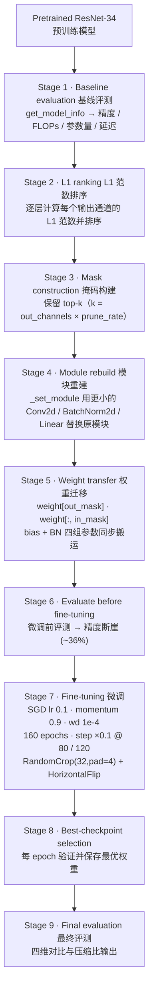
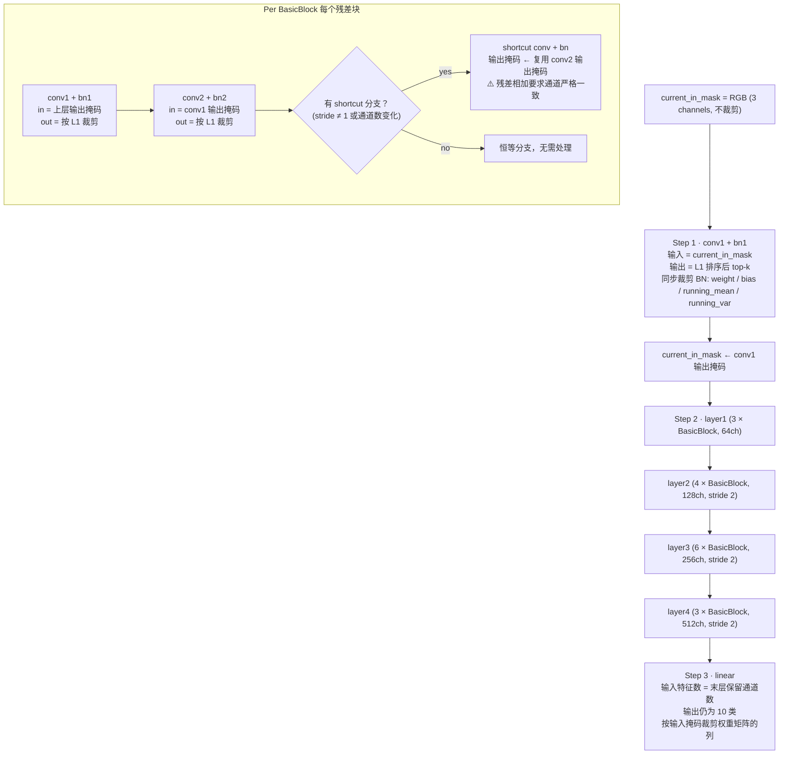

# 02 · DNN Inference Optimization for Resource-Constrained Devices
# 02 · 资源受限设备上的深度神经网络推理优化设计与实现

> **Period 时间**: April – July 2026 · **Role 角色**: Independent research project 独立完成 · **Grade 成绩**: A+
> **Programme 项目**: Open Innovation Experiment Program, Center for Edge Intelligence, Jilin University 吉林大学边缘智能中心开放性创新实验
> **Code 代码**: [`asdf243/dnn-inference-optimization`](https://github.com/asdf243/dnn-inference-optimization) (private 私有)

---

## Contents / 目录

1. [Summary / 摘要](#1-summary--摘要)
2. [Why structured pruning / 为什么选结构化剪枝](#2-why-structured-pruning--为什么选结构化剪枝)
3. [Technical path / 技术路径](#3-technical-path--技术路径)
4. [Layered view / 层次划分](#4-layered-view--层次划分)
5. [The three structural constraints / 三个结构约束](#5-the-three-structural-constraints--三个结构约束)
6. [Results / 实验结果](#6-results--实验结果)
7. [Measurement discipline / 测量方法](#7-measurement-discipline--测量方法)
8. [Limitations and next steps / 局限与后续](#8-limitations-and-next-steps--局限与后续)

---

## 1. Summary / 摘要

**EN** — An end-to-end structured model-compression pipeline built in PyTorch: rank every convolution filter of a trained ResNet-34 by L1 norm, physically remove half the channels, rebuild a genuinely smaller network with correct weight transfer, and fine-tune it back to competitive accuracy. At 50% channel retention on CIFAR-10 the model drops from 21.28 M to 5.33 M parameters and from 1.16 G to 0.29 G FLOPs (both −75%), with top-1 accuracy falling from 95.70% to 91.84%.

**中文** — 用 PyTorch 实现的端到端结构化模型压缩流水线：按 L1 范数对训练好的 ResNet-34 的每个卷积核排序，物理删除一半通道，以正确的权重迁移重建更小的网络，再微调恢复精度。CIFAR-10 上 50% 通道保留率下，参数量 21.28M → 5.33M、计算量 1.16G → 0.29G（均 −75%），top-1 精度 95.70% → 91.84%。

---

## 2. Why structured pruning / 为什么选结构化剪枝

The choice between unstructured and structured pruning is the first real decision in the project, and it is determined by the deployment target rather than by accuracy:
非结构化与结构化剪枝之间的选择是本项目第一个真正的决策，而决定它的是部署目标而非精度：

| | Unstructured 非结构化（权重级） | Structured 结构化（通道级） |
|---|---|---|
| What is removed 删除对象 | Individual weights 单个权重 | Whole filters / channels 整个卷积核/通道 |
| Resulting tensor shape 张量形状 | Unchanged (zeros scattered) 不变，零散分布零值 | Genuinely smaller 真正变小 |
| Speedup requires 加速前提 | Sparse kernels + specialist runtime 稀疏算子 + 专用运行时 | **Nothing — any standard runtime 无需任何前提** |
| Accuracy at equal compression 同压缩率精度 | Usually higher 通常更高 | Usually lower 通常略低 |
| Suitable for edge 适合边缘部署 | Only with dedicated hardware support 需专用硬件支持 | **Yes** |

Since the project's premise is *resource-constrained devices*, structured pruning is the only option that delivers on a device without a sparse-tensor stack. Accepting a somewhat larger accuracy drop in exchange for unconditional deployability is the trade-off the project is built around.
既然项目前提是"资源受限设备"，结构化剪枝是唯一能在没有稀疏张量栈的设备上真正兑现加速的方案。以略大的精度损失换取无条件可部署性，是本项目的核心权衡。

### The importance criterion / 重要性判据

For output channel *i*: `L1_norm[i] = Σ |weight[i, :, :, :]|`. A filter whose weights are collectively near zero contributes little to the layer output and can be removed with limited damage.
对输出通道 *i* 计算卷积核权重绝对值之和。权重整体接近零的卷积核对该层输出贡献小，可较安全地删除。

L1 is the cheapest defensible criterion — no gradients, no forward pass over data, fully deterministic — which makes it the correct **baseline** before attempting anything more expensive (Taylor expansion, gradient-based saliency, learned gates). Establishing the cheap baseline first is a deliberate methodological choice, not a limitation.
L1 是最廉价且站得住脚的判据——不需要梯度、不需要前向数据、完全确定性——因此适合作为尝试更昂贵方法（泰勒展开、基于梯度的显著性、可学习门控）之前的**基线**。先立廉价基线是有意的方法论选择，而非能力局限。

---

## 3. Technical path / 技术路径

### The pruning pass in detail / 剪枝主过程细节

---

## 4. Layered view / 层次划分

| Layer 层 | Module 模块 | Responsibility 职责 |
|---|---|---|
| **Model definition 模型定义** | `resnet.py` | CIFAR-adapted ResNet: `BasicBlock` (expansion 1), `Bottleneck` (expansion 4), `ResNet`, and `resnet18/34/50/101/152` constructors. Differs from the ImageNet variant in conv1 (3×3, stride 1, no max-pool) to suit 32×32 inputs. |
| **Data & metrics 数据与指标** | `utils.py` | `get_dataset` — CIFAR-10/100 with per-dataset normalisation constants, train-time RandomCrop(32, pad 4) + HorizontalFlip, eval-time normalise only. `get_model_accuarcy` — top-1 on the validation loader. |
| **Pruning algorithm 剪枝算法** | `main.py :: l1_structured_prune` | L1 ranking, mask construction, `_set_module` replacement, weight transfer, and enforcement of the three structural constraints (§5). |
| **Measurement 测量** | `main.py :: get_model_info` | Unified harness: accuracy, FLOPs and parameters via `thop.profile`, plus inference latency — every variant measured the same way (§7). |
| **Experiment driver 实验驱动** | `main.py :: __main__` | The nine stages above, printing a four-dimension comparison and compression ratios at the end. |
| **Interactive replication 交互式复现** | `pruning_pytorch_tools.ipynb` | Same pipeline, stepwise, with retained run outputs for inspection. |

---

## 5. The three structural constraints / 三个结构约束

Filter pruning on a plain stack of convolutions is bookkeeping. On a **residual** network it is not, because three invariants must hold simultaneously or the network silently produces wrong output:
在普通卷积堆叠上做通道剪枝只是记账；在**残差**网络上不是，因为三个不变式必须同时成立，否则网络会在不报错的情况下输出错误结果：

### 5.1 Mask propagation / 掩码传递

A layer's **input** mask must equal the previous layer's **output** mask. A single `current_in_mask` variable threads forward through the entire network so adjacent layers always agree on channel dimensions. Get this wrong and the shape mismatch raises immediately — this is the *friendly* failure mode.
某层的**输入**掩码必须等于上一层的**输出**掩码。一个 `current_in_mask` 变量贯穿全网前向传递，保证相邻层通道维度始终一致。这一条做错会立刻抛形状错误——属于"友好"的失败模式。

### 5.2 Residual alignment / 残差对齐

In a downsampling block, the shortcut branch's output channels must match the main path's `conv2` output, or the residual addition fails. The shortcut therefore **reuses `conv2`'s output mask** instead of computing its own L1 ranking — it is not free to choose its own "most important" channels, because its job is to be addable to the main path.
在下采样残差块中，shortcut 分支的输出通道必须与主路径 `conv2` 的输出一致，否则残差相加失败。因此 shortcut **直接复用 `conv2` 的输出掩码**，而不独立计算 L1 排序——它没有自由选择"最重要通道"的权利，因为它的职责是"能与主路径相加"。

### 5.3 BatchNorm statistics travel with their convolution / BN 统计量随卷积一起搬运

Each `BatchNorm2d` carries four per-channel tensors: `weight`, `bias`, `running_mean`, `running_var`. Pruning a convolution's output channels without pruning the corresponding BN entries produces a network that **runs without error and outputs nonsense** — the dangerous failure mode, because nothing raises. Every BN is rebuilt alongside its convolution, with `momentum` preserved.
每个 BN 携带四组逐通道张量。裁剪卷积输出通道而不同步裁剪 BN 对应项，会得到一个**能正常运行但输出错误**的网络——这是危险的失败模式，因为不会抛异常。实现中每个 BN 都与其卷积一同重建，并保留 `momentum`。

---

## 6. Results / 实验结果

| Metric 指标 | Baseline 原模型 | Pruned, before fine-tuning 剪枝后未微调 | Pruned + fine-tuned 微调后 | Change 变化 |
|---|---|---|---|---|
| Top-1 accuracy 精度 | **95.70%** | ~35.9% | **91.84%** | −3.86 pt |
| Parameters 参数量 | 21.28 M | 5.33 M | 5.33 M | **−74.9%** |
| FLOPs 计算量 | 1.16 G | 0.29 G | 0.29 G | **−74.9%** |
| Channel retention 通道保留率 | 100% | 50% | 50% | — |

### Fine-tuning trajectory / 微调轨迹

| Epoch | Top-1 | Note 说明 |
|---|---|---|
| 1 | 35.89% | Post-pruning cliff 剪枝后断崖 |
| 2–10 | 43.55% → 77.76% | Rapid early recovery 快速恢复期 |
| 11 | 79.30% | — |
| ~80 | **> 90%** | **First LR decay (×0.1) 首次学习率衰减** |
| ~120 | — | Second LR decay 第二次衰减 |
| 160 | **91.84%** | Converged 收敛（最优 91.89%） |

### The two instructive observations / 两个有价值的观察

1. **The cliff 断崖** — removing half the channels drops accuracy from 95.70% to ~36%, i.e. pruning destroys the learned balance between features even when each removed filter was individually "unimportant". Importance is not additive. 删掉一半通道使精度从 95.70% 跌至约 36%：即使每个被删的卷积核单独看都"不重要"，剪枝仍破坏了特征之间的配比关系——重要性不可加。
2. **The jump 陡升** — accuracy crosses 90% immediately after the first learning-rate decay, not gradually before it. The surviving filters retain enough structure that what fine-tuning mainly needs is a smaller step size to settle into, rather than extensive re-learning. 精度在首次学习率衰减后立刻越过 90%，而非在此之前逐步爬升：存活卷积核保留了足够结构，微调主要需要的是更小的步长去收敛，而不是大量重新学习。

---

## 7. Measurement discipline / 测量方法

All four numbers for every variant come from one harness, `get_model_info`, so that no comparison mixes measurement methods:
每个变体的四项指标都由同一个工具 `get_model_info` 产出，确保任何对比都不会混用测量方法：

| Dimension 维度 | How measured 测量方式 | Caveat 注意 |
|---|---|---|
| Top-1 accuracy 精度 | Full CIFAR-10 validation set (10,000 images) 完整验证集 | Deterministic 确定性 |
| FLOPs 计算量 | `thop.profile` on a single 1×3×32×32 input | A proxy for cost, not a latency prediction 是成本代理，不等于延迟 |
| Parameters 参数量 | `thop.profile` | Directly determines model file size 直接决定模型文件大小 |
| Inference latency 推理延迟 | Wall-clock on the evaluation device 评测设备上的墙钟时间 | Device- and batch-dependent; useful for relative comparison only 依赖设备与 batch，仅用于相对比较 |

**Baseline numbers were re-derived rather than copied.** The original experiment notes recorded only the pruned model's metrics; the baseline ResNet-34 figures quoted here (95.70% / 21.28 M / 1.16 G) were obtained by re-running the checkpoint through the same harness, which is also what makes the −75% / −3.86 pt comparisons legitimate.
**基线数字是重新测得的，不是抄来的。** 原始实验记录只保存了剪枝后模型的指标；此处引用的基线 ResNet-34 数字（95.70% / 21.28M / 1.16G）是用同一工具重跑 checkpoint 得到的——这也是 −75% / −3.86pt 这些对比能够成立的前提。

---

## 8. Limitations and next steps / 局限与后续

### Known limitations / 已知局限

| Limitation 局限 | Why it matters 影响 |
|---|---|
| **Uniform 50% rate across all layers 全网统一 50% 剪枝率** | Certainly suboptimal. Early layers extract low-level features shared by everything downstream and are typically far more sensitive than late layers; a uniform rate over-prunes the former and under-prunes the latter. 几乎必然次优：早期层提取被下游共享的低级特征，通常比后期层敏感得多；统一比例会过度剪早期层、剪不够后期层。 |
| **FLOPs as the efficiency proxy 用 FLOPs 代理效率** | On real edge hardware memory bandwidth and kernel-launch overhead often dominate; a −75% FLOPs reduction does not guarantee a 4× speedup. 真实边缘硬件上，内存带宽与算子启动开销常占主导；FLOPs −75% 不保证 4× 加速。 |
| **Single compression axis 单一压缩维度** | Pruning alone; quantisation and distillation were surveyed but not run. 只做了剪枝，量化与蒸馏仅做调研未实验。 |
| **Single dataset and architecture 单一数据集与架构** | CIFAR-10 + ResNet-34 only; generalisation to other tasks and topologies is untested. 仅 CIFAR-10 + ResNet-34，未验证对其他任务与拓扑的泛化。 |

### Next steps / 后续方向

These are the natural continuation of this project and the direction of my planned independent study on edge intelligence at NTHU:
这些是本项目的自然延伸，也是我在台湾清华计划中的边缘智能专题研究方向：

1. **INT8 post-training quantisation** — composes multiplicatively with pruning (≈4× from precision on top of ≈4× from structure) and is what integer-only edge accelerators actually require. 训练后 INT8 量化——与剪枝乘性叠加，且是纯整数边缘加速器的实际要求。
2. **Knowledge distillation** — use the unpruned ResNet-34 as teacher to recover more of the 3.86-point gap than plain fine-tuning achieves. 知识蒸馏——以未剪枝模型为教师，恢复比普通微调更多的精度。
3. **Sensitivity-aware per-layer rates** — measure each layer's accuracy sensitivity, then allocate the pruning budget accordingly instead of uniformly. 逐层敏感度剪枝率——测量各层敏感度后按需分配剪枝预算。
4. **On-device latency measurement** — validate that FLOPs reduction translates into wall-clock speedup on actual constrained hardware. 端侧延迟实测——验证 FLOPs 下降是否真的转化为墙钟加速。
