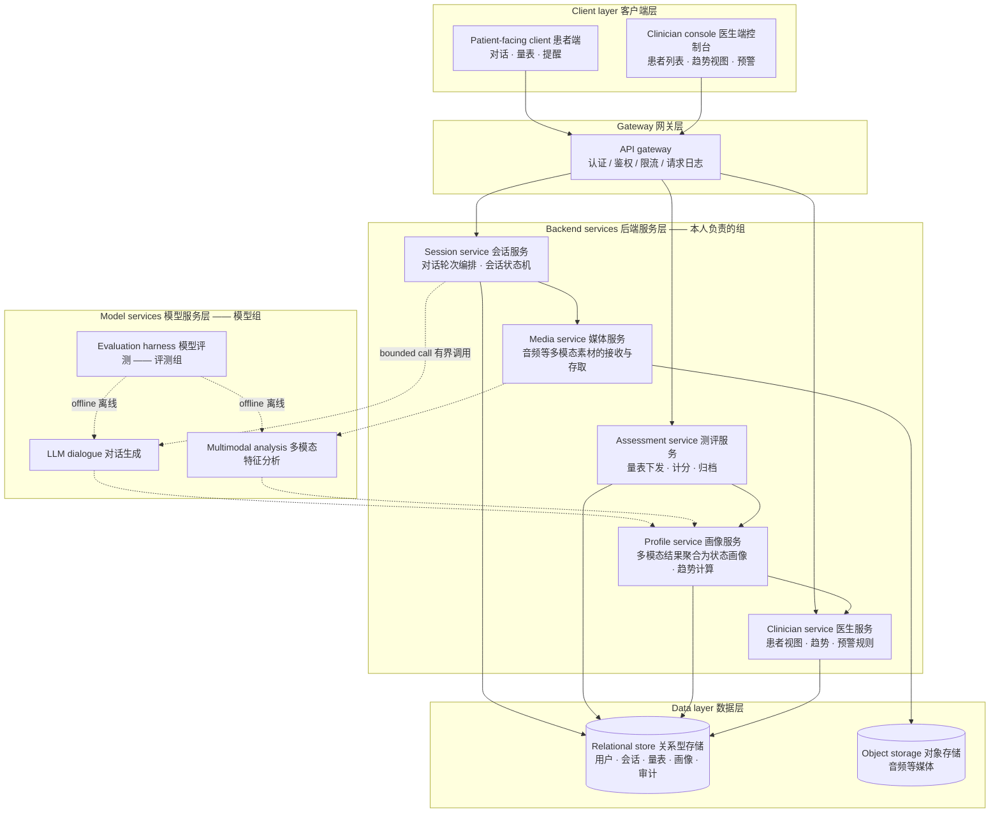
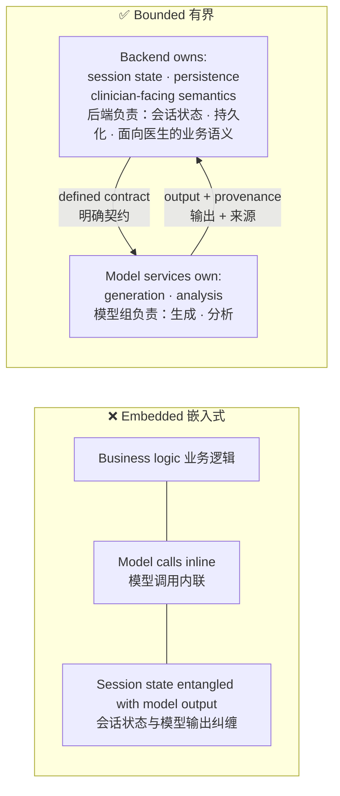
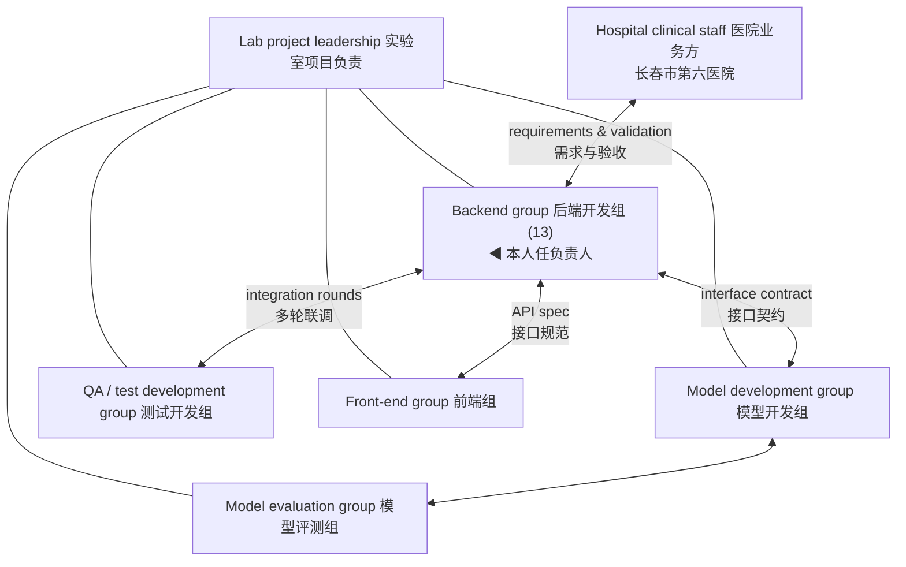

# 03 · LLM-Based Multimodal Digital Twin Platform for Mental Health
# 03 · 心镜智语 —— 基于大语言模型的多模态心理健康数字孪生平台

> **Period 时间**: May – November 2025 · **Role 角色**: Backend Team Lead 后端开发组负责人
> **Partners 合作方**: Virtual Reality Dream Factory Lab, Jilin University × Changchun Sixth Hospital 吉林大学虚拟现实梦工场实验室 × 长春市第六医院
> **Scale 规模**: 13-person backend group, five collaborating parties 13 人后端团队，五方协作
> **Outcome 结果**: deployed into the hospital's production environment · **"Excellent"** conclusion rating, JLU Innovation & Entrepreneurship Training Program 投入医院实际生产使用 · 双创训练计划优秀结题
> **Docs 文档**: [`asdf243/mental-health-digital-twin`](https://github.com/asdf243/mental-health-digital-twin) (private, documentation only 私有，纯文档)

---

> ⚠️ **No source code 无源码** — the codebase belongs to the laboratory and the hospital partner, and the platform processes clinical data. This chapter documents architecture, interface design and engineering process only: no patient data, no credentials, no proprietary model details.
> 代码归属实验室与医院合作方，且平台处理临床数据。本章只记录架构、接口设计与工程流程：不含患者数据、凭据或专有模型细节。

---

## Contents / 目录

1. [Summary / 摘要](#1-summary--摘要)
2. [Clinical problem / 临床问题](#2-clinical-problem--临床问题)
3. [System architecture / 系统架构](#3-system-architecture--系统架构)
4. [The critical boundary / 关键边界](#4-the-critical-boundary--关键边界)
5. [Organisational structure / 组织结构](#5-organisational-structure--组织结构)
6. [What I owned / 我负责的部分](#6-what-i-owned--我负责的部分)
7. [Constraints that shaped the design / 塑造设计的约束](#7-constraints-that-shaped-the-design--塑造设计的约束)
8. [Retrospective / 复盘](#8-retrospective--复盘)

---

## 1. Summary / 摘要

**EN** — A clinical platform that builds a continuously updated **"digital twin" of a patient's psychological state** from multiple modalities — conversational exchanges with an LLM-driven agent, audio, and standardised assessment-scale results — so that clinicians can see how a patient is trending *between* appointments rather than only at them. I led the 13-person backend group, owned the cross-module interface specification and the cross-team integration process, and acted as the backend's single point of contact with the model-development, model-evaluation and QA groups and with the hospital's clinical staff.

**中文** — 一个为临床医生构建**患者心理状态"数字孪生"**的平台：从与 LLM 驱动的对话智能体的交流文本、音频、标准化量表结果等多模态数据中持续汇聚状态画像，使医生能看到患者在两次就诊**之间**的变化趋势，而不只是就诊当天的截面。我统筹 13 人后端团队，负责跨模块接口规范与跨组联调流程，并作为后端组对模型开发组、模型评测组、测试开发组与医院业务方的唯一接口人。

---

## 2. Clinical problem / 临床问题

| Reality 现实 | Consequence 后果 |
|---|---|
| Psychiatric departments are heavily oversubscribed 精神科门诊长期超负荷 | Consultation time is the scarcest resource in the system 问诊时间是系统中最稀缺的资源 |
| Intake questioning and follow-up are routine but time-consuming 入院问询与随访流程化但耗时 | A large share of clinician time goes to work that is necessary but not judgement-intensive 大量医生时间花在必要但不需要专业判断的工作上 |
| What happens between appointments is invisible 两次就诊之间的状态不可见 | Assessment is based on point-in-time snapshots, often self-reported retrospectively 评估基于时点快照，且常依赖回溯性自述 |
| Assessment scales are periodic and coarse 量表评估周期长、颗粒粗 | Deterioration between administrations can go unnoticed 两次施测之间的恶化可能被漏掉 |

The platform targets the third and fourth rows: make the between-visit period observable, in a form a clinician can read at a glance. It is explicitly **assistive** — it surfaces structured information and never issues a diagnosis or a treatment decision.
平台针对的是第三、四行：让两次就诊之间的时段变得可观测，并以医生能一眼读懂的形式呈现。定位明确是**辅助性**的——只呈现结构化信息，不做诊断、不做治疗决策。

---

## 3. System architecture / 系统架构

### Layered view / 层次划分

| Layer 层 | Owner 归属 | Responsibility 职责 | Key design concern 关键设计关注点 |
|---|---|---|---|
| **Client 客户端** | Front-end group 前端组 | Patient interaction; clinician console 患者交互与医生控制台 | A clinician must grasp a patient's state in seconds 医生须在数秒内把握患者状态 |
| **Gateway 网关** | Backend group 后端组 | Authentication, authorisation, rate limiting, request logging 认证、鉴权、限流、请求日志 | Role-based least-privilege exposure 按角色最小暴露 |
| **Session 会话** | Backend group | Turn orchestration and session state machine 对话轮次编排与状态机 | Session state is backend-owned, never model-owned 会话状态归后端，不归模型 |
| **Assessment 测评** | Backend group | Scale delivery, scoring, archival 量表下发、计分、归档 | Scoring must be deterministic and auditable 计分必须确定且可审计 |
| **Profile 画像** | Backend group | Aggregate multimodal results into a state profile and trend 多模态结果聚合为画像与趋势 | Every element carries provenance 每一项都带来源 |
| **Clinician 医生服务** | Backend group | Patient views, trends, alerting rules 患者视图、趋势、预警规则 | Alerts must be explainable, not opaque scores 预警必须可解释，不能是黑箱分数 |
| **Model services 模型服务** | Model group 模型组 | Dialogue generation, multimodal analysis 对话生成、多模态分析 | Called through a bounded interface — §4 通过有界接口调用 |
| **Data 数据** | Backend group | Relational records; media in separate object storage 关系型记录；媒体独立对象存储 | Media separated from records by design 媒体与记录有意分离存储 |

---

## 4. The critical boundary / 关键边界

The single most consequential architectural decision, and the one that generated the most cross-team discussion:
最具影响、也是跨组讨论最多的一个架构决策：

> **Model services are called through a bounded interface. They are never embedded in business code.**
> **模型服务通过有界接口调用，绝不嵌入业务代码。**

What this buys / 由此获得:

| Benefit 收益 | Detail 说明 |
|---|---|
| **Independent iteration 独立迭代** | Model updates need no backend redeployment, and vice versa — essential when the model group iterates far faster than the backend. 模型更新无需后端重新部署，反之亦然——当模型组迭代速度远快于后端时，这一点是必需的。 |
| **Ordinary failure handling 常规故障处理** | Model latency and failure become normal remote-call concerns: timeouts, retries, and a **defined degraded behaviour** when a model service is unavailable. 模型延迟与失败变成普通远程调用问题：超时、重试、以及模型不可用时的**明确降级行为**。 |
| **Traceability 可追溯** | Every model output reaching a clinician carries provenance — which session, which turn, which assessment — so any displayed conclusion can be traced to its source. 到达医生的每条模型输出都带来源标识（哪次会话、哪一轮、哪份量表），任何结论都可回溯。 |
| **Testability 可测性** | The backend can be tested against a contract-conformant stub without the model stack running. 后端可对着符合契约的桩测试，无需启动模型栈。 |

---

## 5. Organisational structure / 组织结构

Five parallel parties building against each other is the defining constraint of this project. When five groups develop simultaneously, **the interface contract is the architecture** — whatever is not pinned down in the contract gets decided independently five times.
五方并行开发是本项目的决定性约束。当五个组同时开发时，**接口契约本身就是架构**——凡是契约没钉死的地方，都会被独立决定五遍。

---

## 6. What I owned / 我负责的部分

### 6.1 Team leadership / 团队统筹

- Sprint planning, task decomposition and progress tracking across a 13-person group. 13 人团队的开发排期、任务拆解与进度跟踪。
- Weekly cross-group sync; defined escalation path for blocking cross-team dependencies. 每周跨组同步会；跨组阻塞依赖的明确上报路径。
- Established the inter-group collaboration process so requirements stayed aligned and information propagated rather than stalling at group boundaries. 建立跨组协作流程，保障需求对齐与信息同步，避免信息卡在组边界。

### 6.2 Interface specification / 接口规范

The core technical deliverable I owned.
我负责的核心技术交付物。

- **Unified RESTful specification** across all backend modules: consistent resource naming, request/response schemas, an error-code taxonomy and a versioning policy — so no two modules invented their own conventions. **统一 RESTful 规范**：资源命名、请求/响应结构、错误码分类与版本策略在所有模块保持一致。
- **Postman as the living contract**: an interface documentation collection plus a test-case library, used as the shared reference between groups. Making the contract *executable* rather than a static document meant disagreements surfaced as failing requests during development instead of as surprises on integration day. **以 Postman 作为"活的契约"**：接口文档集合 + 测试用例库作为跨组共同参照。把契约变成**可执行的**，分歧在开发期以请求失败的形式暴露，而不是留到联调当天。
- **Coordinated the data models and interface contracts for multimodal session data** — conversation text, audio, assessment-scale results — flowing between backend, model services and the clinician-facing front end. 协调多模态会话数据（对话文本、音频、量表结果）在后端、模型服务与医生端之间流转的数据模型与接口契约。

### 6.3 Integration management / 联调管理

**Repeated integration rounds instead of one big-bang integration.** Each round exercised a defined slice end-to-end across groups, which surfaced data-format mismatches, timeout behaviour and concurrency issues early, and measurably reduced rework at the final integration stage.
**多轮联调而非一次性大集成。** 每一轮跨组端到端跑通一个明确的切片，提前暴露数据格式、超时行为与并发问题，实质性降低最终集成阶段的返工量。

### 6.4 Engineering process / 工程流程

Branching strategy, code review, and a pre-release regression-testing routine for the backend group; coordinated the hand-over into the hospital's production environment together with the QA group.
后端组的分支策略、代码评审与发布前回归测试流程；与测试开发组共同完成向医院生产环境的交付。

### 6.5 Requirements translation / 需求转化

Worked directly with clinicians to turn clinical workflows into implementable technical requirements:
与医生直接沟通，把临床流程转化为可落地的技术需求：

| Clinical input 临床输入 | Technical output 技术产出 |
|---|---|
| How a consultation actually proceeds 真实问诊如何推进 | Session states and transitions 会话状态与状态转移 |
| What a clinician needs to see at a glance 医生一眼需要看到什么 | API response shape and the clinician view contract 接口返回结构与医生视图契约 |
| What the platform must never do 平台绝对不能做什么 | Hard constraints in the design 设计中的硬约束 |
| What counts as worth flagging 什么情况值得预警 | Explainable alerting rules 可解释的预警规则 |

---

## 7. Constraints that shaped the design / 塑造设计的约束

| Constraint 约束 | Engineering consequence 工程后果 |
|---|---|
| **Clinical safety 临床安全** — assists, never diagnoses | Model outputs presented as observations with provenance, never as conclusions; the clinician is the decision-maker in every flow. 模型输出以带出处的观察呈现，不作为结论；每条流程中医生都是决策者。 |
| **Patient data sensitivity 患者数据敏感性** | Gateway-level access control; least-privilege exposure per role; media stored separately from relational records. 网关统一鉴权；按角色最小暴露；媒体与关系型记录分离存储。 |
| **Real hospital deployment 真实医院部署** | Availability and degraded-mode behaviour matter more than peak throughput; the system must remain usable when a model service is slow or down. 可用性与降级行为比峰值吞吐更重要；模型服务变慢或不可用时系统仍须可用。 |
| **Five parallel groups 五方并行** | The interface contract had to be executable and versioned, not a document that drifts. 接口契约必须可执行、可版本化，而不是会漂移的文档。 |
| **Non-technical stakeholders 非技术相关方** | Requirements arrive as clinical workflows, not specifications; translation is part of the engineering work, not a preliminary to it. 需求以临床流程而非规格说明的形式到来；转化本身就是工程工作，而非其前置步骤。 |

---

## 8. Retrospective / 复盘

**What worked 有效的做法**
- **Bounded model interface.** The single decision that most reduced coupling; it let the model group iterate at their own pace without ever blocking backend releases. **有界的模型接口。** 降低耦合最有效的单一决策，让模型组以自己的节奏迭代而从不阻塞后端发布。
- **Executable contract.** Postman collections as shared reference caught interface disagreements during development instead of at integration. **可执行的契约。** Postman 集合作为共享参照，在开发期而非联调期捕获接口分歧。
- **Incremental integration.** Repeated small rounds beat one large integration by a wide margin on rework. **增量联调。** 多轮小集成在返工量上远优于一次性大集成。

**What I would do differently 会改进的地方**
- **Contract-first from day one.** The unified specification arrived *after* several modules had already established their own conventions, and reconciling them cost more than writing the spec first would have. This lesson directly shaped how I ran [ARTIFEX](01-artifex.md), where an OpenAPI contract was the single source of truth from the first commit and schema drift was a build failure. **契约优先应当从第一天开始。** 统一规范是在若干模块已各自形成约定**之后**才引入的，统一它们的成本高于一开始就写规范。这个教训直接影响了我在 [ARTIFEX](01-artifex.md) 中的做法：OpenAPI 契约从第一个提交起就是唯一权威，契约漂移即构建失败。
- **Automate the contract checks.** Postman collections were an excellent shared reference but were run manually; wiring them into CI would have caught drift without a human in the loop. **把契约检查自动化。** Postman 集合作为共享参照很好用，但依赖手工运行；接入 CI 才能在无人介入时捕获漂移。
- **Write down the degraded-mode behaviour earlier.** What the system should do when a model service is unavailable was settled during integration rather than at design time, which is later than it should have been for a platform that ends up in a hospital. **更早写清降级行为。** 模型服务不可用时系统应如何表现，是在联调期而非设计期定下来的；对一个最终要进医院的平台而言，这个时机偏晚。

---

> ### 📌 Details to complete before sharing / 分享前待补齐
> Deliberately left blank rather than guessed, so that nothing in this chapter is unverifiable.
> 刻意留空而非猜测，以保证本章内容全部可核实。
>
> - Backend language and framework / 后端语言与框架: `______`
> - Relational database / 关系型数据库: `______`
> - Cache / message queue, if any / 缓存与消息队列（若有）: `______`
> - Object storage for media / 媒体对象存储: `______`
> - Deployment form / 部署形态: `______`
> - Number of API endpoints owned by the backend group / 后端组负责的接口数量: `______`
