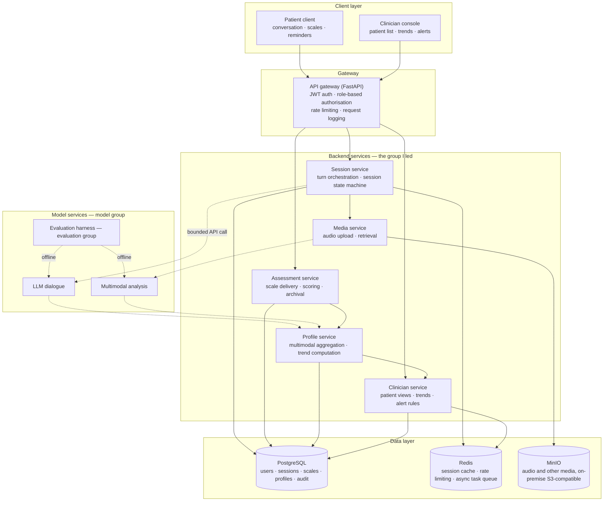
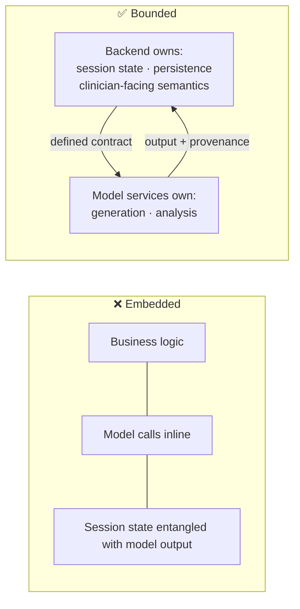
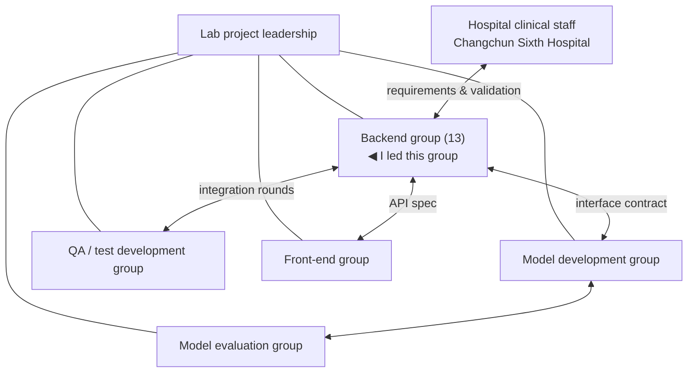

<a href="../README.md">← Portfolio</a> · <a href="zh-CN/03-mental-health-digital-twin.md">中文</a>

# 03 · LLM-Based Multimodal Digital Twin Platform for Mental Health

| | |
|---|---|
| **Period** | May – November 2025 |
| **Role** | Backend Team Lead |
| **Partners** | Virtual Reality Dream Factory Lab, Jilin University × Changchun Sixth Hospital |
| **Scale** | 13-person backend group; five collaborating parties |
| **Outcome** | Deployed into the hospital's production environment · **"Excellent"** conclusion rating, JLU Innovation & Entrepreneurship Training Program |
| **Docs** | [`Hanwen-Tao/mental-health-digital-twin`](https://github.com/Hanwen-Tao/mental-health-digital-twin) (private — access on request; documentation only) |

---

> ⚠️ **No source code.** The codebase belongs to the laboratory and the hospital partner, and the platform processes clinical data. This chapter documents architecture, interface design and engineering process only: no patient data, no credentials, no proprietary model details.

---

## Contents

1. [Summary](#1-summary)
2. [Clinical problem](#2-clinical-problem)
3. [System architecture](#3-system-architecture)
4. [The critical boundary](#4-the-critical-boundary)
5. [Organisational structure](#5-organisational-structure)
6. [What I owned](#6-what-i-owned)
7. [Constraints that shaped the design](#7-constraints-that-shaped-the-design)
8. [Retrospective](#8-retrospective)

---

## 1. Summary

A clinical platform that builds a continuously updated **"digital twin" of a patient's psychological state** from multiple modalities — conversational exchanges with an LLM-driven agent, audio, and standardised assessment-scale results — so that clinicians can see how a patient is trending *between* appointments rather than only at them. I led the 13-person backend group, owned the cross-module interface specification and the cross-team integration process, and acted as the backend's single point of contact with the model-development, model-evaluation and QA groups and with the hospital's clinical staff.

**Stack**: Python · FastAPI · PostgreSQL · Redis · MinIO · Docker · OpenAPI + Postman · JWT.

---

## 2. Clinical problem

| Reality | Consequence |
|---|---|
| Psychiatric departments are heavily oversubscribed | Consultation time is the scarcest resource in the system |
| Intake questioning and follow-up are routine but time-consuming | A large share of clinician time goes to work that is necessary but not judgement-intensive |
| What happens between appointments is invisible | Assessment rests on point-in-time snapshots, often reported retrospectively |
| Assessment scales are periodic and coarse | Deterioration between administrations can go unnoticed |

The platform targets the third and fourth rows: make the between-visit period observable, in a form a clinician can read at a glance. It is explicitly **assistive** — it surfaces structured information and never issues a diagnosis or a treatment decision.

---

## 3. System architecture

### Technology choices

| Concern | Choice | Reason |
|---|---|---|
| Service framework | **Python + FastAPI** | Native async suits a workload dominated by waiting on model services; automatic OpenAPI schema generation made the interface contract executable rather than a separate document |
| Relational store | **PostgreSQL** | Strong constraint support for clinical records; JSONB for assessment payloads whose shape varies per scale |
| Cache and queue | **Redis** | Session state caching, gateway rate limiting, and an async task queue for model calls that must not block a request |
| Object storage | **MinIO** | S3-compatible but **on-premise** — patient audio cannot leave the hospital network, which rules out public cloud storage |
| Deployment | **Docker Compose** on an on-premise server | The hospital intranet is the deployment target; containerisation made the hand-over reproducible |
| Contract tooling | **OpenAPI + Postman** | Schema from code; collections as the shared cross-team reference |
| Auth | **JWT at the gateway** | One place to enforce role-based least-privilege exposure across patient and clinician clients |

### Layered view

| Layer | Owner | Responsibility | Key design concern |
|---|---|---|---|
| **Client** | Front-end group | Patient interaction; clinician console | A clinician must grasp a patient's state in seconds |
| **Gateway** | Backend group | Authentication, authorisation, rate limiting, request logging | Role-based least-privilege exposure |
| **Session** | Backend group | Turn orchestration and session state machine | Session state is backend-owned, never model-owned |
| **Assessment** | Backend group | Scale delivery, scoring, archival | Scoring must be deterministic and auditable |
| **Profile** | Backend group | Aggregate multimodal results into a state profile and trend | Every element carries provenance |
| **Clinician** | Backend group | Patient views, trends, alerting rules | Alerts must be explainable, not opaque scores |
| **Model services** | Model group | Dialogue generation, multimodal analysis | Called through a bounded interface — §4 |
| **Data** | Backend group | Relational records; media in separate object storage | Media separated from records by design |

---

## 4. The critical boundary

The single most consequential architectural decision, and the one that generated the most cross-team discussion:

> **Model services are called through a bounded interface. They are never embedded in business code.**

| Benefit | Detail |
|---|---|
| **Independent iteration** | Model updates need no backend redeployment, and vice versa — essential when the model group iterates far faster than the backend |
| **Ordinary failure handling** | Model latency and failure become normal remote-call concerns: timeouts, retries, and a defined degraded behaviour when a model service is unavailable |
| **Traceability** | Every model output reaching a clinician carries provenance — which session, which turn, which assessment — so any displayed conclusion can be traced to its source |
| **Testability** | The backend can be tested against a contract-conformant stub without the model stack running |

---

## 5. Organisational structure

Five parallel parties building against each other is the defining constraint of this project. When five groups develop simultaneously, **the interface contract is the architecture** — whatever is not pinned down in the contract gets decided independently five times.

---

## 6. What I owned

### 6.1 Team leadership

- Sprint planning, task decomposition and progress tracking across a 13-person group.
- Weekly cross-group sync, with a defined escalation path for blocking cross-team dependencies.
- Established the inter-group collaboration process so requirements stayed aligned and information propagated rather than stalling at group boundaries.

### 6.2 Interface specification

The core technical deliverable I owned.

- **Unified RESTful specification** across all backend modules: consistent resource naming, request/response schemas, an error-code taxonomy and a versioning policy — so no two modules invented their own conventions.
- **Executable contract.** FastAPI generates the OpenAPI schema from the code itself, and a Postman collection plus test-case library served as the shared cross-team reference. Making the contract *executable* rather than a static document meant disagreements surfaced as failing requests during development instead of as surprises on integration day.
- **Coordinated the data models and interface contracts for multimodal session data** — conversation text, audio, assessment-scale results — flowing between backend, model services and the clinician-facing front end.

### 6.3 Integration management

**Repeated integration rounds instead of one big-bang integration.** Each round exercised a defined slice end-to-end across groups, which surfaced data-format mismatches, timeout behaviour and concurrency issues early, and measurably reduced rework at the final integration stage.

### 6.4 Engineering process

Branching strategy, code review, and a pre-release regression-testing routine for the backend group; coordinated the hand-over into the hospital's production environment together with the QA group.

### 6.5 Requirements translation

Worked directly with clinicians to turn clinical workflows into implementable technical requirements:

| Clinical input | Technical output |
|---|---|
| How a consultation actually proceeds | Session states and transitions |
| What a clinician needs to see at a glance | API response shape and the clinician view contract |
| What the platform must never do | Hard constraints in the design |
| What counts as worth flagging | Explainable alerting rules |

---

## 7. Constraints that shaped the design

| Constraint | Engineering consequence |
|---|---|
| **Clinical safety** — assists, never diagnoses | Model outputs presented as observations with provenance, never as conclusions; the clinician is the decision-maker in every flow |
| **Patient data sensitivity** | JWT authorisation at the gateway; least-privilege exposure per role; media in on-premise MinIO, separate from relational records; nothing leaves the hospital network |
| **Real hospital deployment** | Availability and degraded-mode behaviour matter more than peak throughput; the system must remain usable when a model service is slow or down |
| **Five parallel groups** | The interface contract had to be executable and versioned, not a document that drifts |
| **Non-technical stakeholders** | Requirements arrive as clinical workflows, not specifications; translation is part of the engineering work, not a preliminary to it |

---

## 8. Retrospective

**What worked**

- **Bounded model interface.** The single decision that most reduced coupling; it let the model group iterate at their own pace without ever blocking backend releases.
- **Executable contract.** Schema generated from code, plus Postman collections as the shared reference, caught interface disagreements during development instead of at integration.
- **Incremental integration.** Repeated small rounds beat one large integration by a wide margin on rework.

**What I would do differently**

- **Contract-first from day one.** The unified specification arrived *after* several modules had already established their own conventions, and reconciling them cost more than writing the spec first would have. This lesson directly shaped how I ran [ARTIFEX](01-artifex.md), where an OpenAPI contract was the single source of truth from the first commit and schema drift was a build failure.
- **Automate the contract checks.** Postman collections were an excellent shared reference but were run manually; wiring them into CI would have caught drift without a human in the loop.
- **Write down the degraded-mode behaviour earlier.** What the system should do when a model service is unavailable was settled during integration rather than at design time, which is later than it should have been for a platform that ends up in a hospital.
