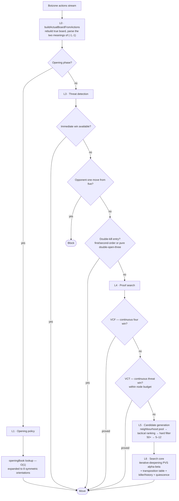

<a href="../README.md">← Portfolio</a> · <a href="zh-CN/04-gomoku-swap1-ai.md">中文</a>

# 04 · Gomoku-Swap1 Game AI on Botzone

| | |
|---|---|
| **Period** | March – May 2026 |
| **Role** | Team Lead |
| **Context** | Data Structures & Algorithms course design, Jilin University |
| **Result** | Bot ranked in the **top 5%** of the course's Botzone ladder |
| **Scale** | ~3.8k lines of C++ in the shipped build · 800 ms per move |
| **Code** | [`Hanwen-Tao/gomoku-swap1-ai`](https://github.com/Hanwen-Tao/gomoku-swap1-ai) (private — access on request) |

---

## Contents

1. [Summary](#1-summary)
2. [Why Swap1 is not ordinary Gomoku](#2-why-swap1-is-not-ordinary-gomoku)
3. [Architecture: the priority pipeline](#3-architecture-the-priority-pipeline)
4. [Layered view](#4-layered-view)
5. [Key techniques](#5-key-techniques)
6. [Three correctness fixes](#6-three-correctness-fixes)
7. [Engineering approach](#7-engineering-approach)
8. [Retrospective](#8-retrospective)

---

## 1. Summary

A tournament engine for Gomoku under the **Swap1 opening rule**, running on the Botzone online judge with an 800 ms per-move budget. The design principle throughout is **"fast to slow, strong to weak"**: cheap and authoritative decisions are made first, and only positions that survive every earlier stage reach the full alpha-beta search. This is what allows an exponential O(b^d) search to return a high-quality move inside the time limit.

---

## 2. Why Swap1 is not ordinary Gomoku

Standard Gomoku has a well-known first-player advantage. Swap1 removes it with a rule that changes the nature of the opening:

> Black places the first stone. White may then **swap** — take over the black stones and continue as black, leaving the original black player to play white.

The first move is therefore no longer an optimisation problem but a **threshold problem**:

| First move | White's rational response | Outcome for us |
|---|---|---|
| Too strong | Swap — take the strong position | We lose the advantage we built |
| Too weak | Decline the swap | We keep a bad opening |
| **Calibrated** | Decline the swap | **We keep a playable opening** |

So the engine must model the opponent's swap decision, then deliberately choose a move that is *good but below the threshold that would trigger a swap*. Playing the strongest available move is actively wrong.

---

## 3. Architecture: the priority pipeline

**Why this ordering.** Each stage is both cheaper and more authoritative than the next. An immediate win is certain and costs one board scan; a VCF proof is certain and costs a narrow deep search; an alpha-beta evaluation is a heuristic estimate and costs the entire remaining time budget. Spending the budget on a search whose conclusion a five-microsecond check would have given for free is the main way engines lose on time.

---

## 4. Layered view

| Layer | Responsibility | Key functions |
|---|---|---|
| **L0 · I/O adaptation** | Parse Botzone's `actions` array; disambiguate the two meanings of `(-1,-1)` — *we are black* at index 0, *opponent swapped* mid-sequence — and rebuild the true board colouring | `buildActualBoardFromActions` |
| **L1 · Opening policy** | Score candidate first moves; choose one below the modelled swap threshold; grade the opponent's first move to decide our own swap; O(1) opening-book lookup expanded to 8 symmetric orientations | `openingBlackValue`, `chooseAntiSwapBlackOpeningMove`, `openingFirstMoveGradeForSwap`, `transformPoint`, `addOpeningRule` |
| **L2 · Pattern evaluation** | Classify every length-5 sliding window into 12 pattern types (open three, rush four, open four, broken three, dead three, …); incremental update on place/undo | `classifyWindow5`, `patternCount`, `evaluateMoveDelta`, `PATTERN_SCORE` |
| **L3 · Threat detection** | Immediate wins and mandatory blocks; first- and second-order double kills; pure double-open-three; poisoned moves; fatal killer replies | `findImmediateWinMoves`, `createsDirectDoubleKill`, `createsSecondOrderDoubleKill`, `findOpenFourCreationMoves`, `isForcingDoubleKillEntry`, `isPoisonedThreatMove`, `findFatalKillerReplies` |
| **L4 · Proof search** | VCF (every attacking move is a four, so the defender's replies are forced) and VCT (open threes, broken threes and double threats also allowed), both under a time-aware node budget | `vctSearch`, `vctAfterAttack`, `findVCTEntries`, `isVCTAttackMove`, `consumeVCTNode` |
| **L5 · Candidate generation** | Collect cells within 1–2 of an existing stone; assign a tactical rank; hard-filter low ranks when a high-rank threat exists | `collectCandidatePoolForSearch`, `generateCandidates` |
| **L6 · Search core** | Iterative-deepening PVS alpha-beta with Zobrist transposition table, killer-move and history heuristics, and quiescence search; returns the deepest completed layer at timeout | `searchWithIterativeDeepening`, `alphaBeta`, `quiescenceSearch`, `probeTT` |

---

## 5. Key techniques

### 5.1 Swap1 threshold modelling

`openingBlackValue` scores each candidate first move by centrality (Manhattan + Chebyshev distance to the star point) with an edge penalty. `chooseAntiSwapBlackOpeningMove` then keeps only points scoring **below** the modelled swap threshold (`SWAP_TAKE_THRESHOLD = 7600`) with a **350-point safety margin**, deliberately avoiding points near the boundary where a small modelling error flips the opponent's decision.

Conversely, when we hold white, `openingFirstMoveGradeForSwap` grades the opponent's first move (star point 100, adjacent 96, diagonal-near 98, traditional strong points such as D4/H3 96) and swaps above a threshold of 70.

### 5.2 Symmetry-expanded opening book

A Gomoku board is invariant under 4 rotations × 2 reflections. Only one canonical orientation of each opening line is entered by hand; `transformPoint` maps it into all 8 equivalent orientations at load time. The book is stored as `unordered_map<string, vector<OpeningCandidate>>` — position encoding → priority-sorted candidate moves — giving O(1) lookup.

### 5.3 Incremental pattern counting

Each cell belongs to exactly **20** length-5 windows (4 directions × 5 offsets). Placing or undoing a stone therefore re-evaluates only those 20 windows rather than the whole board, turning per-node evaluation from O(n²) into amortised O(1). At the node counts an 800 ms budget permits, this is the difference between reaching depth 4 and depth 8+.

### 5.4 Tactical ranking and hard filtering

`collectCandidatePoolForSearch` gathers only cells within radius 1–2 of an existing stone (radius 2 when a live threat exists, 1 in quiet late positions), then `generateCandidates` assigns a tactical rank:

| Rank | Meaning |
|---|---|
| 100 | Our immediate five |
| 95 | Opponent's immediate five (must block) |
| 90 | Creates a double kill next move |
| … | … |
| < 78 | Ordinary candidates |

**The hard filter**: if any candidate has rank ≥ 95, every candidate below rank 78 is dropped from the re-scoring pool. Branching collapses from 50+ to 5–12. This is a classic "eliminate the irrelevant before evaluating deeply" move, and it is the single largest contributor to reachable depth.

### 5.5 VCF / VCT proof search under a node budget

- **VCF** (Victory by Continuous Four): every attacking move is a four, so the defender has at most one legal reply. The search tree is extremely narrow, so it can be proved very deep very cheaply.
- **VCT** (Victory by Continuous Threat): open threes, broken threes and double threats are also permitted, so the branching is much wider and the search must be budgeted.

| Condition | `vctNodeBudget` |
|---|---|
| depth ≥ 3 | 220 |
| depth < 3 | 110 |
| remaining time < 160 ms | ≤ 70 |
| remaining time < 90 ms | ≤ 35 |

A separate `vctGlobalBudget` caps the total across repeated VCT calls within one move, so that several individually-bounded searches cannot jointly exhaust the clock. Budgeting by **node count rather than depth** is the right choice here because VCT branching varies enormously with position — a depth limit would be far too loose in some positions and far too tight in others.

### 5.6 Search core

| Technique | Purpose |
|---|---|
| **Iterative deepening** | Depth 1, 2, 3 … each completed layer writes to the transposition table and improves move ordering for the next; on timeout, return the best move of the deepest **completed** layer — never a partial one |
| **PVS / NegaScout** | The first move is searched with a full window; the rest with a zero window, re-searching only on failure. Most moves are worse than the principal variation and are refuted cheaply |
| **Zobrist transposition table** | Position hashing so that transpositions — the same position reached by different move orders — are evaluated once |
| **Killer move heuristic** | Remembers, per remaining depth, the two moves that caused beta cutoffs — tactical refutations that tend to work again at the same depth |
| **History heuristic** | A board-wide table of how often each move caused a cutoff, used for global move ordering |
| **Quiescence search** | At depth 0, instead of a static evaluation, continue along "noisy" forcing moves for another layer — prevents the horizon effect, where the search stops just before an opponent's rush four and calls a lost position balanced |

---

## 6. Three correctness fixes

These were the focus of the defence, because each was a case where the engine's *understanding of the position* was wrong rather than its search being too shallow.

| # | Bug | Symptom | Fix |
|---|---|---|---|
| 1 | `[1,0,0,1,1]` — two stones separated by a two-cell gap — classified as an **open three** | The engine defended non-threats and attacked with shapes that could not develop | Detect `maxGap >= 2` in `classifyWindow5` and downgrade to `P_DEAD3` |
| 2 | **Pure double-open-three missed** | The original check only tested `winCnt >= 2` (two immediate five-points). A move creating two open threes in different directions has *no* immediate five-point but is still forcing — either three can become an open four | Added an independent per-direction open-three counter (`liveThreeDirs >= 2`) in **both** `findOpenFourCreationMoves` and `isForcingDoubleKillEntry`, so neither layer can miss it |
| 3 | **Poisoned moves scored as good** | A move that "creates a threat" whose only block simultaneously creates a win for the opponent | `isPoisonedThreatMove` simulates the defender's forced reply and checks whether it leaves the defender winning; such moves are excluded |

Fix 2 is the most instructive: the original condition was not *approximately* right, it was categorically incomplete — it tested for one sufficient condition of a forcing move and treated it as necessary. Finding it required constructing the position by hand rather than waiting for it to appear in self-play.

---

## 7. Engineering approach

| Practice | Detail |
|---|---|
| **Versioned iteration trail** | `bot_8 → bot_26`, each a complete playable build. The diffs are the clearest record of how the layered design emerged from a plain alpha-beta and how each tactical bug was found and fixed |
| **Offline match analysis** | `parse_game.py` converts a match log into board states; `analyze_game.cpp` replays and inspects the engine's evaluation at each position, so a loss can be traced to the specific move where the evaluation went wrong |
| **Regression checks** | `test_fix.cpp` holds hand-constructed positions for the pattern-classification fixes, so a later refactor cannot silently reintroduce them |
| **Fallback move generation** | Guarantees a legal move in any position, including malformed or unexpected input — an engine that returns nothing forfeits |

---

## 8. Retrospective

**What worked**

- **Priority pipeline over a single big search.** Giving certainty-yielding checks precedence over heuristic evaluation is what made depth affordable.
- **Encoding game knowledge as search constraints, not evaluation bonuses.** Tactical ranking, hard filtering and node budgets shrink the search *space*; adding the same knowledge as evaluation terms would only have reshuffled an equally large tree.
- **Constructing adversarial positions by hand.** All three correctness bugs were found this way, not by self-play.

**What I would do differently**

- **Automated self-play regression.** Version comparison was manual; an automated ladder between consecutive builds would have quantified each change instead of relying on impression.
- **Tune the evaluation weights systematically.** `PATTERN_SCORE` was hand-tuned; even a coarse parameter sweep against a fixed opponent pool would likely have beaten intuition.
- **Separate the engine from the Botzone protocol.** The single-file submission requirement pushed protocol handling and engine logic into the same translation unit; an internal interface would have made the engine testable outside the judge.
