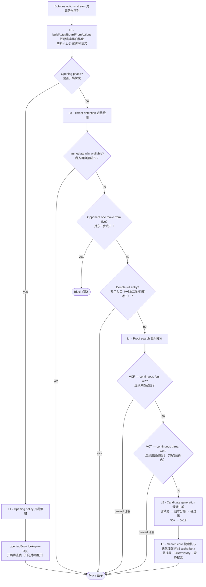

# 04 · Gomoku-Swap1 Game AI on Botzone
# 04 · 五子棋 Swap1 博弈 AI（Botzone 平台）

> **Period 时间**: March – May 2026 · **Role 角色**: Team Lead 队长
> **Context 背景**: Data Structures & Algorithms course design, Jilin University 吉林大学数据结构与算法设计课程设计
> **Result 结果**: bot ranked in the **top 5%** of the course's Botzone ladder 课程 Botzone 天梯**前 5%**
> **Scale 规模**: ~3.8k lines of C++ in the shipped build · 800 ms per move 提交版本约 3,800 行 C++，单步 800 ms
> **Code 代码**: [`asdf243/gomoku-swap1-ai`](https://github.com/asdf243/gomoku-swap1-ai) (private 私有)

---

## Contents / 目录

1. [Summary / 摘要](#1-summary--摘要)
2. [Why Swap1 is not ordinary Gomoku / 为什么 Swap1 不是普通五子棋](#2-why-swap1-is-not-ordinary-gomoku--为什么-swap1-不是普通五子棋)
3. [Architecture: the priority pipeline / 架构：优先级流水线](#3-architecture-the-priority-pipeline--架构优先级流水线)
4. [Layered view / 层次划分](#4-layered-view--层次划分)
5. [Key techniques / 关键技术](#5-key-techniques--关键技术)
6. [Three correctness fixes / 三处正确性修复](#6-three-correctness-fixes--三处正确性修复)
7. [Engineering approach / 工程方法](#7-engineering-approach--工程方法)
8. [Retrospective / 复盘](#8-retrospective--复盘)

---

## 1. Summary / 摘要

**EN** — A tournament engine for Gomoku under the **Swap1 opening rule**, running on the Botzone online judge with an 800 ms per-move budget. The design principle throughout is **"fast to slow, strong to weak"**: cheap and authoritative decisions are made first, and only positions that survive every earlier stage reach the full alpha-beta search. This is what allows an exponential O(b^d) search to return a high-quality move inside the time limit.

**中文** — 面向 Botzone 平台、在 **Swap1 一手交换规则**下、单步 800 ms 限时的五子棋对战引擎。整体设计遵循 **"由快到慢、由强到弱"**：优先级高且代价低的判定先做，只有通过了所有前置阶段的局面才进入完整 Alpha-Beta 搜索。这正是让理论上 O(b^d) 的指数搜索能在限时内给出高质量落子的原因。

---

## 2. Why Swap1 is not ordinary Gomoku / 为什么 Swap1 不是普通五子棋

Standard Gomoku has a well-known first-player advantage. Swap1 removes it with a rule that changes the nature of the opening:
标准五子棋有众所周知的先手优势，Swap1 用一条改变开局性质的规则来消除它：

> Black places the first stone. White may then **swap** — take over the black stones and continue as black, leaving the original black player to play white.
> 黑方落第一子后，白方可以选择**换手**——接过黑棋继续执黑，原黑方改执白。

The consequence is that the first move is no longer an optimisation problem but a **threshold problem**:
后果是首手不再是一个优化问题，而是一个**阈值问题**：

| First move 首手 | White's rational response 白方理性反应 | Outcome for us 我方结果 |
|---|---|---|
| Too strong 太强（天元、近天元） | Swap — take the strong position 换手，接过好位置 | We lose the advantage we built 我们失去自己造出的优势 |
| Too weak 太弱（边角劣点） | Decline the swap 不换手 | We keep a bad opening 我们留下一个差开局 |
| **Calibrated 恰好** | Decline the swap 不换手 | **We keep a playable opening 我们保留一个可下的开局** |

So the engine must model the opponent's swap decision, then deliberately choose a move that is *good but below the threshold that would trigger a swap*. Playing the strongest available move is actively wrong.
因此引擎必须建模对手的换手决策，然后刻意选择一个*好、但低于会触发换手的阈值*的落点。下"当前最强的一步"在这里是错的。

---

## 3. Architecture: the priority pipeline / 架构：优先级流水线

**Why this ordering / 为什么是这个顺序**: each stage is both cheaper and more authoritative than the next. An immediate win is certain and costs one board scan; a VCF proof is certain and costs a narrow deep search; an alpha-beta evaluation is a heuristic estimate and costs the entire remaining time budget. Spending the budget on a search whose conclusion a five-microsecond check would have given for free is the main way engines lose on time.
每一阶段都比下一阶段更便宜且更权威。直接成五是确定的，代价是一次棋盘扫描；VCF 证明是确定的，代价是一次窄而深的搜索；Alpha-Beta 评估只是启发式估计，代价是全部剩余时间预算。把预算花在一个五微秒检查就能免费得出结论的搜索上，是引擎超时告负的主要原因。

---

## 4. Layered view / 层次划分

| Layer 层 | Responsibility 职责 | Key functions 关键函数 |
|---|---|---|
| **L0 · I/O adaptation 输入输出适配** | Parse Botzone's `actions` array; disambiguate the two meanings of `(-1,-1)` — *we are black* when at index 0, *opponent swapped* when mid-sequence — and rebuild the true board colouring accordingly | `buildActualBoardFromActions` |
| **L1 · Opening policy 开局策略** | Score candidate first moves; choose one below the modelled swap threshold; grade the opponent's first move to decide our own swap; O(1) opening-book lookup expanded to 8 symmetric orientations | `openingBlackValue`, `chooseAntiSwapBlackOpeningMove`, `openingFirstMoveGradeForSwap`, `transformPoint`, `addOpeningRule` |
| **L2 · Pattern evaluation 棋型评估** | Classify every length-5 sliding window into 12 pattern types (open three, rush four, open four, broken three, dead three, …); incremental update on place/undo | `classifyWindow5`, `patternCount`, `evaluateMoveDelta`, `PATTERN_SCORE` |
| **L3 · Threat detection 威胁检测** | Immediate wins and mandatory blocks; first- and second-order double kills; pure double-open-three; poisoned moves; fatal killer replies | `findImmediateWinMoves`, `createsDirectDoubleKill`, `createsSecondOrderDoubleKill`, `findOpenFourCreationMoves`, `isForcingDoubleKillEntry`, `isPoisonedThreatMove`, `findFatalKillerReplies` |
| **L4 · Proof search 证明搜索** | VCF (every attacking move is a four, so the defender's replies are forced) and VCT (open threes, broken threes and double threats also allowed), both under a time-aware node budget | `vctSearch`, `vctAfterAttack`, `findVCTEntries`, `isVCTAttackMove`, `consumeVCTNode` |
| **L5 · Candidate generation 候选生成** | Collect cells within 1–2 of an existing stone; assign a tactical rank; hard-filter low ranks when a high-rank threat exists | `collectCandidatePoolForSearch`, `generateCandidates` |
| **L6 · Search core 搜索核心** | Iterative-deepening PVS alpha-beta with Zobrist transposition table, killer-move and history heuristics, and quiescence search; returns the deepest completed layer at timeout | `searchWithIterativeDeepening`, `alphaBeta`, `quiescenceSearch`, `probeTT` |

---

## 5. Key techniques / 关键技术

### 5.1 Swap1 threshold modelling / Swap1 阈值建模

`openingBlackValue` scores each candidate first move by centrality (Manhattan + Chebyshev distance to the star point) with an edge penalty. `chooseAntiSwapBlackOpeningMove` then keeps only points scoring **below** the modelled swap threshold (`SWAP_TAKE_THRESHOLD = 7600`) with a **350-point safety margin**, deliberately avoiding points near the boundary where a small modelling error flips the opponent's decision.
`openingBlackValue` 按中心性（到天元的曼哈顿 + 切比雪夫距离）与贴边惩罚为每个候选首手打分；`chooseAntiSwapBlackOpeningMove` 只保留分数**低于**换手阈值（`SWAP_TAKE_THRESHOLD = 7600`）且留 **350 分安全边际**的点，刻意避开临界点——在临界点附近，模型的微小误差就会翻转对手的决策。

Conversely, when we hold white, `openingFirstMoveGradeForSwap` grades the opponent's first move (star point 100, adjacent 96, diagonal-near 98, traditional strong points such as D4/H3 96) and swaps above a threshold of 70.
反过来执白时，`openingFirstMoveGradeForSwap` 对对手首手评级（天元 100、近邻 96、斜近天元 98、D4/H3 等传统强点 96），高于阈值 70 即换手。

### 5.2 Symmetry-expanded opening book / 对称展开的开局库

A Gomoku board is invariant under 4 rotations × 2 reflections. Only one canonical orientation of each opening line is entered by hand; `transformPoint` maps it into all 8 equivalent orientations at load time. The book is stored as `unordered_map<string, vector<OpeningCandidate>>` — position encoding → priority-sorted candidate moves — giving O(1) lookup.
五子棋棋盘在 4 种旋转 × 2 种镜像下等价。定式只按一个标准方向手工录入，`transformPoint` 在装载时映射出全部 8 个等价方向。开局库存为 `unordered_map<string, vector<OpeningCandidate>>`（局面编码 → 按优先级排序的候选着），查找 O(1)。

### 5.3 Incremental pattern counting / 增量棋型统计

Each cell belongs to exactly **20** length-5 windows (4 directions × 5 offsets). Placing or undoing a stone therefore re-evaluates only those 20 windows rather than the whole board, turning per-node evaluation from O(n²) into amortised O(1). At the node counts an 800 ms budget permits, this is the difference between reaching depth 4 and depth 8+.
每个格点恰好属于 **20** 个长度为 5 的窗口（4 方向 × 5 偏移）。落子/撤子只重算这 20 个窗口而非整盘，把每节点评估从 O(n²) 降到摊还 O(1)。在 800 ms 预算允许的节点数下，这是"搜到第 4 层"与"搜到第 8 层以上"的差别。

### 5.4 Tactical ranking and hard filtering / 战术分层与硬过滤

`collectCandidatePoolForSearch` gathers only cells within radius 1–2 of an existing stone (radius 2 when a live threat exists, 1 in quiet late positions), then `generateCandidates` assigns a tactical rank:
`collectCandidatePoolForSearch` 只收集已有棋子半径 1–2 内的格点（存在活跃威胁时半径 2，后期安静局面 1），随后 `generateCandidates` 分配战术等级：

| Rank 等级 | Meaning 含义 |
|---|---|
| 100 | Our immediate five 我方直接成五 |
| 95 | Opponent's immediate five (must block) 对方直接成五（必防） |
| 90 | Creates a double kill next move 下一手可成双杀 |
| … | … |
| < 78 | Ordinary candidates 普通候选 |

**The hard filter**: if any candidate has rank ≥ 95, every candidate below rank 78 is dropped from the re-scoring pool. Branching collapses from 50+ to 5–12. This is a classic "eliminate the irrelevant before evaluating deeply" move, and it is the single largest contributor to reachable depth.
**硬过滤**：只要存在等级 ≥ 95 的候选，等级 < 78 的候选全部不进入重评分池。分支因子从 50+ 坍缩到 5–12。这是典型的"先排除无关项再做深度评估"，也是可达深度的最大贡献来源。

### 5.5 VCF / VCT proof search under a node budget / 节点预算下的 VCF/VCT

- **VCF** (Victory by Continuous Four): every attacking move is a four, so the defender has at most one legal reply. The search tree is extremely narrow, so it can be proved very deep very cheaply. **VCF（连续冲四胜）**：每一攻击手都是冲四，防守方至多一种合法应手，搜索树极窄，因此可以很便宜地证明到很深。
- **VCT** (Victory by Continuous Threat): open threes, broken threes and double threats are also permitted, so the branching is much wider and the search must be budgeted. **VCT（连续威胁胜）**：允许活三、跳活三与双杀，分支明显变宽，必须限制预算。

Budget policy 预算策略:

| Condition 条件 | `vctNodeBudget` |
|---|---|
| depth ≥ 3 | 220 |
| depth < 3 | 110 |
| remaining time < 160 ms 剩余时间 < 160 ms | ≤ 70 |
| remaining time < 90 ms 剩余时间 < 90 ms | ≤ 35 |

A separate `vctGlobalBudget` caps the total across repeated VCT calls within one move, so that several individually-bounded searches cannot jointly exhaust the clock. Budgeting by **node count rather than depth** is the right choice here because VCT branching varies enormously with position — a depth limit would be far too loose in some positions and far too tight in others.
另有 `vctGlobalBudget` 限制单步内多次 VCT 调用的总量，避免多个各自有界的搜索共同耗尽时钟。这里按**节点数而非深度**限制是正确的，因为 VCT 的分支因子随局面剧烈变化——深度限制在某些局面下过松、在另一些局面下过紧。

### 5.6 Search core / 搜索核心

| Technique 技术 | Purpose 作用 |
|---|---|
| **Iterative deepening 迭代加深** | Depth 1, 2, 3 … each completed layer writes to the transposition table and improves move ordering for the next; on timeout, return the best move of the deepest **completed** layer — never a partial one. 逐层加深，每完成一层写入置换表并改善下一层的着法排序；超时则返回最深**已完成**层的最佳着，绝不返回半成品。 |
| **PVS / NegaScout** | The first move is searched with a full window; the rest with a zero window, re-searching only on failure. Most moves are worse than the PV and are refuted cheaply. 首着用全窗口搜索，其余用零窗口快速验证，失败才重搜。大多数着法劣于主变，可廉价反驳。 |
| **Zobrist transposition table 置换表** | Position hashing so that transpositions (same position reached by different move orders) are evaluated once. 局面哈希，使不同着法顺序到达的相同局面只评估一次。 |
| **Killer move heuristic** | Remembers, per remaining depth, the two moves that caused beta cutoffs — tactical refutations that tend to work again at the same depth. 记录每个剩余深度上造成 beta 剪枝的两个着法——同深度下往往再次奏效的战术反驳手。 |
| **History heuristic 历史启发** | A board-wide table of how often each move caused a cutoff, used for global move ordering. 全局记录各着法造成剪枝的频次，用于整体着法排序。 |
| **Quiescence search 安静搜索** | At depth 0, instead of a static evaluation, continue along "noisy" forcing moves for another layer — prevents the horizon effect, where the search stops just before an opponent's rush four and calls a lost position balanced. 深度为 0 时不直接静态评估，而是沿"吵闹"的强制手再搜一层——防止地平线效应：搜索恰好停在对方冲四之前，把必败局面判成均势。 |

---

## 6. Three correctness fixes / 三处正确性修复

These were the focus of the defence, because each was a case where the engine's *understanding of the position* was wrong rather than its search being too shallow.
这三处是答辩的重点，因为它们都是引擎对*局面的理解*错误，而不是搜索不够深。

| # | Bug 缺陷 | Symptom 症状 | Fix 修复 |
|---|---|---|---|
| 1 | `[1,0,0,1,1]` — two stones separated by a two-cell gap — classified as an **open three** 两子中间隔两格被误判为活三 | The engine defended non-threats and attacked with shapes that could not develop 引擎防守不存在的威胁，并用无法发展的形状进攻 | Detect `maxGap >= 2` in `classifyWindow5` and downgrade to `P_DEAD3` 在 `classifyWindow5` 中检测 `maxGap >= 2` 并降级为死三 |
| 2 | **Pure double-open-three missed** 纯双活三被漏判 | The original check only tested `winCnt >= 2` (two immediate five-points). A move creating two open threes in different directions has *no* immediate five-point but is still forcing — either three can become an open four. 原检查只测 `winCnt >= 2`（两个直接成五点）。在两个方向各成一个活三的着法没有任何直接成五点，但仍是强制手——任一活三都可变活四。 | Added an independent per-direction open-three counter (`liveThreeDirs >= 2`) in **both** `findOpenFourCreationMoves` and `isForcingDoubleKillEntry`, so neither layer can miss it 在两处判定中都加入独立方向活三计数，保证两层都不遗漏 |
| 3 | **Poisoned moves scored as good** 假先手被评为好棋 | A move that "creates a threat" whose only block simultaneously creates a win for the opponent 造出的"威胁"其唯一堵点恰好同时为对手形成双杀或直接胜 | `isPoisonedThreatMove` simulates the defender's forced reply and checks whether it leaves the defender winning; such moves are excluded 模拟对方被迫的应手，检查其是否反而让对方获胜；此类着法被排除 |

Fix 2 is the most instructive: the original condition was not *approximately* right, it was categorically incomplete — it tested for one sufficient condition of a forcing move and treated it as necessary. Finding it required constructing the position by hand rather than waiting for it to appear in self-play.
第 2 处最有教益：原条件不是"大致正确"，而是**范畴性地不完整**——它把强制手的一个充分条件当成了必要条件。找到它靠的是手工构造局面，而不是等它在自对弈中出现。

---

## 7. Engineering approach / 工程方法

| Practice 做法 | Detail 说明 |
|---|---|
| **Versioned iteration trail 版本化迭代轨迹** | `bot_8 → bot_26`, each a complete playable build. The diffs are the clearest record of how the layered design emerged from a plain alpha-beta and how each tactical bug was found and fixed. 每一版都是完整可对战的构建；差异本身就是"分层架构如何从朴素 Alpha-Beta 演化而来"以及"每个战术缺陷如何被发现和修复"的最清晰记录。 |
| **Offline match analysis 离线对局分析** | `parse_game.py` converts a match log into board states; `analyze_game.cpp` replays and inspects the engine's evaluation at each position, so a loss can be traced to the specific move where the evaluation went wrong. 把对局日志转为棋盘状态并回放检查各局面的评估值，使一次失利能定位到评估出错的具体一手。 |
| **Regression checks 回归检查** | `test_fix.cpp` holds hand-constructed positions for the pattern-classification fixes, so a later refactor cannot silently reintroduce them. 保存针对棋型判定修复的手工构造局面，防止后续重构静默引入回归。 |
| **Fallback move generation 兜底候选生成** | Guarantees a legal move in any position, including malformed or unexpected input — an engine that returns nothing forfeits. 保证任意局面（含畸形或意外输入）下都能输出合法落点——不落子等于判负。 |

---

## 8. Retrospective / 复盘

**What worked 有效的做法**
- **Priority pipeline over a single big search.** Giving certainty-yielding checks precedence over heuristic evaluation is what made depth affordable. **优先级流水线优于单一大搜索。** 让能给出确定结论的检查优先于启发式评估，是深度变得可负担的原因。
- **Encoding game knowledge as search constraints, not evaluation bonuses.** Tactical ranking, hard filtering and node budgets shrink the search *space*; adding the same knowledge as evaluation terms would only have reshuffled an equally large tree. **把棋理编码为搜索空间的硬约束，而不是评估函数的加分项。** 战术分层、硬过滤与节点预算缩小的是搜索*空间*；把同样的知识做成评估项只会在同样大的树里重新排序。
- **Constructing adversarial positions by hand.** All three correctness bugs were found this way, not by self-play. **手工构造对抗性局面。** 三处正确性缺陷全部由此发现，而非自对弈。

**What I would do differently 会改进的地方**
- **Automated self-play regression.** Version comparison was manual; an automated ladder between consecutive builds would have quantified each change instead of relying on impression. **自动化自对弈回归。** 版本对比是手工的；在相邻版本之间跑自动天梯可以量化每次改动的收益，而不依赖主观印象。
- **Tune the evaluation weights systematically.** `PATTERN_SCORE` was hand-tuned; even a coarse parameter sweep against a fixed opponent pool would likely have beaten intuition. **系统性调评估权重。** `PATTERN_SCORE` 是手工调的；对固定对手池做哪怕粗粒度的参数扫描，很可能优于直觉。
- **Separate the engine from the Botzone protocol.** The single-file submission requirement pushed protocol handling and engine logic into the same translation unit; an internal interface would have made the engine testable outside the judge. **把引擎与 Botzone 协议分离。** 单文件提交的要求把协议处理与引擎逻辑放进了同一个编译单元；一层内部接口可以让引擎在评测机之外独立可测。
