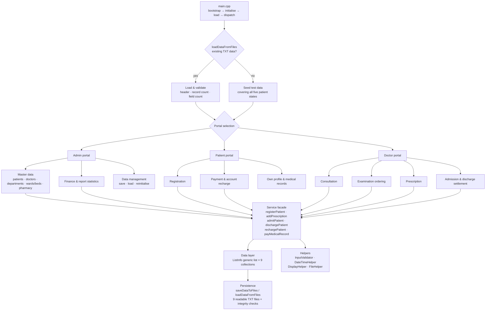
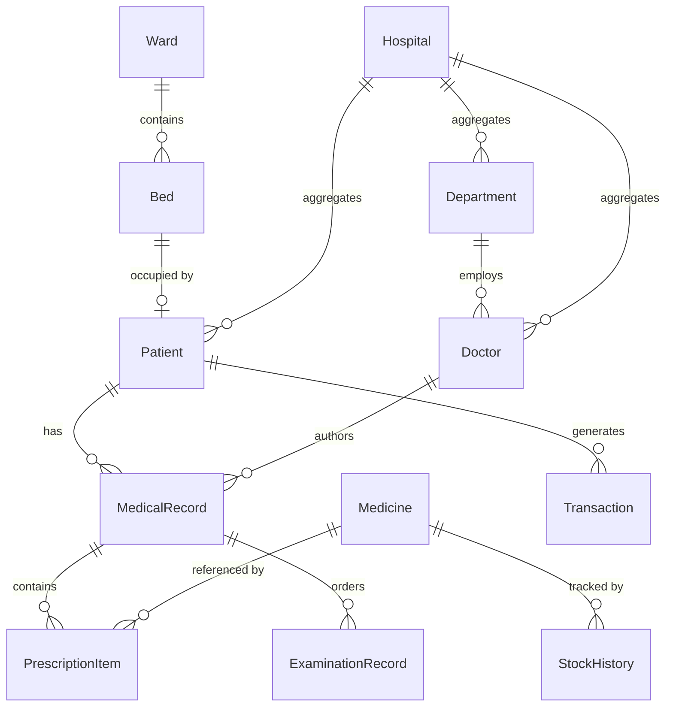
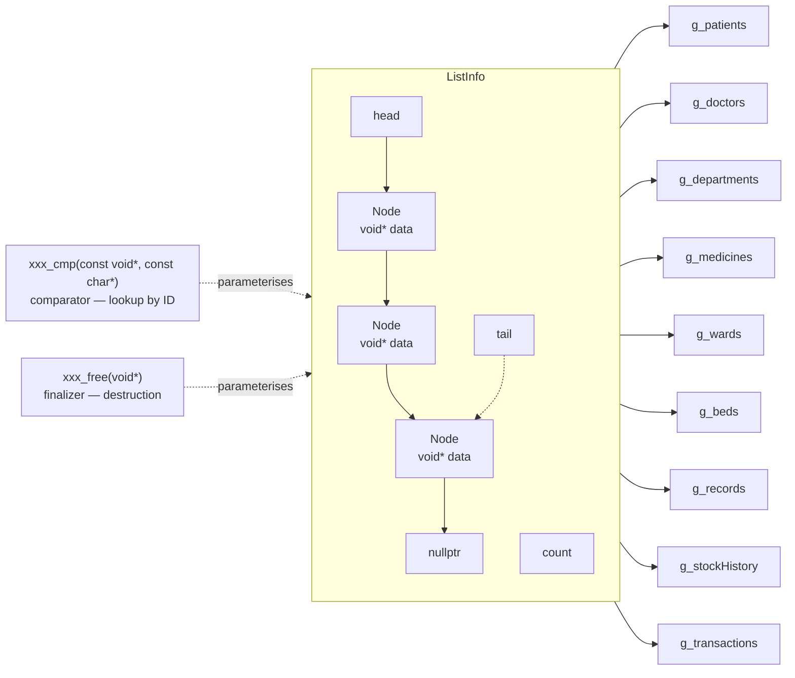
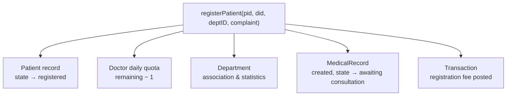

<div align="right"><a href="../README.md">← Portfolio</a> · <a href="zh-CN/05-hospital-information-system.md">中文</a></div>

# 05 · Hospital Information System — Three-Role C++ System

| | |
|---|---|
| **Period** | March 2025 – May 2026 |
| **Role** | Team Lead |
| **Grade** | A+ |
| **Context** | Started in the Object-Oriented Programming course (2025), rebuilt as a three-role system for the Fundamentals of Programming course design (2026) |
| **Scale** | ~6.4k lines of C++ · 13 business structs · 9 data collections · no STL containers |
| **Code** | [`asdf243/hospital-information-system`](https://github.com/asdf243/hospital-information-system) (private — access on request) |

---

## Contents

1. [Summary](#1-summary)
2. [The two constraints](#2-the-two-constraints)
3. [Architecture](#3-architecture)
4. [Layered view](#4-layered-view)
5. [Domain model](#5-domain-model)
6. [The generic linked list](#6-the-generic-linked-list)
7. [Service facade](#7-service-facade)
8. [Validation and persistence](#8-validation-and-persistence)
9. [Retrospective](#9-retrospective)

---

## 1. Summary

A console hospital information system covering the complete outpatient and inpatient journey: registration → consultation → examination → prescription → admission → discharge → settlement. The second iteration split the original single-menu program into **three independent portals** (admin / patient / doctor) sharing one data layer but exposing different entry points and permissions, mirroring how roles are separated in an actual hospital.

---

## 2. The two constraints

Both came from the course, and both turned out to be the most instructive part of the project.

| Constraint | Naive response | What we did instead |
|---|---|---|
| **No STL containers** | Write nine separate linked lists, one per entity type | One generic list parameterised by callbacks — §6 |
| **Data must be inspectable at the defence** | Add a dump utility for the binary format | Move persistence itself to validated human-readable TXT — §8 |

The first constraint is the real content of a data-structures exercise: without `std::vector` and `std::map`, the design question becomes *how do you avoid writing the same container nine times in a language whose templates are not yet in your toolbox*. The second forced the persistence layer to be defensive, because a readable format is also an editable one — a hand-edited file must not be able to corrupt the in-memory state.

---

## 3. Architecture



### The three portals

| Portal | User | Scope | Why separate |
|---|---|---|---|
| **Admin** | Hospital administration | Master data, finance, reports, data management | Provides the operating basis for the other two portals; demonstrated first |
| **Patient** | Patients | Registration, payment, own records | Must see only its own data — the narrowest permission surface |
| **Doctor** | Clinicians | Consultation, examination, prescription, admission/discharge | Core clinical workflow; the longest state chain |

All three share the same underlying collections and business functions; what differs is the entry point and the permitted operations. That separation is the whole point of the second iteration — the first version could do everything the second can, but every capability was reachable from one undifferentiated menu.

---

## 4. Layered view

| Layer | File | Lines | Responsibility |
|---|---|---|---|
| **Entry & routing** | `main.cpp` | 404 | Bootstraps hospital state, loads or seeds data, dispatches to portals |
| **Presentation** | `menu.cpp` | 2,282 | Ten menu screens: main, patient, doctor, department, ward, pharmacy, medical record, finance, report, data. Input capture and error messaging only — never touches the global lists directly |
| **Service facade** | `his.cpp` | 2,819 | Cross-module transactions and all business invariants |
| **Domain model** | `his.h` | 789 | 13 business structs + 4 helper classes |
| **Data structure** | `c_list.cpp/.h` | 130 | One generic singly linked list |

Note the shape: the presentation layer is large (many screens) but shallow, the facade is where the difficulty is concentrated, and the data structure is 130 lines serving nine collections. That is the intended distribution.

---

## 5. Domain model



| Struct | Role |
|---|---|
| `Patient` | Demographics, account balance, admission state |
| `Doctor` | Profile, department, daily quota |
| `Department` | Clinical department |
| `Medicine` | Drug catalogue and stock level |
| `PrescriptionItem` | One prescribed line item |
| `MedicalRecord` | A visit: complaint, diagnosis, items, settlement state |
| `ExaminationRecord` | An ordered examination |
| `Ward` / `Bed` | Ward and bed with occupancy state |
| `Transaction` | Financial ledger entry |
| `StockHistory` | Drug stock movement |
| `DateTime` | Date/time value type |
| `Hospital` | Aggregate root holding all collections |

Helper classes: `InputValidator`, `DateTimeHelper`, `DisplayHelper`, `FileHelper`.

---

## 6. The generic linked list

The design problem: nine heterogeneous entity types, no STL, and no appetite for nine near-identical list implementations.



`Node` holds a `void* data`; `ListInfo` holds `head`, `tail` and `count`. Type-specific behaviour is injected through two function pointers:

```c
int  patient_cmp(const void* data, const char* id);   // lookup by ID
void patient_free(void* data);                        // destruction
```

Adding a new business entity means writing two five-line callbacks — not another container. This is the C-style analogue of a template container, and making that analogy explicit was the point of the exercise: the same separation of *structure* from *element type* that templates provide, achieved with indirection instead of code generation.

**Trade-off**: type safety is lost at the boundary — a `void*` will happily accept the wrong type and fail at runtime instead of compile time. The mitigation is that every collection is only ever accessed through typed accessor functions in the facade layer, so raw `void*` handling never escapes the data layer.

---

## 7. Service facade

Registration is the clearest example of why this layer exists. A single "register patient" action touches **five** pieces of state:



Before the refactor, each menu branch performed these five updates inline — five opportunities per call site to forget one, and no single place to read the invariant. Afterwards the menu calls `registerPatient(...)` and the consistency rules live in exactly one function.

| Facade function | State touched |
|---|---|
| `registerPatient` | Patient · Doctor quota · Department · MedicalRecord · Transaction |
| `addPrescription` | MedicalRecord · PrescriptionItem · Medicine stock · StockHistory |
| `admitPatient` | Patient state · Bed occupancy · Ward · deposit Transaction |
| `dischargePatient` | Bed release · settlement · MedicalRecord closure · Transaction |
| `rechargePatient` | Patient balance · Transaction |
| `payMedicalRecord` | MedicalRecord settlement state · Patient balance · Transaction |

---

## 8. Validation and persistence

### Defensive input validation

The rule adopted: **no illegal input ever reaches the data layer.** `InputValidator` gates menu choices, names, phone numbers, ID numbers, amounts, quantities, dates, stock levels, bed availability and patient admission state, rejecting invalid entries at the boundary with a specific message rather than a generic failure.

### Readable persistence with integrity checks

Nine `.dat` files in a human-readable text format. Loading verifies, in order: **file header → record count → per-record field count → basic field format**, and rejects malformed records individually rather than aborting or, worse, inserting partial state.

| | Binary (v1) | Readable TXT (v2) |
|---|---|---|
| Inspectable at the defence | ✗ | ✓ |
| Hand-editable for test setup | ✗ | ✓ |
| Load-time validation possible | Limited | ✓ |
| File size | Smaller | Larger |
| Parse speed | Faster | Slower |

At this data scale the last two rows are irrelevant and the first three are decisive.

### Test data covering all five states

The seeded dataset deliberately contains one patient in each state, so a defence demo can exercise every branch across the three portals with no setup:

1. Registered, not yet seen
2. Seen, not yet examined
3. Admitted, not yet discharged
4. Outpatient flow complete
5. Inpatient flow complete

---

## 9. Retrospective

**What worked**

- **One generic container instead of nine.** The callback-parameterised list is the single design decision that kept a 6.4k-line program from becoming a 10k-line one, and it is the part of the project that best demonstrates understanding rather than effort.
- **Facade before features.** Pulling cross-module transactions into named functions made the second iteration's three-portal split almost mechanical — the portals differ in entry and permission, not in business logic.
- **Test data designed for demonstration.** Covering all five patient states meant the defence never needed setup steps.

**What I would do differently**

- **Type-safe wrappers over the `void*` list.** Even without templates, per-type inline wrapper functions would have moved a class of errors from runtime to compile time.
- **Automated tests.** Verification was manual through the menus; even a small harness driving the facade functions directly would have caught regressions during the rebuild.
- **Split `his.cpp` earlier.** At 2,819 lines it holds the facade, the CRUD operations and persistence together; splitting along those seams would have made the file navigable.
