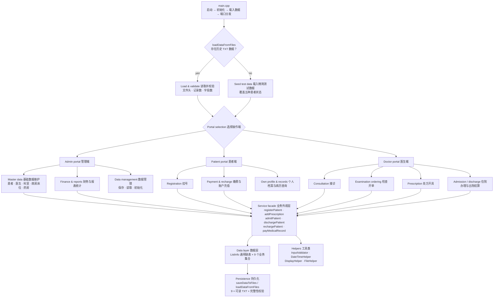
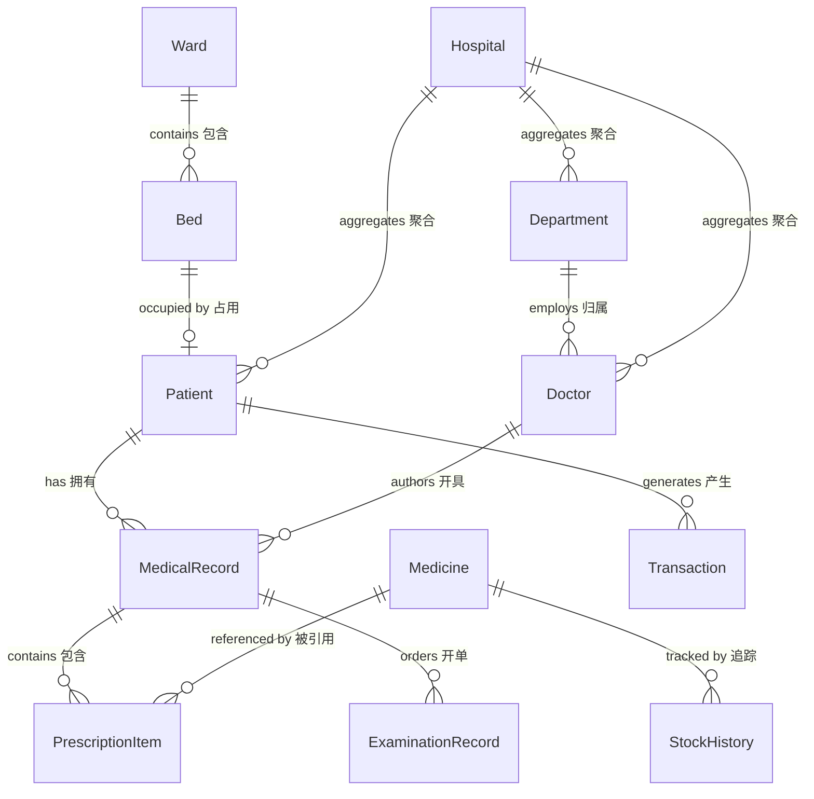
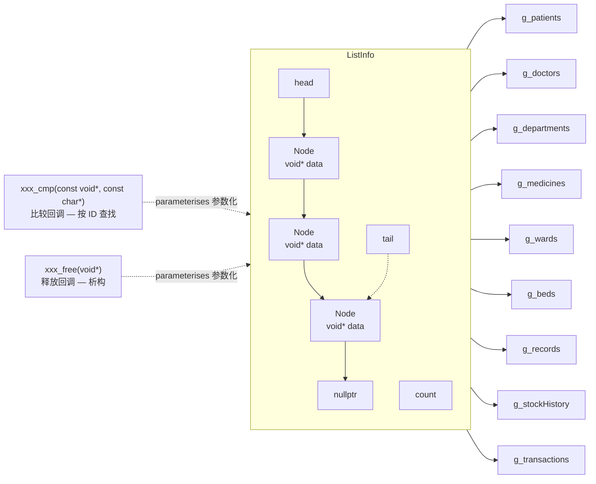
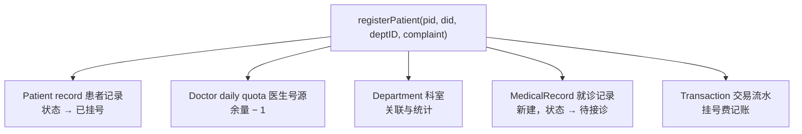

# 05 · Hospital Information System (HIS) — Three-Role C++ System
# 05 · 轻量级医院信息管理系统（C++ 三端架构）

> **Period 时间**: March 2025 – May 2026 · **Role 角色**: Team Lead 队长 · **Grade 成绩**: A+
> **Context 背景**: started in the Object-Oriented Programming course (2025), rebuilt as a three-role system for the Fundamentals of Programming course design (2026) 始于面向对象程序设计课程（2025），在程序设计基础课程设计中重构为三端系统（2026）
> **Scale 规模**: ~6.4k lines of C++ · 13 business structs · 9 data collections · no STL containers 约 6,400 行 C++ · 13 个业务结构体 · 9 个数据集合 · 不使用 STL 容器
> **Code 代码**: [`asdf243/hospital-information-system`](https://github.com/asdf243/hospital-information-system) (private 私有)

---

## Contents / 目录

1. [Summary / 摘要](#1-summary--摘要)
2. [The two constraints / 两个约束](#2-the-two-constraints--两个约束)
3. [Architecture / 架构](#3-architecture--架构)
4. [Layered view / 层次划分](#4-layered-view--层次划分)
5. [Domain model / 领域模型](#5-domain-model--领域模型)
6. [The generic linked list / 通用链表](#6-the-generic-linked-list--通用链表)
7. [Service facade / 业务外观层](#7-service-facade--业务外观层)
8. [Validation and persistence / 校验与持久化](#8-validation-and-persistence--校验与持久化)
9. [Retrospective / 复盘](#9-retrospective--复盘)

---

## 1. Summary / 摘要

**EN** — A console hospital information system covering the complete outpatient and inpatient journey: registration → consultation → examination → prescription → admission → discharge → settlement. The second iteration split the original single-menu program into **three independent portals** (admin / patient / doctor) sharing one data layer but exposing different entry points and permissions, mirroring how roles are separated in an actual hospital.

**中文** — 覆盖完整就医流程（挂号 → 接诊 → 检查 → 处方 → 住院 → 出院 → 结算）的命令行医院信息系统。第二版把原本的单一综合菜单重构为 **三个独立操作端**（管理端 / 患者端 / 医生端）：共享同一套数据层，但入口与权限分离，贴近真实医院的岗位分工。

---

## 2. The two constraints / 两个约束

Both constraints came from the course, and both turned out to be the most instructive part of the project:
两个约束都来自课程要求，而它们恰恰是项目中最有教益的部分：

| Constraint 约束 | Naive response 朴素应对 | What we did instead 实际做法 |
|---|---|---|
| **No STL containers 不得使用 STL 容器** | Write nine separate linked lists, one per entity type 为九类实体各写一套链表 | One generic list parameterised by callbacks — §6 一套由回调参数化的通用链表 |
| **Data must be inspectable at the defence 答辩时数据需可人工核查** | Add a dump utility for the binary format 为二进制格式加一个导出工具 | Move persistence itself to validated human-readable TXT — §8 把持久化本身改为带校验的可读 TXT |

The first constraint is the real content of a data-structures exercise: without `std::vector` and `std::map`, the design question becomes *how do you avoid writing the same container nine times in a language without templates in your toolbox yet*. The second forced the persistence layer to be defensive, because a readable format is also an editable one — a hand-edited file must not be able to corrupt the in-memory state.
第一个约束才是数据结构训练的真正内容：没有 `std::vector` 和 `std::map` 之后，设计问题变成"在还不能用模板的前提下，如何避免把同一个容器写九遍"。第二个约束迫使持久化层变得防御性——可读的格式同时也是可编辑的格式，手工改过的文件不能有机会破坏内存中的状态。

---

## 3. Architecture / 架构



### The three portals / 三端划分

| Portal 操作端 | Who 使用者 | Scope 职责范围 | Why separate 分离理由 |
|---|---|---|---|
| **Admin 管理端** | Hospital administration 院方管理 | Master data, finance, reports, data management 基础数据、财务、报表、数据管理 | Provides the operating basis for the other two portals; demonstrated first 为另外两端提供运行基础，答辩时最先演示 |
| **Patient 患者端** | Patients 患者 | Registration, payment, own records 挂号、缴费、个人记录 | Must see only its own data — the narrowest permission surface 只能看到自己的数据——权限面最窄 |
| **Doctor 医生端** | Clinicians 医生 | Consultation, examination, prescription, admission/discharge 接诊、检查、处方、住院出院 | Core clinical workflow; the longest state chain 核心诊疗流程，状态链最长 |

All three share the same underlying collections and business functions; what differs is the entry point and the permitted operations. That separation is the whole point of the second iteration — the first version could do everything the second can, but every capability was reachable from one undifferentiated menu.
三端共享同一套底层集合与业务函数，区别只在入口与可执行的操作。这一分离正是第二版重构的全部要点——第一版功能上无所不能，但所有能力都从同一个无差别菜单可达。

---

## 4. Layered view / 层次划分

| Layer 层 | File 文件 | Lines 行数 | Responsibility 职责 |
|---|---|---|---|
| **Entry & routing 入口与路由** | `main.cpp` | 404 | Bootstraps hospital state, loads or seeds data, dispatches to portals 初始化状态、载入或播种数据、分发到三端 |
| **Presentation 表示层** | `menu.cpp` | 2,282 | Ten menu screens: main, patient, doctor, department, ward, pharmacy, medical record, finance, report, data 十个菜单屏。Input capture and error messaging only — never touches the global lists directly 只负责输入采集与错误提示，不直接操作全局链表 |
| **Service facade 业务外观层** | `his.cpp` | 2,819 | Cross-module transactions and all business invariants 跨模块事务与全部业务不变式 |
| **Domain model 领域模型** | `his.h` | 789 | 13 business structs + 4 helper classes 13 个业务结构体 + 4 个工具类 |
| **Data structure 数据结构** | `c_list.cpp/.h` | 130 | One generic singly linked list 一套通用单链表 |

Note the shape: the presentation layer is large (many screens) but shallow, the facade is where the difficulty is concentrated, and the data structure is 130 lines serving nine collections. That is the intended distribution.
注意这个形状：表示层很大（屏幕多）但很浅，难度集中在外观层，而数据结构只有 130 行却服务九个集合。这正是期望中的分布。

---

## 5. Domain model / 领域模型



| Struct 结构体 | Role 作用 |
|---|---|
| `Patient` | Demographics, account balance, admission state 基本信息、账户余额、住院状态 |
| `Doctor` | Profile, department, daily quota 信息、所属科室、号源 |
| `Department` | Clinical department 科室 |
| `Medicine` | Drug catalogue and stock level 药品目录与库存 |
| `PrescriptionItem` | One prescribed line item 单条处方明细 |
| `MedicalRecord` | A visit: complaint, diagnosis, items, settlement state 一次就诊：主诉、诊断、明细、结算状态 |
| `ExaminationRecord` | An ordered examination 一次检查 |
| `Ward` / `Bed` | Ward and bed with occupancy state 病房与床位及占用状态 |
| `Transaction` | Financial ledger entry 交易流水 |
| `StockHistory` | Drug stock movement 药品库存流水 |
| `DateTime` | Date/time value type 日期时间值类型 |
| `Hospital` | Aggregate root holding all collections 聚合根，持有全部集合 |

Helper classes 工具类: `InputValidator` · `DateTimeHelper` · `DisplayHelper` · `FileHelper`

---

## 6. The generic linked list / 通用链表

The design problem: nine heterogeneous entity types, no STL, and no appetite for nine near-identical list implementations.
设计问题：九类异构实体、不能用 STL、又不愿写九套近乎相同的链表。



`Node` holds a `void* data`; `ListInfo` holds `head`, `tail` and `count`. Type-specific behaviour is injected through two function pointers:
`Node` 持有 `void* data`；`ListInfo` 持有 `head`、`tail`、`count`。类型相关的行为通过两个函数指针注入：

```
int  patient_cmp(const void* data, const char* id);   // lookup by ID 按 ID 查找
void patient_free(void* data);                        // destruction 析构
```

Adding a new business entity means writing two five-line callbacks — not another container. This is the C-style analogue of a template container, and making that analogy explicit was the point of the exercise: it is the same separation of *structure* from *element type* that templates provide, achieved with indirection instead of code generation.
新增一类业务实体只需写两个五行回调，而不是再写一个容器。这是模板容器的 C 风格对应物，而把这个对应关系讲清楚正是本次练习的意义：它实现的是模板所提供的同一种"结构与元素类型分离"，只是用间接寻址而非代码生成来达成。

**Trade-off / 代价**: type safety is lost at the boundary — a `void*` will happily accept the wrong type and fail at runtime instead of compile time. The mitigation is that every collection is only ever accessed through typed accessor functions in the facade layer, so raw `void*` handling never escapes the data layer.
**代价**：边界处失去类型安全——`void*` 会欣然接受错误类型，在运行期而非编译期失败。缓解方式是所有集合只经由外观层中的类型化访问函数使用，裸 `void*` 的处理不逸出数据层。

---

## 7. Service facade / 业务外观层

Registration is the clearest example of why this layer exists. A single "register patient" action touches **five** pieces of state:
挂号是这一层存在理由的最清晰例子。一个"挂号"动作牵涉**五处**状态：



Before the refactor, each menu branch performed these five updates inline — which meant five opportunities per call site to forget one, and no single place to read the invariant. Afterwards the menu calls `registerPatient(...)` and the consistency rules live in exactly one function.
重构前，每个菜单分支都内联执行这五处更新——意味着每个调用点都有五次遗漏机会，而且没有任何一个地方能读到完整的不变式。重构后菜单只调 `registerPatient(...)`，一致性规则恰好存在于一个函数中。

| Facade function 外观函数 | State touched 涉及状态 |
|---|---|
| `registerPatient` | Patient · Doctor quota · Department · MedicalRecord · Transaction |
| `addPrescription` | MedicalRecord · PrescriptionItem · Medicine stock · StockHistory |
| `admitPatient` | Patient state · Bed occupancy · Ward · deposit Transaction |
| `dischargePatient` | Bed release · settlement · MedicalRecord closure · Transaction |
| `rechargePatient` | Patient balance · Transaction |
| `payMedicalRecord` | MedicalRecord settlement state · Patient balance · Transaction |

---

## 8. Validation and persistence / 校验与持久化

### Defensive input validation / 防御式输入校验

The rule adopted: **no illegal input ever reaches the data layer.** `InputValidator` gates menu choices, names, phone numbers, ID numbers, amounts, quantities, dates, stock levels, bed availability and patient admission state, rejecting invalid entries at the boundary with a specific message rather than a generic failure.
采纳的规则是：**任何非法输入都不得到达数据层。** `InputValidator` 对菜单选项、姓名、电话、身份证、金额、数量、日期、库存、床位可用性与患者住院状态逐项把关，在边界处以具体信息拒绝，而非笼统报错。

### Readable persistence with integrity checks / 可读持久化与完整性校验

Nine `.dat` files in a human-readable text format. Loading verifies, in order: **file header → record count → per-record field count → basic field format**, and rejects malformed records individually rather than aborting or, worse, inserting partial state.
九个人类可读的 `.dat` 文本文件。载入时依序校验：**文件头 → 记录数 → 每条记录的字段数 → 字段基本格式**，并逐条拒绝畸形记录，而不是整体失败或（更糟）插入部分状态。

| | Binary (v1) 二进制 | Readable TXT (v2) 可读 TXT |
|---|---|---|
| Inspectable at the defence 答辩可核查 | ✗ | ✓ |
| Hand-editable for test setup 可手工编辑造数据 | ✗ | ✓ |
| Load-time validation possible 载入可校验 | Limited 有限 | ✓ |
| File size 文件体积 | Smaller 更小 | Larger 更大 |
| Parse speed 解析速度 | Faster 更快 | Slower 更慢 |

At this data scale the last two rows are irrelevant and the first three are decisive.
在本项目的数据规模下，后两行无关紧要，前三行是决定性的。

### Test data covering all five states / 覆盖五种状态的测试数据

The seeded dataset deliberately contains one patient in each state, so a defence demo can exercise every branch across the three portals with no setup:
播种数据刻意为每种状态各安排一位患者，使答辩演示无需任何准备即可跑通三端所有分支：

1. Registered, not yet seen 已挂号未诊疗
2. Seen, not yet examined 已接诊未检查
3. Admitted, not yet discharged 已住院未出院
4. Outpatient flow complete 门诊全流程完成
5. Inpatient flow complete 住院全流程完成

---

## 9. Retrospective / 复盘

**What worked 有效的做法**
- **One generic container instead of nine.** The callback-parameterised list is the single design decision that kept a 6.4k-line program from becoming a 10k-line one, and it is the part of the project that best demonstrates understanding rather than effort. **一套通用容器而非九套。** 回调参数化的链表是让这个 6,400 行程序没有变成 10,000 行的关键决策，也是项目中最能体现"理解"而非"工作量"的部分。
- **Facade before features.** Pulling cross-module transactions into named functions made the second iteration's three-portal split almost mechanical — the portals differ in entry and permission, not in business logic. **先做外观层，再加功能。** 把跨模块事务提取为具名函数后，第二版的三端拆分几乎是机械性的——三端的差异在入口与权限，而非业务逻辑。
- **Test data designed for demonstration.** Covering all five patient states meant the defence never needed setup steps. **为演示设计的测试数据。** 覆盖五种状态意味着答辩时不需要任何准备步骤。

**What I would do differently 会改进的地方**
- **Type-safe wrappers over the `void*` list.** Even without templates, per-type inline wrapper functions would have moved a class of errors from runtime to compile time. **为 `void*` 链表加类型安全包装。** 即使不用模板，为每种类型写内联包装函数也能把一类错误从运行期移到编译期。
- **Automated tests.** Verification was manual through the menus; even a small harness driving the facade functions directly would have caught regressions during the rebuild. **自动化测试。** 验证完全靠手工走菜单；哪怕一个直接驱动外观函数的小测试工具，也能在重构期间捕获回归。
- **Split `his.cpp` earlier.** At 2,819 lines it holds the facade, the CRUD operations and persistence together; splitting along those seams would have made the file navigable. **更早拆分 `his.cpp`。** 2,819 行里同时装着外观层、CRUD 与持久化；沿这些接缝拆开会让文件变得可导航。
