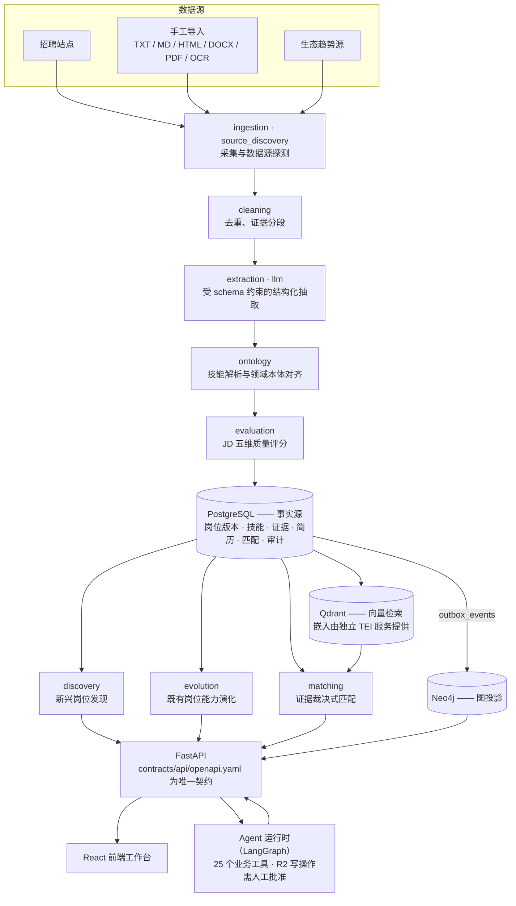
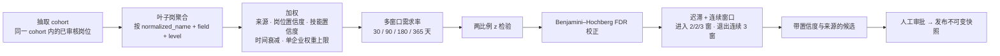
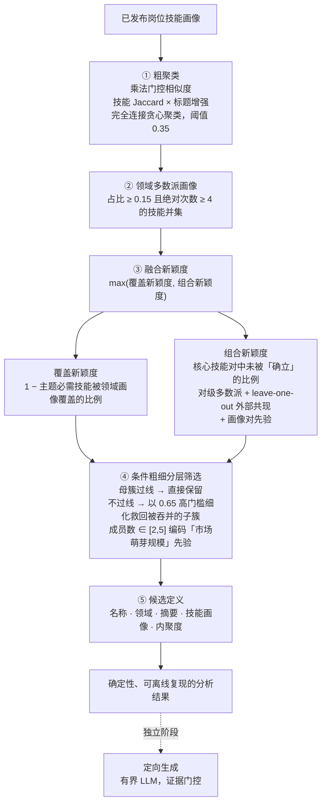
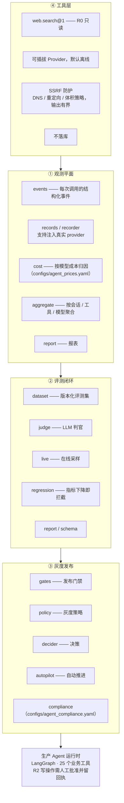

<a href="../../README.zh-CN.md">← 作品集</a> · <a href="../01-artifex.md">English</a>

# 01 · ARTIFEX —— 多源异构数据驱动的岗位与能力图谱构建及动态演化分析系统

| | |
|---|---|
| **时间** | 2026 年 6 月 – 9 月 |
| **角色** | 队长兼核心开发（算法与后端） |
| **背景** | 科大讯飞企业命题 **XH-202621** |
| **团队** | 4 人 |
| **个人贡献** | 48 次提交、391 个文件、新增约 6 万行 |
| **代码** | [`asdf243/artifex-job-competency-graph`](https://github.com/asdf243/artifex-job-competency-graph)（私有） |

---

## 目录

1. [摘要](#一摘要)
2. [问题定义](#二问题定义)
3. [系统架构](#三系统架构)
4. [我负责的模块](#四我负责的模块)
5. [重点：新兴岗位发现算法](#五重点新兴岗位发现算法)
6. [重点：LLM Agent 平台层](#六重点llm-agent-平台层)
7. [评测与数字的边界](#七评测与数字的边界)
8. [工程实践](#八工程实践)
9. [复盘](#九复盘)

---

## 一、摘要

ARTIFEX 从招聘站点与手工导入的多源 JD 出发，经清洗与证据分段、LLM 结构化抽取，构建**以技能点为粒度的岗位—能力图谱**；在此之上发现语料中尚不存在的**新兴岗位**，检测**既有岗位**能力要求随时间的变化，把事实投影为可查询的图谱，并以"逐项要求对照候选人真实经历证据裁决"的方式完成人岗匹配。所有 AI 结论都绑定到来源证据片段，证据不足时系统 **fail-closed**（拒绝输出）而非猜测。

我担任队长并负责算法与后端核心：新兴岗位发现算法、可复现评测契约、既有岗位能力演化检测、简历—岗位匹配基准，以及 LLM Agent 平台层（观测、评测、灰度发布）。

---

## 二、问题定义

赛题要求四项能力。精确表述很重要，因为其中两项远比表面上困难。

| # | 赛题条款 | 难点 |
|---|---|---|
| ① | 多源采集清洗与**新岗位发现** | 「新」没有真值。岗位的"新"是*相对于既有岗位*而言的，因此必须有先验参照系——见第五节 |
| ② | 既有岗位**能力更新** | 区分真实需求变化与采样噪声是统计推断问题，不是计数问题 |
| ③ | 岗位—能力全景图谱 | 保持投影与不断变化的事实源一致 |
| ④ | 简历解析与人岗匹配 | 关键词重合会奖励简历注水；系统必须裁决证据而非统计词频 |

---

## 三、系统架构

### 层次划分

| 层 | 包 | 职责 | 参与度 |
|---|---|---|---|
| **采集** | `ingestion/` | 数据源探测 Worker、批量导入、多格式解析 | 部分 |
| **清洗** | `cleaning/` | 归一化、内容哈希去重、证据分段 | 部分 |
| **抽取** | `extraction/`、`llm/` | 受 schema 约束的有界 LLM 抽取 | 部分 |
| **本体** | `ontology/` | 技能解析、领域与层级本体对齐 | 部分 |
| **发现** | `discovery/` | **新兴岗位发现——第五节** | **主责** |
| **演化** | `evolution/` | **能力演化检测——第 4.2 节** | **主责** |
| **匹配** | `matching/`、`recommendation/` | 证据裁决、差距分析、学习路径 | **基准主责** |
| **图谱** | `graph/`、`storage/neo4j/` | 基于 Outbox 的 Neo4j 投影 | 部分 |
| **智能体** | `agent/` | **观测、评测、灰度——第六节** | **主责** |
| **评测** | `evaluation/`、`tools/` | **可复现评测契约——第七节** | **主责** |
| **接口** | `api/`、`contracts/` | 契约优先的 FastAPI，OpenAPI 为唯一权威 | 共同 |

**技术栈**：Python 3.12 · FastAPI · SQLAlchemy + Alembic · Dishka（依赖注入）· LangGraph · PostgreSQL 17 · Neo4j 5.26 · Qdrant + Text Embeddings Inference（BAAI/bge-m3）· React 19 + TypeScript + Vite + Tailwind · Docker Compose · pytest（70% 覆盖率门禁）

---

## 四、我负责的模块

### 4.1 新兴岗位发现 → [第五节](#五重点新兴岗位发现算法)

### 4.2 既有岗位能力演化检测

**问题。** 某项技能在本季度 JD 中出现得比上季度多，可能是市场真实变化，也可能是采样噪声；同时检验成千上万个技能时，总有一些会偶然"显著"。

值得展开的设计点：

- **迟滞而非单一阈值。** 进入与退出使用不同阈值且要求连续窗口，避免边界附近的技能在岗位画像中反复进出。
- **单企业权重上限。** 一家公司把同一岗位发布 200 次，不得因此制造出"市场趋势"。
- **泛化词只作为上下文。** 模糊词汇被记录为观测，但不能单独进入能力画像。
- **每条结论都带来源。** 每个检测到的变化都附带产生它的证据与置信度。

交付：`analyze` / `latest` / `approve` 契约闭环、数据库迁移 `0052`、20 项单元测试。

### 4.3 简历—岗位匹配算法基准

对 **12 种算法**——Jaccard、TF-IDF 余弦、BM25、字符 n-gram TF-IDF、技能加权匹配、技能覆盖度、内容过滤 + 协同过滤、LSA/SVD、编辑距离、监督分类、同义词/本体扩展、加权投票集成——在 13 份简历 × 10 个 JD 上做标准化对比。

使基准有信息量的是**极限难例集**：刻意夸大的简历（声称吞吐量 10 倍、自研替代 Kafka、效率提升 500%）、关键词堆砌的简历（声称 18 项技能实际只用 3 项）、跨域模糊简历，以及完全不相关的负例。纯词频方法（TF-IDF、LSA、BM25）在极限难例上 Top-1 为 **0**——它们恰好奖励难例中的注水行为——而技能词表与监督分类方法则稳定得多。

监督部分：TF-IDF（jieba 分词、1–2 gram、8,000 维、sublinear TF）+ **LinearSVC**（`class_weight='balanced'`），在 **16,935 条真实 JD、31 个类别**上训练。把朴素贝叶斯换成线性 SVM 使 5 折交叉验证准确率从 0.704 提升到 **0.763**；原因可诊断而非纯经验——朴素贝叶斯假设特征条件独立，而真实 JD 中的技能词强相关（"后端" ↔ "Java" ↔ "Spring"），该假设被直接破坏。

四维**简历信度评分**（声明具体性、内容深度、关键词覆盖率、红牌惩罚）识别注水，MAE 0.143、与人工评分相关系数 0.776。

> ⚠️ **状态**：该基准是**历史离线对比**。生产匹配策略后来改为按岗位要求逐项裁决候选人真实项目、实习与工作经历的 `evidence-grounded/2.x`。基准数字描述的是基准本身，不是上线系统。

### 4.4 后端基础设施

按 OpenAPI 契约实现岗位 API（五个端点）、导入去重与数据库完整性约束、Qdrant 客户端生命周期与健康检查、图谱查询与快照导出端点、Request-ID 中间件与统一错误处理；13 个测试文件仍在主干。

---

## 五、重点：新兴岗位发现算法

### 5.1 对称陷阱

显而易见的做法是离群检测：把岗位聚类，标记与其他簇不相似的簇。这个做法有一个容易被忽略的失败模式：

> 假设语料只含两类岗位——*RAG 工程师*与 *Java 开发工程师*，二者互不相似。移除其中任何一个，**剩下的那个都会因"孤立"而被判为新颖**。但 *Java 开发*是极其常见的岗位。

结论：新颖性**不能**由语料内部的相对位置定义，必须有一个外部参照系——"什么算已确立"的先验。

### 5.2 先验：领域多数派技能画像

对每个已发布领域，取该领域岗位中**出现频次占比**超过阈值（默认 0.15，并设绝对下限 4 次）的技能并集，作为该领域的**画像（signature）**——即"本领域主流岗位需要什么"的经验描述。

为什么选它：

- **可解释** —— 一个技能是否"常见"由频次占比决定，而非潜空间坐标。
- **数据自给** —— 只依赖已发布/已批准岗位，不需要外部行业知识库。
- **可复现** —— 频次统计是确定性的，同一份数据总得到同一份画像。

### 5.3 算法流水线

### 5.4 保守原则

**缺证据 ≠ 新颖。** 当某主题没有必需技能、或所在领域没有画像先验（冷启动、小语料）时，新颖度按 **0.0** 处理，不报出。

早期版本（≤1.2）在此返回 `1.0`——"不确定就报出来让人复核"。实践中这是系统性误报：无技能画像的岗位、冷启动语料下的全部主题都会被判新兴，人工复核队列被噪声淹没。由于候选默认状态是 `needs_review`，多报直接让队列彻底失去可用性。翻转这一个默认值是迭代日志中收益最大的单项改动之一。

### 5.5 迭代记录

18 轮迭代，每轮重跑完整评测：

| 轮次 | 关键改动 | 端到端 F1 |
|---|---|---|
| r1（基线） | 复测 1.2 版行为 | 0.000（P = 0.08，全为误报） |
| r3 | 单连接 → 完全连接贪心聚类 | 0.31 |
| r4–r5 | leave-one-out 外部共现 + 成员门控 | 0.45 |
| r7 | 线性融合 → max 融合 + 画像对先验 | 0.62 |
| r10–r11 | 条件粗细分层 + 参数扫描定门槛（0.65 / 0.35 / 0.65） | 0.89 |
| r13 | 评测数据注入通用技能（Git/Linux/Docker），消除过乐观 | 0.89（更难的语料） |
| r15 | 画像占比 0.4 → 0.15 + 绝对下限 4 | 0.93 |
| r16–r18 | 默认参数冻结 + 复验 | **0.964** |

聚类质量同步改善：过度合并率 1.0 → 0.51，纯度 0.04 → 0.65。剩余的 0.51 是有意的权衡——渐进演化的主题与常规主题天然相邻，强行分开带来的漏报代价高于收益。

---

## 六、重点：LLM Agent 平台层

四个子系统，共同让一个 LLM Agent 变得**可运维**而不只是**能运行**：

| 子系统 | 存在理由 | 命令行工具 |
|---|---|---|
| **观测** | 没有按模型的成本归因，"Agent 很贵"无法转化为行动。recorder 必须支持注入真实 provider，否则成本归因是对着 mock 测的，结果根本不对 | `tools/agent_observe.py` |
| **评测** | 版本化评测集 + LLM 判官 + 回归门禁，把"Agent 变差了"从用户反馈变成 CI 失败 | `tools/agent_eval.py` |
| **灰度** | 门禁、策略与决策器，让"升级 Agent 版本"成为有记录标准的决策而非拍脑袋 | `tools/agent_rollout.py` |
| **工具** | 外部网络访问是风险最高的工具类别；该工具只读、默认离线、SSRF 加固、输出有界、从不落库 | `tools/agent_verify.py` |

---

## 七、评测与数字的边界

本节存在的理由是：这是我最希望导师审视的部分。

### 7.1 评测契约

把散落的一次性评测脚本收敛为**可复现契约**，并可接入 CI 门禁：

| 组件 | 作用 |
|---|---|
| `EVAL_CONTRACT_VERSION` | 契约自身版本化 |
| `GoldenLabelSet` + `golden_fingerprint` | 顺序无关、版本敏感的金标指纹——重排标签不改变指纹，改变内容则改变 |
| `parse_golden` / `read_golden` | 兼容裸布尔值与 `{"emerging": bool, "reason": ...}` 两种格式；其他输入抛 `GoldenFormatError` |
| `EmergingEvalGate` + `check_gate` | 逐项 PASS/FAIL 并报告缺口；门限设在当前基线下方约 20%，语义是*回归检测*而非质量声明 |
| 固定种子（7）、30 次 bootstrap | 稳定性是测出来的，不是假设的 |
| `--review-batch` | 周期性人工抽检数据单 |
| `--check` 退出码 1 | 任一指标低于门限即构建失败 |

### 7.2 合成数据与真实数据

| 设定 | 结果 | 含义 |
|---|---|---|
| **合成端到端评测**（v1.3） | P 0.933 · R 1.000 · **F1 0.964** · FPR 0.019 | 在人工构造真值的数据上，算法按设计工作 |
| **81 条真实 JD，规则线**（golden g1） | P **0.158** · R 1.000 · F1 0.273 · bootstrap Jaccard 0.242 | 真实市场数据上规则线严重多报：召回完美，精确率不行 |
| **81 条真实 JD，LLM 线** | F1 ≈ 0.55–0.86（跑次间有方差） | 更好，但不确定。语料从 70 条增至 81 条时 F1 从约 1.0 回落到 0.5–0.86——契约如实记录该方差，并以刻意宽松的下限 0.45 拦截回归 |

**两者都报告。** 0.964 属于合成基准，在所有出现的地方都如此标注，它不是对真实世界准确率的声明。把差距暴露出来、并让评测体系在语料增长时自动暴露这种差距，才是这部分工作的真正贡献。

### 7.3 一个改变了全部结果的 bug

在简历匹配基准中，类别预测（英文 `field`）被直接与标签（中文 `label`）比较，导致分类准确率**恒为 0**——而基于它的对比结果已经写进了报告。发现后我修复比较逻辑、重跑全部实验、订正所有已发布结果（报告 v3）。同一轮还修复了三处：分类器描述错误（文档写朴素贝叶斯，实际是 LinearSVC）、硬编码路径影响可移植性、`set` 与 `list` 的迭代顺序差异导致合成简历语言选择不确定、结果跑次间不稳定。

---

## 八、工程实践

| 实践 | 落实 |
|---|---|
| **契约优先** | `contracts/api/openapi.yaml` 是前后端唯一权威；契约漂移是构建失败，而不是会议议题 |
| **证据绑定** | 每条 AI 结论链接到来源证据片段；证据不足即 fail-closed |
| **不可变版本** | 能力更新发布新的不可变 `JobVersion`，而非就地修改当前版本 |
| **Outbox 模式** | PostgreSQL 保持为事实源；Neo4j 是由 `outbox_events` 驱动的投影 |
| **数据库迁移** | `database/postgres/migrations/` 下的 Alembic 链；schema 变更与代码变更同步交付 |
| **CI 门禁** | `ruff` lint；pytest 配 **70% 综合覆盖率门禁**；Worker 协调与 Agent 控制平面的集成测试；前端 statements/lines/functions/branches 覆盖率均 ≥ 60% |
| **权限分级** | Agent 工具按 R0–R2 分级；R2（写）操作需人工批准并留回执 |
| **可复现部署** | 单条 `docker compose up` 拉起前端、后端、迁移、postgres、neo4j、qdrant 与嵌入服务，另有可选的本地 vLLM LoRA 配置 |

---

## 九、复盘

**有效的做法**

- **把新颖性检测当作*先验*问题而非*距离*问题。** 对称陷阱在被表述出来之前并不显然，而正确表述它的价值超过之后任何调参。
- **每轮记录 F1。** 18 轮之后，这份日志是区分"这个改动有效"与"这个改动恰好赶上了改善"的唯一依据。
- **在语料扩张*之前*建好评测契约。** 这是 70 → 81 条时的回归被门禁而非用户发现的原因。

**会改进的地方**

- **更早引入真实数据。** 合成基准驱动了 18 轮调优，之后真实 JD 才暴露出 0.158 的精确率——其中相当一部分调优是在为非目标分布优化。
- **更早区分"分析链"与"产品链"。** 两者纠缠过久，分析链最终整体下线而其算法内核被产品链复用；更早识别这一分野可以减少返工。
- **更廉价的 LLM 评测。** LLM 线的跑次间方差迫使回归门限设得很宽松；用更大的金标集配合配对样本比较，可以在可接受成本下收紧上下界。

---

*系统整体的团队验收结果——JD 解析契约门控语义正确率 94.00%；简历解析两次全量 0.9624 / 0.9670（100 份 PDF）；人岗匹配准确率 0.980、macro-F1 0.980；Agent 200 条测试集严格成功率 92.0%——属于四人团队的共同成果，非个人成果。*
