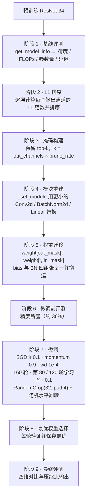
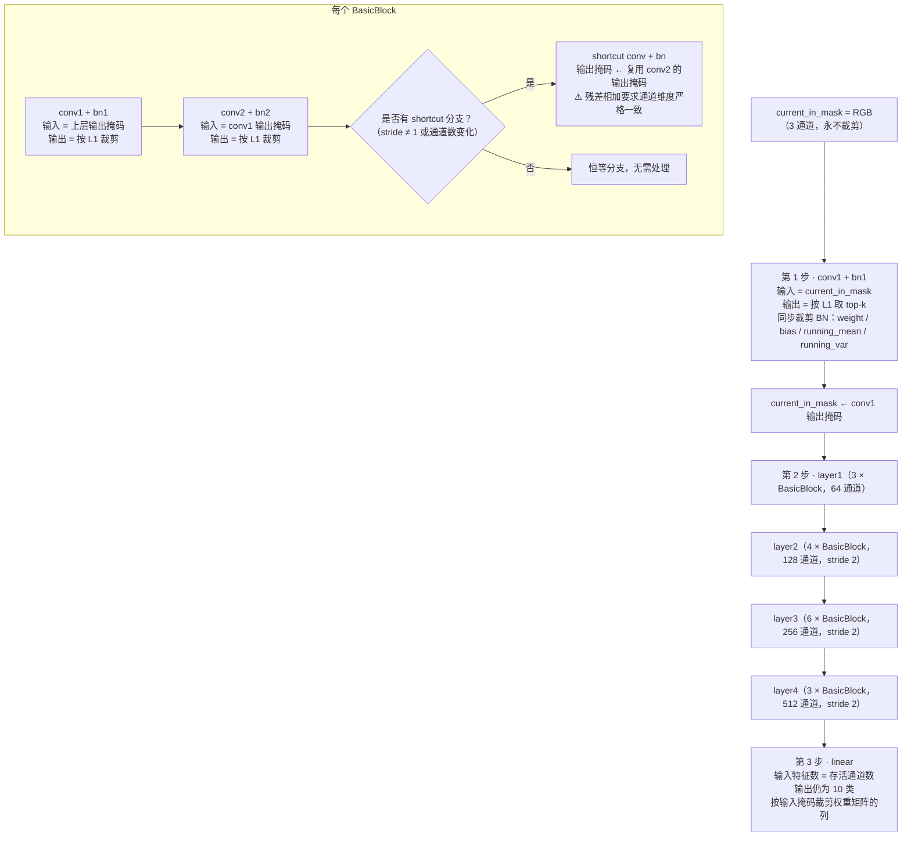

<a href="../../README.zh-CN.md">← 作品集</a> · <a href="../02-dnn-inference-optimization.md">English</a>

# 02 · 资源受限设备上的深度神经网络推理优化设计与实现

| | |
|---|---|
| **时间** | 2026 年 4 月 – 7 月 |
| **角色** | 独立完成 |
| **项目** | 吉林大学边缘智能中心 开放性创新实验 |
| **成绩** | A+ |
| **代码** | [`Hanwen-Tao/dnn-inference-optimization`](https://github.com/Hanwen-Tao/dnn-inference-optimization)（私有——可应要求开放） |

---

## 目录

1. [摘要](#一摘要)
2. [为什么选结构化剪枝](#二为什么选结构化剪枝)
3. [技术路径](#三技术路径)
4. [层次划分](#四层次划分)
5. [三个结构约束](#五三个结构约束)
6. [实验结果](#六实验结果)
7. [测量方法](#七测量方法)
8. [局限与后续方向](#八局限与后续方向)

---

## 一、摘要

用 PyTorch 实现的端到端结构化模型压缩流水线：按 L1 范数对训练好的 ResNet-34 的每个卷积核排序，物理删除一半通道，以正确的权重迁移重建更小的网络，再微调恢复精度。CIFAR-10 上 50% 通道保留率下，参数量 21.28M → 5.33M、计算量 1.16G → 0.29G（均 −75%），top-1 精度 95.70% → 91.84%。

---

## 二、为什么选结构化剪枝

非结构化与结构化剪枝之间的选择是本项目第一个真正的决策，而决定它的是部署目标而非精度。

| | 非结构化（权重级） | 结构化（通道级） |
|---|---|---|
| 删除对象 | 单个权重 | 整个卷积核 / 通道 |
| 张量形状 | 不变，零散分布零值 | 真正变小 |
| 加速前提 | 稀疏算子 + 专用运行时 | **无需任何前提，标准运行时即可** |
| 同压缩率下精度 | 通常更高 | 通常略低 |
| 适合边缘部署 | 需专用硬件支持 | **是** |

既然项目前提是"资源受限设备"，结构化剪枝是唯一能在没有稀疏张量栈的设备上真正兑现加速的方案。以略大的精度损失换取无条件可部署性，是本项目的核心权衡。

### 重要性判据

对输出通道 *i*：`L1_norm[i] = Σ |weight[i, :, :, :]|`。权重整体接近零的卷积核对该层输出贡献小，可较安全地删除。

L1 是最廉价且站得住脚的判据——不需要梯度、不需要前向数据、完全确定性——因此适合作为尝试更昂贵方法（泰勒展开、基于梯度的显著性、可学习门控）之前的**基线**。先立廉价基线是有意的方法论选择，而非能力局限。

---

## 三、技术路径

### 剪枝主过程细节

---

## 四、层次划分

| 层 | 模块 | 职责 |
|---|---|---|
| **模型定义** | `resnet.py` | 适配 CIFAR 的 ResNet：`BasicBlock`（expansion 1）、`Bottleneck`（expansion 4）、`ResNet` 与 `resnet18/34/50/101/152` 构造函数。与 ImageNet 版的区别在 conv1（3×3、stride 1、无最大池化），适配 32×32 输入 |
| **数据与指标** | `utils.py` | `get_dataset`——CIFAR-10/100，含各数据集归一化常数、训练期 RandomCrop(32, pad 4) + 水平翻转、评测期仅归一化；`get_model_accuarcy`——验证集 top-1 |
| **剪枝算法** | `main.py :: l1_structured_prune` | L1 排序、掩码构建、经 `_set_module` 替换模块、权重迁移，以及三个结构约束的执行（第五节） |
| **测量** | `main.py :: get_model_info` | 统一工具：经 `thop.profile` 得到精度、FLOPs 与参数量，外加推理延迟——每个变体的测量方式完全一致（第七节） |
| **实验驱动** | `main.py :: __main__` | 上述九个阶段，最后输出四维对比与压缩比 |
| **交互式复现** | `pruning_pytorch_tools.ipynb` | 同一流水线的分步版本，保留运行输出 |

---

## 五、三个结构约束

在普通卷积堆叠上做通道剪枝只是记账；在**残差**网络上不是，因为三个不变式必须同时成立，否则网络会在不报错的情况下输出错误结果。

### 5.1 掩码传递

某层的**输入**掩码必须等于上一层的**输出**掩码。一个 `current_in_mask` 变量贯穿全网前向传递，保证相邻层通道维度始终一致。这一条做错会立刻抛形状错误——属于*友好*的失败模式。

### 5.2 残差对齐

在下采样残差块中，shortcut 分支的输出通道必须与主路径 `conv2` 的输出一致，否则残差相加失败。因此 shortcut **直接复用 `conv2` 的输出掩码**，而不独立计算 L1 排序——它没有自由选择"最重要通道"的权利，因为它的职责是"能与主路径相加"。

### 5.3 BN 统计量随卷积一起搬运

每个 `BatchNorm2d` 携带四组逐通道张量：`weight`、`bias`、`running_mean`、`running_var`。裁剪卷积输出通道而不同步裁剪 BN 对应项，会得到一个**能正常运行但输出错误**的网络——这是危险的失败模式，因为不会抛异常。实现中每个 BN 都与其卷积一同重建，并保留 `momentum`。

---

## 六、实验结果

| 指标 | 原模型 | 剪枝后未微调 | 剪枝并微调后 | 变化 |
|---|---|---|---|---|
| Top-1 精度 | **95.70%** | 约 35.9% | **91.84%** | −3.86 个百分点 |
| 参数量 | 21.28 M | 5.33 M | 5.33 M | **−74.9%** |
| 计算量（FLOPs） | 1.16 G | 0.29 G | 0.29 G | **−74.9%** |
| 通道保留率 | 100% | 50% | 50% | — |

### 微调轨迹

| 轮次 | Top-1 | 说明 |
|---|---|---|
| 1 | 35.89% | 剪枝后断崖 |
| 2–10 | 43.55% → 77.76% | 快速恢复期 |
| 11 | 79.30% | — |
| 约 80 | **> 90%** | **首次学习率衰减（×0.1）** |
| 约 120 | — | 第二次学习率衰减 |
| 160 | **91.84%** | 收敛（最优 91.89%） |

### 两个有价值的观察

1. **断崖。** 删掉一半通道使精度从 95.70% 跌至约 36%——即使每个被删的卷积核单独看都"不重要"，剪枝仍破坏了特征之间的配比关系。重要性不可加。
2. **陡升。** 精度在首次学习率衰减后立刻越过 90%，而非在此之前逐步爬升。存活的卷积核保留了足够结构，微调主要需要的是更小的步长去收敛，而不是大量重新学习。

---

## 七、测量方法

每个变体的四项指标都由同一个工具 `get_model_info` 产出，确保任何对比都不会混用测量方法。

| 维度 | 测量方式 | 注意 |
|---|---|---|
| Top-1 精度 | 完整 CIFAR-10 验证集（10,000 张） | 确定性 |
| FLOPs | 对单个 1×3×32×32 输入调用 `thop.profile` | 是成本代理，不等于延迟预测 |
| 参数量 | `thop.profile` | 直接决定模型文件大小 |
| 推理延迟 | 评测设备上的墙钟时间 | 依赖设备与 batch，仅用于相对比较 |

**基线数字是重新测得的，不是抄来的。** 原始实验记录只保存了剪枝后模型的指标；此处引用的基线 ResNet-34 数字（95.70% / 21.28M / 1.16G）是用同一工具重跑 checkpoint 得到的——这也是 −75% / −3.86pt 这些对比能够成立的前提。

---

## 八、局限与后续方向

### 已知局限

| 局限 | 影响 |
|---|---|
| **全网统一 50% 剪枝率** | 几乎必然次优。早期层提取被下游共享的低级特征，通常比后期层敏感得多；统一比例会过度剪早期层、剪不够后期层 |
| **用 FLOPs 代理效率** | 真实边缘硬件上，内存带宽与算子启动开销常占主导；FLOPs −75% 不保证 4× 加速 |
| **单一压缩维度** | 只做了剪枝，量化与蒸馏仅做调研未实验 |
| **单一数据集与架构** | 仅 CIFAR-10 + ResNet-34，未验证对其他任务与拓扑的泛化 |

### 后续方向

本项目的自然延伸，也是我在边缘智能方向专题研究的计划：

1. **训练后 INT8 量化**——与剪枝乘性叠加（结构上约 4× 之上再叠精度上的约 4×），且是纯整数边缘加速器的实际要求。
2. **知识蒸馏**——以未剪枝的 ResNet-34 为教师，恢复比普通微调更多的那 3.86 个百分点。
3. **逐层敏感度剪枝率**——测量各层的精度敏感度后按需分配剪枝预算，而非统一比例。
4. **端侧延迟实测**——验证 FLOPs 下降是否真的在受限硬件上转化为墙钟加速。
