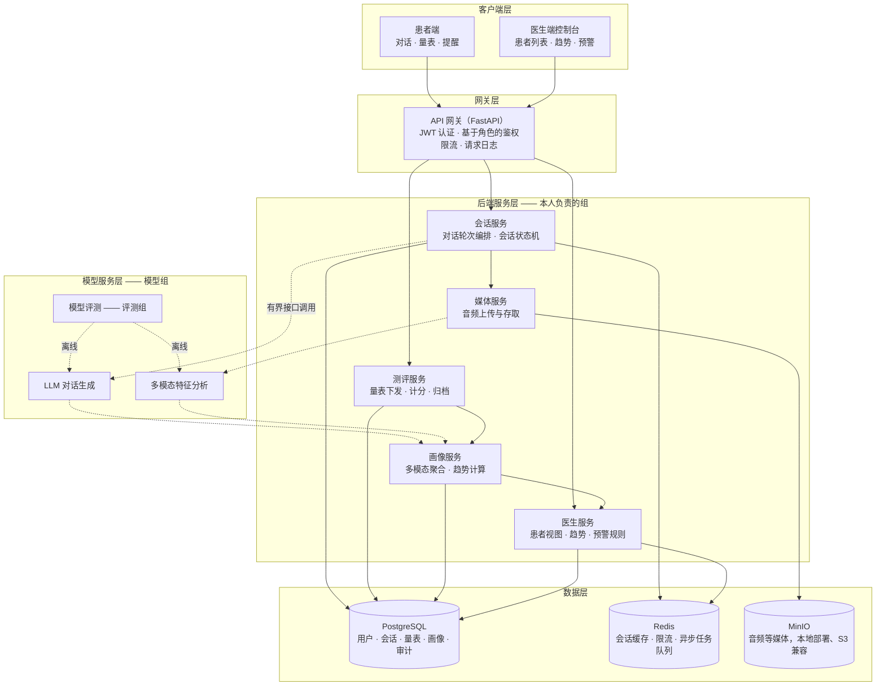
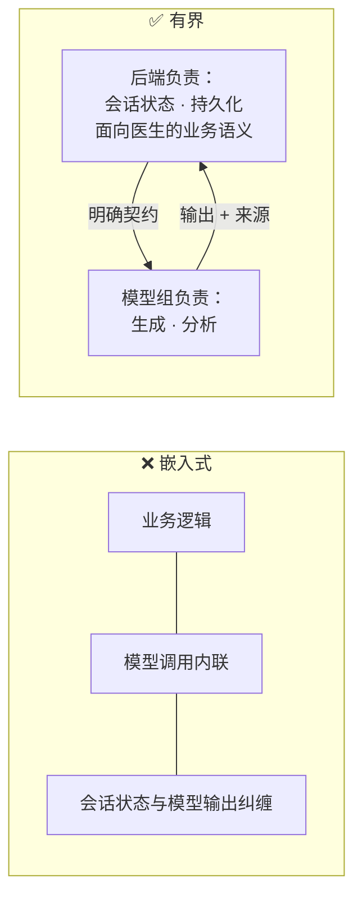
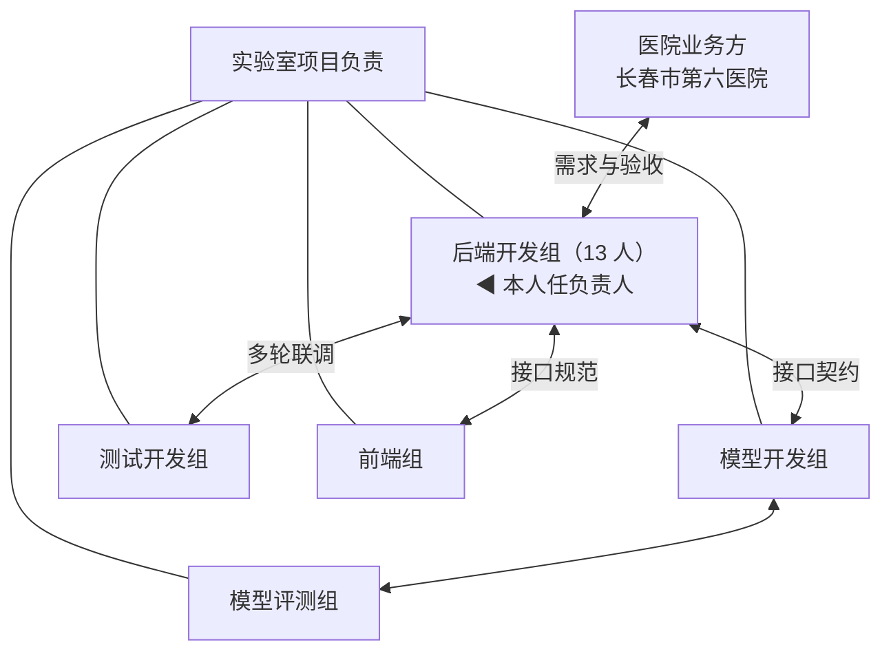

<a href="../../README.zh-CN.md">← 作品集</a> · <a href="../03-mental-health-digital-twin.md">English</a>

# 03 · 心镜智语 —— 基于大语言模型的多模态心理健康数字孪生平台

| | |
|---|---|
| **时间** | 2025 年 5 月 – 11 月 |
| **角色** | 后端开发组负责人 |
| **合作方** | 吉林大学虚拟现实梦工场实验室 × 长春市第六医院 |
| **规模** | 13 人后端团队；五方协作 |
| **结果** | 已投入医院实际生产使用 · 吉林大学双创训练计划**优秀结题** |
| **文档** | [`asdf243/mental-health-digital-twin`](https://github.com/asdf243/mental-health-digital-twin)（私有，纯文档） |

---

> ⚠️ **无源码。** 代码归属实验室与医院合作方，且平台处理临床数据。本章只记录架构、接口设计与工程流程：不含患者数据、凭据或专有模型细节。

---

## 目录

1. [摘要](#一摘要)
2. [临床问题](#二临床问题)
3. [系统架构](#三系统架构)
4. [关键边界](#四关键边界)
5. [组织结构](#五组织结构)
6. [我负责的部分](#六我负责的部分)
7. [塑造设计的约束](#七塑造设计的约束)
8. [复盘](#八复盘)

---

## 一、摘要

一个为临床医生构建**患者心理状态"数字孪生"**的平台：从与 LLM 驱动的对话智能体的交流文本、音频、标准化量表结果等多模态数据中持续汇聚状态画像，使医生能看到患者在两次就诊**之间**的变化趋势，而不只是就诊当天的截面。我统筹 13 人后端团队，负责跨模块接口规范与跨组联调流程，并作为后端组对模型开发组、模型评测组、测试开发组与医院业务方的唯一接口人。

**技术栈**：Python · FastAPI · PostgreSQL · Redis · MinIO · Docker · OpenAPI + Postman · JWT。

---

## 二、临床问题

| 现实 | 后果 |
|---|---|
| 精神科门诊长期超负荷 | 问诊时间是系统中最稀缺的资源 |
| 入院问询与随访流程化但耗时 | 大量医生时间花在必要但不需要专业判断的工作上 |
| 两次就诊之间的状态不可见 | 评估依赖时点快照，且常常是回溯性自述 |
| 量表评估周期长、颗粒粗 | 两次施测之间的恶化可能被漏掉 |

平台针对的是第三、四行：让两次就诊之间的时段变得可观测，并以医生能一眼读懂的形式呈现。其定位明确是**辅助性**的——只呈现结构化信息，不做诊断、不做治疗决策。

---

## 三、系统架构

### 技术选型理由

| 关注点 | 选择 | 理由 |
|---|---|---|
| 服务框架 | **Python + FastAPI** | 原生异步适合"大部分时间在等模型服务"的负载；自动生成 OpenAPI schema，使接口契约成为可执行的东西而非另一份文档 |
| 关系型存储 | **PostgreSQL** | 临床记录需要强约束支持；量表载荷结构随量表而异，用 JSONB 承载 |
| 缓存与队列 | **Redis** | 会话状态缓存、网关限流，以及不能阻塞请求的模型调用的异步任务队列 |
| 对象存储 | **MinIO** | S3 兼容但**本地部署**——患者音频不能离开医院网络，这排除了公有云存储 |
| 部署 | 本地服务器上的 **Docker Compose** | 部署目标是医院内网；容器化让交付过程可复现 |
| 契约工具 | **OpenAPI + Postman** | schema 由代码生成；集合作为跨组共享参照 |
| 认证鉴权 | 网关层 **JWT** | 在同一处对患者端与医生端执行基于角色的最小权限暴露 |

### 层次划分

| 层 | 归属 | 职责 | 关键设计关注点 |
|---|---|---|---|
| **客户端** | 前端组 | 患者交互与医生控制台 | 医生须在数秒内把握患者状态 |
| **网关** | 后端组 | 认证、鉴权、限流、请求日志 | 按角色最小权限暴露 |
| **会话** | 后端组 | 对话轮次编排与状态机 | 会话状态归后端，不归模型 |
| **测评** | 后端组 | 量表下发、计分、归档 | 计分必须确定且可审计 |
| **画像** | 后端组 | 多模态结果聚合为画像与趋势 | 每一项都带来源 |
| **医生服务** | 后端组 | 患者视图、趋势、预警规则 | 预警必须可解释，不能是黑箱分数 |
| **模型服务** | 模型组 | 对话生成、多模态分析 | 通过有界接口调用——见第四节 |
| **数据** | 后端组 | 关系型记录；媒体独立对象存储 | 媒体与记录有意分离存储 |

---

## 四、关键边界

最具影响、也是跨组讨论最多的一个架构决策：

> **模型服务通过有界接口调用，绝不嵌入业务代码。**

| 收益 | 说明 |
|---|---|
| **独立迭代** | 模型更新无需后端重新部署，反之亦然——当模型组迭代速度远快于后端时，这一点是必需的 |
| **常规故障处理** | 模型延迟与失败变成普通远程调用问题：超时、重试、以及模型不可用时的明确降级行为 |
| **可追溯** | 到达医生的每条模型输出都带来源标识（哪次会话、哪一轮、哪份量表），任何结论都可回溯 |
| **可测性** | 后端可对着符合契约的桩进行测试，无需启动整套模型栈 |

---

## 五、组织结构

五方并行开发是本项目的决定性约束。当五个组同时开发时，**接口契约本身就是架构**——凡是契约没钉死的地方，都会被独立决定五遍。

---

## 六、我负责的部分

### 6.1 团队统筹

- 13 人团队的开发排期、任务拆解与进度跟踪。
- 每周跨组同步会，并为跨组阻塞依赖设定明确的上报路径。
- 建立跨组协作流程，保障需求对齐与信息同步，避免信息卡在组边界。

### 6.2 接口规范

我负责的核心技术交付物。

- **统一 RESTful 规范**覆盖所有后端模块：资源命名、请求/响应结构、错误码分类与版本策略保持一致，杜绝各模块自造约定。
- **可执行的契约。** FastAPI 从代码本身生成 OpenAPI schema，配合 Postman 接口集合与测试用例库作为跨组共享参照。把契约变成*可执行的*而非静态文档，意味着分歧会在开发期以请求失败的形式暴露，而不是留到联调当天。
- **协调多模态会话数据的数据模型与接口契约**——对话文本、音频、量表结果——在后端、模型服务与医生端之间流转。

### 6.3 联调管理

**多轮联调而非一次性大集成。** 每一轮跨组端到端跑通一个明确的切片，提前暴露数据格式、超时行为与并发问题，实质性降低最终集成阶段的返工量。

### 6.4 工程流程

后端组的分支策略、代码评审与发布前回归测试流程；与测试开发组共同完成向医院生产环境的交付。

### 6.5 需求转化

与医生直接沟通，把临床流程转化为可落地的技术需求：

| 临床输入 | 技术产出 |
|---|---|
| 真实问诊如何推进 | 会话状态与状态转移 |
| 医生一眼需要看到什么 | 接口返回结构与医生视图契约 |
| 平台绝对不能做什么 | 设计中的硬约束 |
| 什么情况值得预警 | 可解释的预警规则 |

---

## 七、塑造设计的约束

| 约束 | 工程后果 |
|---|---|
| **临床安全**——辅助而非诊断 | 模型输出以带出处的观察呈现，不作为结论；每条流程中医生都是决策者 |
| **患者数据敏感性** | 网关层 JWT 鉴权；按角色最小暴露；媒体存于本地 MinIO，与关系型记录分离；数据不离开医院网络 |
| **真实医院部署** | 可用性与降级行为比峰值吞吐更重要；模型服务变慢或不可用时系统仍须可用 |
| **五方并行开发** | 接口契约必须可执行、可版本化，而不是会漂移的文档 |
| **非技术相关方** | 需求以临床流程而非规格说明的形式到来；转化本身就是工程工作，而非其前置步骤 |

---

## 八、复盘

**有效的做法**

- **有界的模型接口。** 降低耦合最有效的单一决策，让模型组以自己的节奏迭代而从不阻塞后端发布。
- **可执行的契约。** schema 由代码生成、Postman 集合作为共享参照，使接口分歧在开发期而非联调期被捕获。
- **增量联调。** 多轮小集成在返工量上远优于一次性大集成。

**会改进的地方**

- **契约优先应当从第一天开始。** 统一规范是在若干模块已各自形成约定*之后*才引入的，统一它们的成本高于一开始就写规范。这个教训直接影响了我在 [ARTIFEX](01-artifex.md) 中的做法：OpenAPI 契约从第一个提交起就是唯一权威，契约漂移即构建失败。
- **把契约检查自动化。** Postman 集合作为共享参照很好用，但依赖手工运行；接入 CI 才能在无人介入时捕获漂移。
- **更早写清降级行为。** 模型服务不可用时系统应如何表现，是在联调期而非设计期定下来的；对一个最终要进医院的平台而言，这个时机偏晚。
