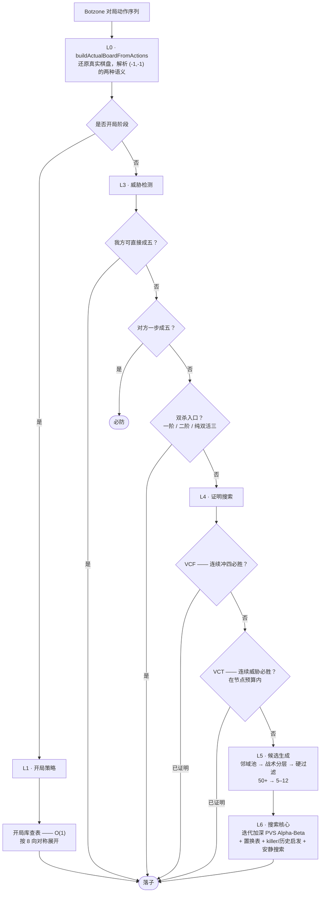

<a href="../../README.zh-CN.md">← 作品集</a> · <a href="../04-gomoku-swap1-ai.md">English</a>

# 04 · 五子棋 Swap1 博弈 AI（Botzone 平台）

| | |
|---|---|
| **时间** | 2026 年 3 月 – 5 月 |
| **角色** | 队长 |
| **背景** | 吉林大学 数据结构与算法设计课程设计 |
| **结果** | Bot 位列课程 Botzone 天梯**前 5%** |
| **规模** | 提交版本约 3,800 行 C++ · 单步 800 毫秒 |
| **代码** | [`asdf243/gomoku-swap1-ai`](https://github.com/asdf243/gomoku-swap1-ai)（私有——可应要求开放） |

---

## 目录

1. [摘要](#一摘要)
2. [为什么 Swap1 不是普通五子棋](#二为什么-swap1-不是普通五子棋)
3. [架构：优先级流水线](#三架构优先级流水线)
4. [层次划分](#四层次划分)
5. [关键技术](#五关键技术)
6. [三处正确性修复](#六三处正确性修复)
7. [工程方法](#七工程方法)
8. [复盘](#八复盘)

---

## 一、摘要

面向 Botzone 平台、在 **Swap1 一手交换规则**下、单步 800 毫秒限时的五子棋对战引擎。整体设计遵循 **"由快到慢、由强到弱"**：优先级高且代价低的判定先做，只有通过了所有前置阶段的局面才进入完整 Alpha-Beta 搜索。这正是让理论上 O(b^d) 的指数搜索能在限时内给出高质量落子的原因。

---

## 二、为什么 Swap1 不是普通五子棋

标准五子棋有众所周知的先手优势。Swap1 用一条改变开局性质的规则来消除它：

> 黑方落第一子后，白方可以选择**换手**——接过黑棋继续执黑，原黑方改执白。

因此首手不再是一个优化问题，而是一个**阈值问题**：

| 首手 | 白方理性反应 | 我方结果 |
|---|---|---|
| 太强 | 换手，接过好位置 | 我们失去自己造出的优势 |
| 太弱 | 不换手 | 我们留下一个差开局 |
| **恰好** | 不换手 | **我们保留一个可下的开局** |

所以引擎必须建模对手的换手决策，然后刻意选择一个*好、但低于会触发换手的阈值*的落点。下"当前最强的一步"在这里是错的。

---

## 三、架构：优先级流水线

**为什么是这个顺序。** 每一阶段都比下一阶段更便宜且更权威。直接成五是确定的，代价是一次棋盘扫描；VCF 证明是确定的，代价是一次窄而深的搜索；Alpha-Beta 评估只是启发式估计，代价是全部剩余时间预算。把预算花在一个五微秒检查就能免费得出结论的搜索上，是引擎超时告负的主要原因。

---

## 四、层次划分

| 层 | 职责 | 关键函数 |
|---|---|---|
| **L0 · 输入输出适配** | 解析 Botzone 的 `actions` 数组；区分 `(-1,-1)` 的两种语义——出现在索引 0 表示*我方执黑*，出现在中间表示*对方换手*——并据此还原真实的黑白棋盘 | `buildActualBoardFromActions` |
| **L1 · 开局策略** | 为候选首手打分；选择低于换手阈值模型的一手；对对手首手评级以决定我方是否换手；开局库 O(1) 查表并按 8 向对称展开 | `openingBlackValue`、`chooseAntiSwapBlackOpeningMove`、`openingFirstMoveGradeForSwap`、`transformPoint`、`addOpeningRule` |
| **L2 · 棋型评估** | 把每个长度为 5 的滑动窗口归类为 12 种棋型（活三、冲四、活四、跳活三、死三……）；落子/撤子时增量更新 | `classifyWindow5`、`patternCount`、`evaluateMoveDelta`、`PATTERN_SCORE` |
| **L3 · 威胁检测** | 直接成五与必防点；一阶与二阶双杀；纯双活三；假先手；致命应手 | `findImmediateWinMoves`、`createsDirectDoubleKill`、`createsSecondOrderDoubleKill`、`findOpenFourCreationMoves`、`isForcingDoubleKillEntry`、`isPoisonedThreatMove`、`findFatalKillerReplies` |
| **L4 · 证明搜索** | VCF（每一攻击手都是冲四，防守方应手被迫）与 VCT（同时允许活三、跳活三与双杀），均在时间感知的节点预算内进行 | `vctSearch`、`vctAfterAttack`、`findVCTEntries`、`isVCTAttackMove`、`consumeVCTNode` |
| **L5 · 候选生成** | 收集已有棋子半径 1–2 内的格点；分配战术等级；存在高等级威胁时硬过滤掉低等级候选 | `collectCandidatePoolForSearch`、`generateCandidates` |
| **L6 · 搜索核心** | 迭代加深 PVS Alpha-Beta，配合 Zobrist 置换表、Killer Move 与历史启发、安静搜索；超时返回最深已完成层的结果 | `searchWithIterativeDeepening`、`alphaBeta`、`quiescenceSearch`、`probeTT` |

---

## 五、关键技术

### 5.1 Swap1 阈值建模

`openingBlackValue` 按中心性（到天元的曼哈顿 + 切比雪夫距离）与贴边惩罚为每个候选首手打分；`chooseAntiSwapBlackOpeningMove` 只保留分数**低于**换手阈值模型（`SWAP_TAKE_THRESHOLD = 7600`）且留 **350 分安全边际**的点，刻意避开临界点——在临界点附近，模型的微小误差就会翻转对手的决策。

反过来执白时，`openingFirstMoveGradeForSwap` 对对手首手评级（天元 100、近邻 96、斜近天元 98、D4/H3 等传统强点 96），高于阈值 70 即换手。

### 5.2 对称展开的开局库

五子棋棋盘在 4 种旋转 × 2 种镜像下等价。定式只按一个标准方向手工录入，`transformPoint` 在装载时映射出全部 8 个等价方向。开局库存为 `unordered_map<string, vector<OpeningCandidate>>`（局面编码 → 按优先级排序的候选着），查找 O(1)。

### 5.3 增量棋型统计

每个格点恰好属于 **20** 个长度为 5 的窗口（4 方向 × 5 偏移）。落子或撤子因此只重算这 20 个窗口而非整盘，把每节点评估从 O(n²) 降到摊还 O(1)。在 800 毫秒预算允许的节点数下，这是"搜到第 4 层"与"搜到第 8 层以上"的差别。

### 5.4 战术分层与硬过滤

`collectCandidatePoolForSearch` 只收集已有棋子半径 1–2 内的格点（存在活跃威胁时半径 2，后期安静局面 1），随后 `generateCandidates` 分配战术等级：

| 等级 | 含义 |
|---|---|
| 100 | 我方直接成五 |
| 95 | 对方直接成五（必防） |
| 90 | 下一手可成双杀 |
| …… | …… |
| < 78 | 普通候选 |

**硬过滤**：只要存在等级 ≥ 95 的候选，等级 < 78 的候选全部不进入重评分池。分支因子从 50+ 坍缩到 5–12。这是典型的"先排除无关项，再做深度评估"，也是可达深度的最大贡献来源。

### 5.5 节点预算下的 VCF / VCT 证明搜索

- **VCF**（连续冲四胜）：每一攻击手都是冲四，防守方至多一种合法应手，搜索树极窄，因此可以很便宜地证明到很深。
- **VCT**（连续威胁胜）：同时允许活三、跳活三与双杀，分支明显变宽，必须限制预算。

| 条件 | `vctNodeBudget` |
|---|---|
| 深度 ≥ 3 | 220 |
| 深度 < 3 | 110 |
| 剩余时间 < 160 毫秒 | ≤ 70 |
| 剩余时间 < 90 毫秒 | ≤ 35 |

另有 `vctGlobalBudget` 限制单步内多次 VCT 调用的总量，避免多个各自有界的搜索共同耗尽时钟。这里按**节点数而非深度**限制是正确的，因为 VCT 的分支因子随局面剧烈变化——深度限制在某些局面下过松、在另一些局面下过紧。

### 5.6 搜索核心

| 技术 | 作用 |
|---|---|
| **迭代加深** | 深度 1、2、3……每完成一层都写入置换表并改善下一层的着法排序；超时则返回最深**已完成**层的最佳着，绝不返回半成品 |
| **PVS / NegaScout** | 首着用全窗口搜索，其余用零窗口快速验证，失败才重搜。大多数着法劣于主变，可被廉价反驳 |
| **Zobrist 置换表** | 局面哈希，使不同着法顺序到达的相同局面只评估一次 |
| **Killer Move 启发** | 记录每个剩余深度上造成 beta 剪枝的两个着法——同深度下往往再次奏效的战术反驳手 |
| **历史启发** | 全局记录各着法造成剪枝的频次，用于整体着法排序 |
| **安静搜索** | 深度为 0 时不直接静态评估，而是沿"吵闹"的强制手再搜一层——防止地平线效应：搜索恰好停在对方冲四之前，把必败局面判成均势 |

---

## 六、三处正确性修复

这三处是答辩的重点，因为它们都是引擎对*局面的理解*错误，而不是搜索不够深。

| # | 缺陷 | 症状 | 修复 |
|---|---|---|---|
| 1 | `[1,0,0,1,1]`（两子中间隔两格）被归类为**活三** | 引擎防守不存在的威胁，并用无法发展的形状进攻 | 在 `classifyWindow5` 中检测 `maxGap >= 2` 并降级为 `P_DEAD3` |
| 2 | **纯双活三被漏判** | 原检查只测 `winCnt >= 2`（两个直接成五点）。在两个方向各成一个活三的着法*没有*任何直接成五点，但仍是强制手——任一活三都可变活四 | 在 `findOpenFourCreationMoves` 与 `isForcingDoubleKillEntry` **两处**都加入独立方向活三计数（`liveThreeDirs >= 2`），保证两层都不遗漏 |
| 3 | **假先手被评为好棋** | 一个"造出威胁"的着法，其唯一堵点恰好同时让对手获胜 | `isPoisonedThreatMove` 模拟对方被迫的应手，检查其是否反而让对方获胜；此类着法被排除 |

第 2 处最有教益：原条件不是"大致正确"，而是**范畴性地不完整**——它把强制手的一个充分条件当成了必要条件。找到它靠的是手工构造局面，而不是等它在自对弈中出现。

---

## 七、工程方法

| 做法 | 说明 |
|---|---|
| **版本化迭代轨迹** | `bot_8 → bot_26`，每一版都是完整可对战的构建。差异本身就是"分层架构如何从朴素 Alpha-Beta 演化而来"以及"每个战术缺陷如何被发现和修复"的最清晰记录 |
| **离线对局分析** | `parse_game.py` 把对局日志转为棋盘状态；`analyze_game.cpp` 回放并检查引擎在各局面的评估值，使一次失利能定位到评估出错的具体一手 |
| **回归检查** | `test_fix.cpp` 保存针对棋型判定修复的手工构造局面，防止后续重构静默引入回归 |
| **兜底候选生成** | 保证任意局面（含畸形或意外输入）下都能输出合法落点——不落子等于判负 |

---

## 八、复盘

**有效的做法**

- **优先级流水线优于单一大搜索。** 让能给出确定结论的检查优先于启发式评估，是深度变得可负担的原因。
- **把棋理编码为搜索约束，而不是评估加分项。** 战术分层、硬过滤与节点预算缩小的是搜索*空间*；把同样的知识做成评估项只会在同样大的树里重新排序。
- **手工构造对抗性局面。** 三处正确性缺陷全部由此发现，而非自对弈。

**会改进的地方**

- **自动化自对弈回归。** 版本对比是手工的；在相邻版本之间跑自动天梯可以量化每次改动的收益，而不依赖主观印象。
- **系统性调评估权重。** `PATTERN_SCORE` 是手工调的；对固定对手池做哪怕粗粒度的参数扫描，很可能优于直觉。
- **把引擎与 Botzone 协议分离。** 单文件提交的要求把协议处理与引擎逻辑放进了同一个编译单元；一层内部接口可以让引擎在评测机之外独立可测。
