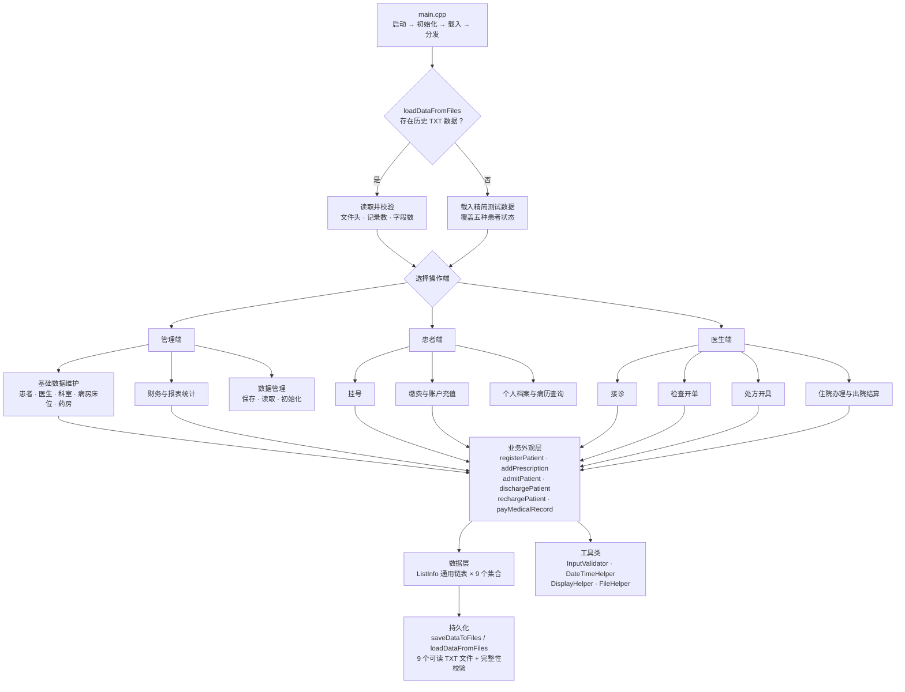
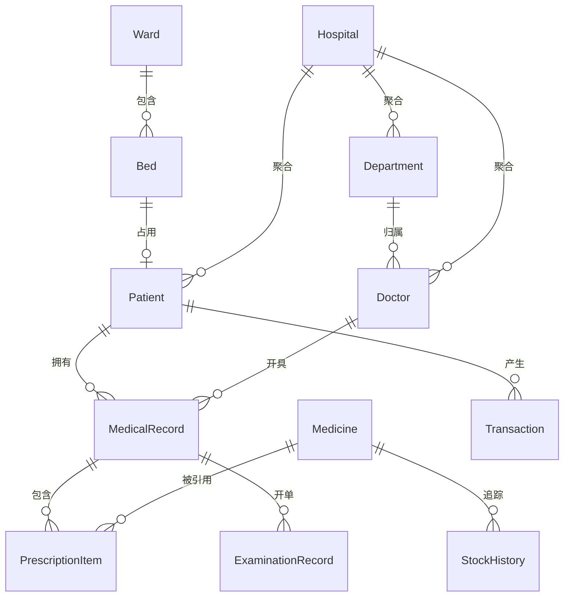
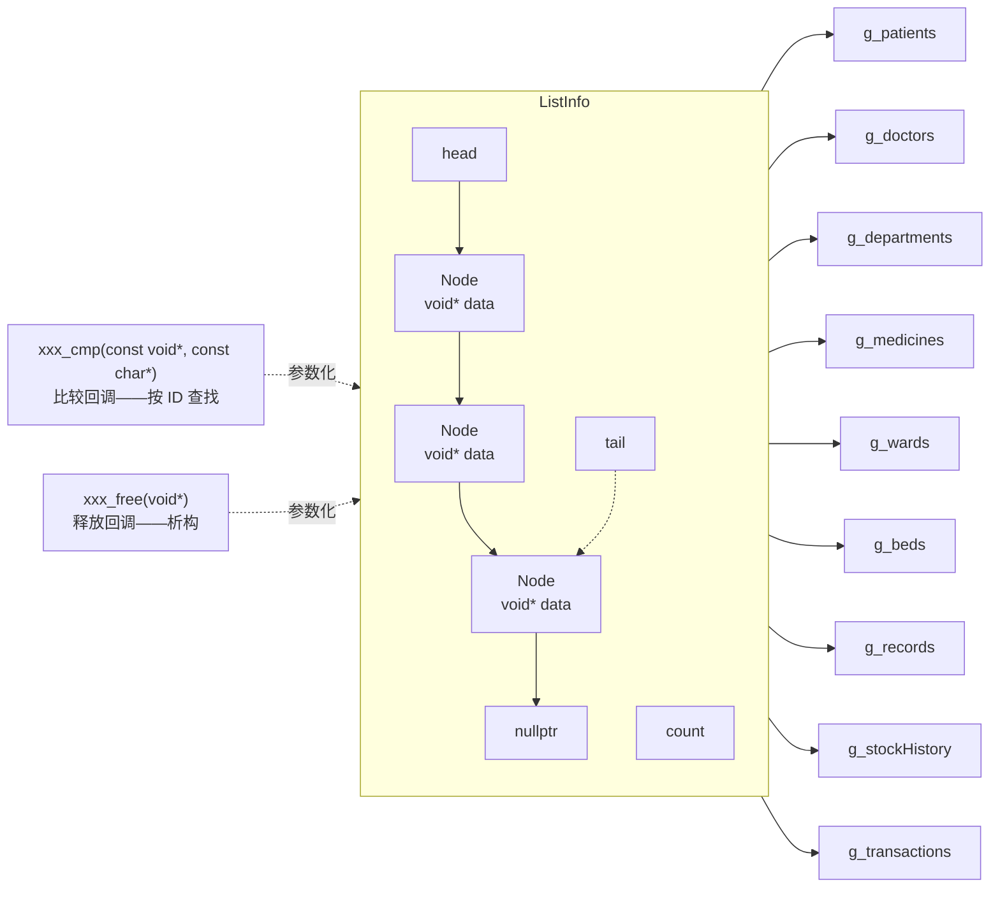
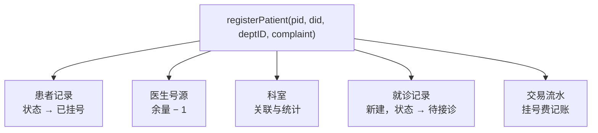

<div align="right"><a href="../../README.zh-CN.md">← 作品集</a> · <a href="../05-hospital-information-system.md">English</a></div>

# 05 · 轻量级医院信息管理系统 —— C++ 三端架构

| | |
|---|---|
| **时间** | 2025 年 3 月 – 2026 年 5 月 |
| **角色** | 队长 |
| **成绩** | A+ |
| **背景** | 始于面向对象程序设计课程（2025），在程序设计基础课程设计中重构为三端系统（2026） |
| **规模** | 约 6,400 行 C++ · 13 个业务结构体 · 9 个数据集合 · 不使用 STL 容器 |
| **代码** | [`Hanwen-Tao/hospital-information-system`](https://github.com/Hanwen-Tao/hospital-information-system)（私有——可应要求开放） |

---

## 目录

1. [摘要](#一摘要)
2. [两个约束](#二两个约束)
3. [架构](#三架构)
4. [层次划分](#四层次划分)
5. [领域模型](#五领域模型)
6. [通用链表](#六通用链表)
7. [业务外观层](#七业务外观层)
8. [校验与持久化](#八校验与持久化)
9. [复盘](#九复盘)

---

## 一、摘要

覆盖完整门诊与住院流程（挂号 → 接诊 → 检查 → 处方 → 住院 → 出院 → 结算）的命令行医院信息系统。第二版把原本的单一综合菜单重构为**三个独立操作端**（管理端 / 患者端 / 医生端）：共享同一套数据层，但入口与权限分离，贴近真实医院的岗位分工。

---

## 二、两个约束

两个约束都来自课程要求，而它们恰恰是项目中最有教益的部分。

| 约束 | 朴素应对 | 实际做法 |
|---|---|---|
| **不得使用 STL 容器** | 为九类实体各写一套链表 | 一套由回调参数化的通用链表——第六节 |
| **答辩时数据需可人工核查** | 为二进制格式加一个导出工具 | 把持久化本身改为带校验的可读 TXT——第八节 |

第一个约束才是数据结构训练的真正内容：没有 `std::vector` 和 `std::map` 之后，设计问题变成"在模板还不在工具箱里的前提下，如何避免把同一个容器写九遍"。第二个约束迫使持久化层变得防御性——可读的格式同时也是可编辑的格式，手工改过的文件不能有机会破坏内存中的状态。

---

## 三、架构



### 三端划分

| 操作端 | 使用者 | 职责范围 | 分离理由 |
|---|---|---|---|
| **管理端** | 院方管理 | 基础数据、财务、报表、数据管理 | 为另外两端提供运行基础，答辩时最先演示 |
| **患者端** | 患者 | 挂号、缴费、个人记录 | 只能看到自己的数据——权限面最窄 |
| **医生端** | 医生 | 接诊、检查、处方、住院出院 | 核心诊疗流程，状态链最长 |

三端共享同一套底层集合与业务函数，区别只在入口与可执行的操作。这一分离正是第二版重构的全部要点——第一版功能上无所不能，但所有能力都从同一个无差别菜单可达。

---

## 四、层次划分

| 层 | 文件 | 行数 | 职责 |
|---|---|---|---|
| **入口与路由** | `main.cpp` | 404 | 初始化医院状态、载入或播种数据、分发到三端 |
| **表示层** | `menu.cpp` | 2,282 | 十个菜单屏：主菜单、患者、医生、科室、病房、药房、病历、财务、报表、数据。只负责输入采集与错误提示，从不直接操作全局链表 |
| **业务外观层** | `his.cpp` | 2,819 | 跨模块事务与全部业务不变式 |
| **领域模型** | `his.h` | 789 | 13 个业务结构体 + 4 个工具类 |
| **数据结构** | `c_list.cpp/.h` | 130 | 一套通用单链表 |

注意这个形状：表示层很大（屏幕多）但很浅，难度集中在外观层，而数据结构只有 130 行却服务九个集合。这正是期望中的分布。

---

## 五、领域模型



| 结构体 | 作用 |
|---|---|
| `Patient` | 患者基本信息、账户余额、住院状态 |
| `Doctor` | 医生信息、所属科室、号源 |
| `Department` | 科室 |
| `Medicine` | 药品目录与库存 |
| `PrescriptionItem` | 单条处方明细 |
| `MedicalRecord` | 一次就诊：主诉、诊断、明细、结算状态 |
| `ExaminationRecord` | 一次检查 |
| `Ward` / `Bed` | 病房与床位及占用状态 |
| `Transaction` | 交易流水 |
| `StockHistory` | 药品库存流水 |
| `DateTime` | 日期时间值类型 |
| `Hospital` | 聚合根，持有全部集合 |

工具类：`InputValidator`、`DateTimeHelper`、`DisplayHelper`、`FileHelper`。

---

## 六、通用链表

设计问题：九类异构实体、不能用 STL、又不愿写九套近乎相同的链表。



`Node` 持有 `void* data`；`ListInfo` 持有 `head`、`tail`、`count`。类型相关的行为通过两个函数指针注入：

```c
int  patient_cmp(const void* data, const char* id);   // 按 ID 查找
void patient_free(void* data);                        // 析构
```

新增一类业务实体只需写两个五行回调，而不是再写一个容器。这是模板容器的 C 风格对应物，而把这个对应关系讲清楚正是本次练习的意义：它实现的是模板所提供的同一种"结构与元素类型分离"，只是用间接寻址而非代码生成来达成。

**代价**：边界处失去类型安全——`void*` 会欣然接受错误类型，在运行期而非编译期失败。缓解方式是所有集合只经由外观层中的类型化访问函数使用，裸 `void*` 的处理不逸出数据层。

---

## 七、业务外观层

挂号是这一层存在理由的最清晰例子。一个"挂号"动作牵涉**五处**状态：



重构前，每个菜单分支都内联执行这五处更新——意味着每个调用点都有五次遗漏机会，而且没有任何一个地方能读到完整的不变式。重构后菜单只调 `registerPatient(...)`，一致性规则恰好存在于一个函数中。

| 外观函数 | 涉及状态 |
|---|---|
| `registerPatient` | 患者 · 医生号源 · 科室 · 就诊记录 · 交易流水 |
| `addPrescription` | 就诊记录 · 处方明细 · 药品库存 · 库存流水 |
| `admitPatient` | 患者状态 · 床位占用 · 病房 · 押金流水 |
| `dischargePatient` | 床位释放 · 结算 · 就诊记录关闭 · 交易流水 |
| `rechargePatient` | 患者余额 · 交易流水 |
| `payMedicalRecord` | 就诊记录结算状态 · 患者余额 · 交易流水 |

---

## 八、校验与持久化

### 防御式输入校验

采纳的规则是：**任何非法输入都不得到达数据层。** `InputValidator` 对菜单选项、姓名、电话、身份证、金额、数量、日期、库存、床位可用性与患者住院状态逐项把关，在边界处以具体信息拒绝，而非笼统报错。

### 可读持久化与完整性校验

九个人类可读的 `.dat` 文本文件。载入时依序校验：**文件头 → 记录数 → 每条记录的字段数 → 字段基本格式**，并逐条拒绝畸形记录，而不是整体失败或（更糟）插入部分状态。

| | 二进制（v1） | 可读 TXT（v2） |
|---|---|---|
| 答辩可核查 | ✗ | ✓ |
| 可手工编辑造数据 | ✗ | ✓ |
| 载入可校验 | 有限 | ✓ |
| 文件体积 | 更小 | 更大 |
| 解析速度 | 更快 | 更慢 |

在本项目的数据规模下，后两行无关紧要，前三行是决定性的。

### 覆盖五种状态的测试数据

播种数据刻意为每种状态各安排一位患者，使答辩演示无需任何准备即可跑通三端所有分支：

1. 已挂号未诊疗
2. 已接诊未检查
3. 已住院未出院
4. 门诊全流程完成
5. 住院全流程完成

---

## 九、复盘

**有效的做法**

- **一套通用容器而非九套。** 回调参数化的链表是让这个 6,400 行程序没有变成 10,000 行的关键决策，也是项目中最能体现"理解"而非"工作量"的部分。
- **先做外观层，再加功能。** 把跨模块事务提取为具名函数后，第二版的三端拆分几乎是机械性的——三端的差异在入口与权限，而非业务逻辑。
- **为演示设计的测试数据。** 覆盖五种患者状态意味着答辩时不需要任何准备步骤。

**会改进的地方**

- **为 `void*` 链表加类型安全包装。** 即使不用模板，为每种类型写内联包装函数也能把一类错误从运行期移到编译期。
- **自动化测试。** 验证完全靠手工走菜单；哪怕一个直接驱动外观函数的小测试工具，也能在重构期间捕获回归。
- **更早拆分 `his.cpp`。** 2,819 行里同时装着外观层、CRUD 与持久化；沿这些接缝拆开会让文件变得可导航。
